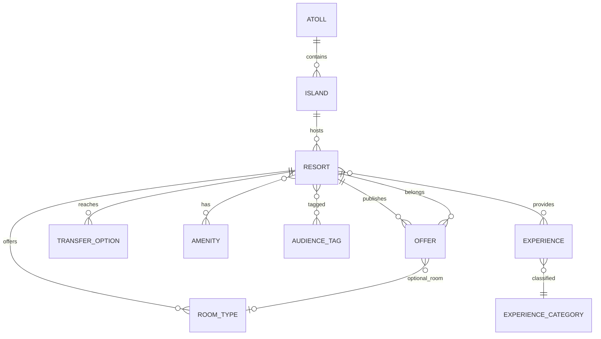
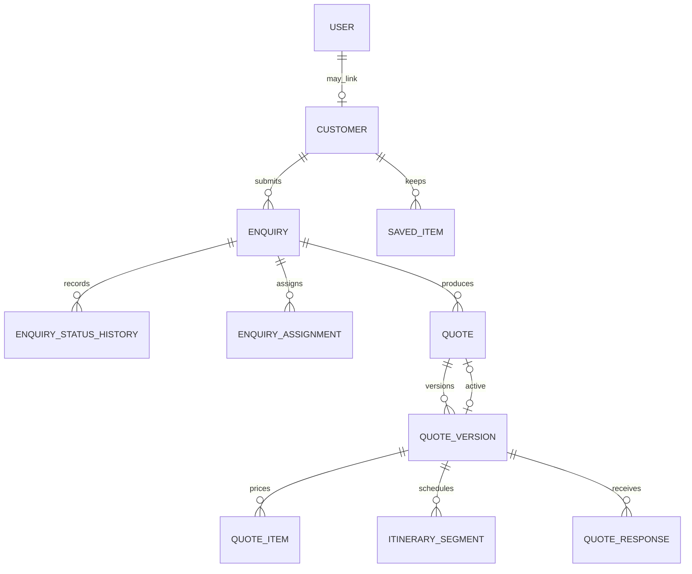

# Maldives Explorer — Database Design

| Field | Value |
| --- | --- |
| Status | Database contract, revision 1.1. Application migrations are not part of this revision. |
| Version | 1.1 |
| Date | 10 October 2026 |
| Authority | This document is the database contract. It refines Implementation Plan §5 and §6. Product rules remain in the documentation suite and the implementation plan. |
| Engine | PostgreSQL 16 |
| ORM | Prisma 6.16.2 with the `postgresqlExtensions` preview |
| Validation | On 10 October 2026 the schema in §7 was extracted to a temporary PostgreSQL 16.14 cluster. `prisma format` and `prisma validate` passed. The generated migration and the §8–§9 integrity SQL applied with no errors. Assertion queries returned zero rows. The same scripts were applied again to a second empty database. No migration was written under the application `prisma/` tree. |

The schema uses 28 enumerations and 70 models. Primary keys are database-generated UUIDs. Money is `NUMERIC(12,2)`. Timestamps are `timestamptz` in UTC. Slugs are the public route keys. Lifecycle states that application code branches on are PostgreSQL enums. Business taxonomies (meal plans, transfer types, price bands, and the rest) are rows in `vocabulary_items`.

Search vectors, partial indexes, check constraints, and immutability triggers are SQL that Prisma cannot express. They belong in a follow-up migration described in §8 and §9. The Prisma schema itself does not declare those objects, so `prisma migrate` will not fight the hand-written SQL.

## 1. Refinements to the implementation plan

These are part of the database contract. They close gaps that would otherwise leave relationships unenforceable.

| Topic | Adopted design |
| --- | --- |
| Auth.js | `accounts` and `verification_tokens` sit beside `users` and `sessions`. Password reset and magic links use `verification_tokens`. The identifier is prefixed, for example `reset:` or `magic:`, plus the email. |
| Won, Lost, and Closed | `enquiries.won_reference` is required when status is `WON`. `enquiries.terminal_reason_code` is required when status is `LOST` or `CLOSED`. |
| Portal messages | `messages` uses `staff_sender_id` and `customer_sender_id`. Exactly one is set, matching `sender_type`. |
| Dining and rooms | Meal plans on a venue are `dining_venue_meal_plans`. Room category and venue type are vocabulary foreign keys. A transfer option has a `label` so one resort can list two speedboats. |
| Article search | The CMS writes `articles.body_plain`. The generated `search_vector` reads that column. |
| Concurrent edits | `revision` on resorts, offers, articles, enquiries, and quote versions. Writers increment it and update with `WHERE revision = ?`. |
| Offer and article slugs | Unique on `(locale, slug)` for articles and collections. Resort, island, atoll, experience, offer, and expert slugs stay globally unique. MVP content is `en`. |
| Public offer index | The partial index filters `status = 'PUBLISHED'` only. Public queries apply `valid_until >= current_date` because `valid_until` is a date. The index predicate does not use `now()` or `current_date`. |
| Coordinates | `atolls` and `islands` store latitude and longitude. `resorts` does not. The coordinate check is on the two tables that own the columns. |
| Full text | `search_vector` is a generated column owned by SQL. Prisma Client does not write it. |
| Quote PDF | `quote_versions.pdf_media_id` references `media_assets`. |
| Email history | `email_deliveries.template_id` references the template row. `template_code` is the snapshot used if the template is later edited. |
| Party size | `adult_count` and `child_count` are the submitted totals. Traveler rows are the age detail. A partial child list is rejected. |
| Anonymous shortlist, comparison, recently viewed | No tables. The browser holds them until sign-in merges resorts, offers, experiences, and articles into `saved_items`. |
| Phase 2 booking and payments | No tables in this design. An accepted quote version is the future parent of a booking. A payment belongs to a booking. |

## 2. Conventions

| Rule | Implementation |
| --- | --- |
| Identifiers | `id UUID PRIMARY KEY DEFAULT gen_random_uuid()` |
| Names | Prisma fields are camelCase. Columns and tables are snake_case via `@map` and `@@map`. |
| Email | `citext`, trimmed, unique |
| Currency | `CHAR(3)` matching `^[A-Z]{3}$` |
| Country | `CHAR(2)` or null |
| Slug | `^[a-z0-9]+(?:-[a-z0-9]+)*$` |
| Archive | `status = ARCHIVED` and `archived_at`. Hard delete is reserved for the privacy job and for draft-only children. |
| Publication | `DRAFT → IN_REVIEW → APPROVED → SCHEDULED or PUBLISHED → UNPUBLISHED → ARCHIVED` |
| Delete behavior | Commercial parents use `ON DELETE RESTRICT`. Pure join rows use `CASCADE`. Attribution users use `SET NULL`. |
| Insert-only history | Consent records, audit logs, enquiry status history, and assignment history reject update and delete. |
| Sent quotes | After `sent_at` is set, only `status`, `revision`, and `updated_at` may change. Child lines cannot change. |
| JSON | Allowed for snapshots, article blocks, homepage config, provider payloads, and settings. Core facts that are filtered or joined are columns. |
| Personal data | Classified in §10. Anonymization rewrites rows. It does not drop commercial history. |

Publication columns, repeated on every public document:

`status`, `published_at`, `scheduled_at`, `unpublished_at`, `archived_at`, `created_at`, `updated_at`, `created_by_id`, `updated_by_id`.

`PUBLISHED` requires `published_at`. `SCHEDULED` requires `scheduled_at`. `ARCHIVED` requires `archived_at`.

## 3. Enumerations

Prisma enum names map to snake_case PostgreSQL types. Values are the labels below.

| Enum | PostgreSQL type | Values |
| --- | --- | --- |
| `UserStatus` | `user_status` | `INVITED`, `ACTIVE`, `SUSPENDED`, `DISABLED` |
| `PublishStatus` | `publish_status` | `DRAFT`, `IN_REVIEW`, `APPROVED`, `SCHEDULED`, `PUBLISHED`, `UNPUBLISHED`, `ARCHIVED` |
| `IslandType` | `island_type` | `RESORT`, `LOCAL`, `UNINHABITED` |
| `PropertyType` | `property_type` | `RESORT`, `GUESTHOUSE`, `LIVEABOARD` |
| `MediaKind` | `media_kind` | `IMAGE`, `VIDEO`, `DRONE`, `TOUR_360`, `DOCUMENT` |
| `MediaRole` | `media_role` | `HERO`, `GALLERY`, `OG`, `PORTRAIT`, `ATTACHMENT` |
| `MediaOwnerType` | `media_owner_type` | `RESORT`, `ROOM_TYPE`, `DINING_VENUE`, `ISLAND`, `ATOLL`, `EXPERIENCE`, `OFFER`, `ARTICLE`, `EXPERT`, `COLLECTION`, `AWARD` |
| `SavedEntityType` | `saved_entity_type` | `RESORT`, `OFFER`, `EXPERIENCE`, `ARTICLE` |
| `CollectionEntityType` | `collection_entity_type` | `RESORT`, `OFFER`, `EXPERIENCE`, `ARTICLE`, `ISLAND`, `ATOLL` |
| `ContentEntityType` | `content_entity_type` | `RESORT`, `OFFER`, `EXPERIENCE`, `ARTICLE`, `ISLAND`, `ATOLL` |
| `FaqOwnerType` | `faq_owner_type` | `GLOBAL`, `RESORT`, `ISLAND`, `ATOLL`, `EXPERIENCE`, `OFFER`, `ARTICLE` |
| `AttachmentOwnerType` | `attachment_owner_type` | `ENQUIRY`, `QUOTE_VERSION`, `NOTE`, `MESSAGE` |
| `EnquiryStatus` | `enquiry_status` | `NEW`, `CONTACT_ATTEMPTED`, `CONTACTED`, `QUALIFIED`, `QUOTED`, `NEGOTIATION`, `WON`, `LOST`, `CLOSED` |
| `TravelerType` | `traveler_type` | `ADULT`, `CHILD`, `INFANT` |
| `TaskStatus` | `task_status` | `OPEN`, `IN_PROGRESS`, `DONE`, `CANCELLED` |
| `NoteVisibility` | `note_visibility` | `INTERNAL`, `CUSTOMER` |
| `CommChannel` | `comm_channel` | `EMAIL`, `PHONE`, `PORTAL`, `WHATSAPP` |
| `CommDirection` | `comm_direction` | `INBOUND`, `OUTBOUND` |
| `QuoteVersionStatus` | `quote_version_status` | `DRAFT`, `IN_REVIEW`, `APPROVED`, `SENT`, `ACCEPTED`, `DECLINED`, `EXPIRED`, `SUPERSEDED`, `WITHDRAWN` |
| `QuoteItemType` | `quote_item_type` | `ACCOMMODATION`, `TRANSFER`, `EXPERIENCE`, `TAX`, `FEE`, `DISCOUNT`, `OTHER` |
| `QuoteResponseType` | `quote_response_type` | `CLARIFICATION`, `ACCEPT`, `DECLINE` |
| `ConsentPurpose` | `consent_purpose` | `ENQUIRY_CONTACT`, `ACCOUNT`, `NEWSLETTER`, `ANALYTICS`, `MARKETING` |
| `ConsentStatus` | `consent_status` | `GRANTED`, `WITHDRAWN` |
| `ConsentSubjectType` | `consent_subject_type` | `CUSTOMER`, `USER`, `SUBSCRIPTION`, `ANONYMOUS` |
| `SubscriptionStatus` | `subscription_status` | `PENDING`, `CONFIRMED`, `UNSUBSCRIBED`, `SUPPRESSED` |
| `ReviewSource` | `review_source` | `FIRST_PARTY`, `EDITORIAL`, `IMPORTED` |
| `VerificationStatus` | `verification_status` | `UNVERIFIED`, `VERIFIED`, `REJECTED` |
| `ModerationStatus` | `moderation_status` | `PENDING`, `APPROVED`, `HIDDEN`, `REJECTED` |
| `EmailClassification` | `email_classification` | `TRANSACTIONAL`, `MARKETING` |
| `EmailDeliveryStatus` | `email_delivery_status` | `QUEUED`, `SENT`, `DELIVERED`, `FAILED`, `BOUNCED`, `SUPPRESSED` |
| `JobStatus` | `job_status` | `PENDING`, `RUNNING`, `SUCCEEDED`, `FAILED`, `CANCELLED` |
| `MfaType` | `mfa_type` | `TOTP` |
| `HomepageModuleType` | `homepage_module_type` | `HERO`, `FEATURED_RESORTS`, `FEATURED_OFFERS`, `FEATURED_EXPERIENCES`, `FEATURED_GUIDES`, `DESTINATION_EXPLAINER`, `TRUST`, `TESTIMONIALS`, `NEWSLETTER`, `RECENTLY_VIEWED` |
| `VocabularySet` | `vocabulary_set` | `MEAL_PLAN`, `TRANSFER_TYPE`, `OCCUPANCY_BASIS`, `PRICE_BAND`, `TRIP_TYPE`, `LOSS_REASON`, `CLOSURE_REASON`, `ROOM_CATEGORY`, `VENUE_TYPE` |
| `SenderType` | `sender_type` | `CUSTOMER`, `STAFF` |
| `AnalyticsConsent` | `analytics_consent` | `GRANTED`, `DENIED`, `UNKNOWN` |
| `BlockType` | `block_type` | `RICH_TEXT`, `CALLOUT`, `FAQ_LIST`, `CTA`, `RELATED_ENTITIES`, `IMAGE_BAND` |

Enquiry transitions stay in the service. The database stores the history row and the terminal-field checks. It does not encode the full transition graph, because reopen rules depend on permission.

`VocabularySet` is the discriminator for `vocabulary_items`. A foreign key can point at any row. §9 binds each foreign key to one set.

## 4. Entity catalog

### 4.1 Identity and access

| Model | Table | Role |
| --- | --- | --- |
| `User` | `users` | Login identity for customers and staff. Status replaces deletion. |
| `Role` | `roles` | Named role. Seeded, not invented per request. |
| `Permission` | `permissions` | Fine-grained code such as `quote.approve`. |
| `RolePermission` | `role_permissions` | Many-to-many. |
| `UserRole` | `user_roles` | Many-to-many with assigner and time. |
| `MfaFactor` | `mfa_factors` | One TOTP secret per user. Secret is stored encrypted by the application. |
| `Session` | `sessions` | Auth.js session plus revocation, user agent, and IP hash. |
| `Account` | `accounts` | Auth.js provider link. Credentials do not require a row. |
| `VerificationToken` | `verification_tokens` | Single-use reset and magic-link tokens. |
| `ExpertProfile` | `expert_profiles` | Public byline. Optional link to a user. |

A person with no `user_roles` row is a customer when a `customers.user_id` points at them. Staff permissions are the union of their roles. Consultant access to a customer is still limited to assigned enquiries in the service.

### 4.2 Geography and catalog

| Model | Table | Role |
| --- | --- | --- |
| `Atoll` | `atolls` | Geographic parent of islands. |
| `Island` | `islands` | Resort island, local island, or uninhabited island. |
| `Resort` | `resorts` | Property. `property_type` allows guesthouse and liveaboard without a second table. MVP publishes resorts. |
| `RoomType` | `room_types` | Sellable room or villa. Slug unique per resort. |
| `DiningVenue` | `dining_venues` | Restaurant, bar, café, or in-villa dining. |
| `DiningVenueMealPlan` | `dining_venue_meal_plans` | Venue to meal-plan vocabulary. |
| `TransferOption` | `transfer_options` | Speedboat, seaplane, domestic flight, or combined. Duration requires a source note. |
| `Amenity` | `amenities` | Controlled amenity list. |
| `ResortAmenity` | `resort_amenities` | Join. |
| `AudienceTag` | `audience_tags` | Family, adults only, honeymoon, diving, luxury, budget. |
| `ResortAudience` | `resort_audiences` | Join. |
| `ExperienceCategory` | `experience_categories` | Interest taxonomy. |
| `Experience` | `experiences` | The canonical activity. Excursions are quote lines that may point here. |
| `ResortExperience` | `resort_experiences` | Join, with optional notes. |
| `IslandExperience` | `island_experiences` | Join. |

Indicative price columns on `resorts` are a set. If `indicative_from_price` is present, currency, basis, transfer flag, tax flag, source note, and `price_reviewed_at` are all present. `has_house_reef` null means unknown and the public page omits the claim. True or false requires a source note and a review time.

### 4.3 Offers and collections

| Model | Table | Role |
| --- | --- | --- |
| `Offer` | `offers` | Commercial proposition tied to a published resort. Optional room type must belong to that resort. |
| `OfferInclusion` | `offer_inclusions` | Ordered lines. |
| `OfferExclusion` | `offer_exclusions` | Ordered lines. |
| `OfferAudience` | `offer_audiences` | Join. |
| `Collection` | `collections` | Editorial grouping. Route `/collections/[slug]`. |
| `CollectionItem` | `collection_items` | Polymorphic member. Unique per collection, type, and id. |

A public offer has `status = PUBLISHED`, `valid_until >= current_date`, and a parent resort that is `PUBLISHED`. Expired direct URLs are an application response, not a deleted row.

`comparison_price` requires `comparison_basis_note`. The service refuses a savings percentage when occupancy, room, or meal basis differ.

### 4.4 Content and media

| Model | Table | Role |
| --- | --- | --- |
| `ContentCategory` | `content_categories` | Guide tree. Parent cycles are rejected. |
| `Tag` | `tags` | Tags. Public tag archives are `noindex` in the application. |
| `Article` | `articles` | Guide or article. Author and reviewer are expert profiles. |
| `ArticleTag` | `article_tags` | Join. |
| `ContentRelation` | `content_relations` | Related resort, offer, experience, island, atoll, or article. |
| `Faq` | `faqs` | Global, or owned by one public entity. |
| `HomepageModule` | `homepage_modules` | Ordered, schedulable homepage blocks. |
| `ReusableBlock` | `reusable_blocks` | Shared block addressed by `code`. |
| `MediaAsset` | `media_assets` | Stored object. `storage_key` is unique. |
| `MediaLink` | `media_links` | Polymorphic placement and role. |
| `Redirect` | `redirects` | Path redirect after a slug change. |
| `Award` | `awards` | Unpublished until issuer, year, and source URL exist. The URL column is required at insert. |

Article `body` is JSON. Allowed block types are paragraph, heading, list, quote, image (a `mediaId`), faq, callout, cta, and related entities. Zod validates the document on write. `body_plain` is the search text for the same document.

Homepage `config` is JSON validated by module type:

| Module | Config holds |
| --- | --- |
| `HERO` | Headline, subheading, optional media id |
| `FEATURED_RESORTS`, `FEATURED_OFFERS`, `FEATURED_EXPERIENCES`, `FEATURED_GUIDES` | Ordered ids |
| `DESTINATION_EXPLAINER` | Atoll or island ids, plus optional reusable-block code |
| `TRUST` | Expert ids and award ids |
| `TESTIMONIALS` | Review ids |
| `NEWSLETTER` | Preference set key |
| `RECENTLY_VIEWED` | Empty object. The browser supplies the items. |

Featured ids that are unpublished or expired are dropped at read time.

Published images and drone stills require `alt_text` (empty string means decorative). Published video requires `caption` or `transcript`.

### 4.5 Customers, consent, and shortlists

| Model | Table | Role |
| --- | --- | --- |
| `Customer` | `customers` | Commercial contact. Optional one-to-one user. |
| `ConsentRecord` | `consent_records` | Insert-only evidence. One row per change, not an in-place flag. |
| `SavedItem` | `saved_items` | Server wishlist after authentication. |
| `Subscription` | `subscriptions` | Newsletter address, status, and the consent row that allowed it. |

`customers.email` and `users.email` are both unique. Linking sets `customers.user_id` when the citext values match. One user has at most one customer row.

`saved_items` does not foreign-key the target, because the target table depends on `entity_type`. §6 lists the assertion query. Removing a published entity does not delete the saved row. The merge and the account page report it as unavailable.

### 4.6 Enquiries and CRM

| Model | Table | Role |
| --- | --- | --- |
| `Enquiry` | `enquiries` | The lead. `reference` matches `ME-E-######`. `submitted_snapshot` is frozen. |
| `EnquiryTraveler` | `enquiry_travelers` | Age detail. |
| `EnquiryResort` | `enquiry_resorts` | Shortlist resorts. |
| `EnquiryOffer` | `enquiry_offers` | Shortlist offers. |
| `EnquiryInterest` | `enquiry_interests` | Shortlist experiences. |
| `EnquiryStatusHistory` | `enquiry_status_history` | Insert-only transitions. |
| `EnquiryAssignment` | `enquiry_assignments` | Insert-only assignment history. Reason required. |
| `Task` | `tasks` | Follow-up. |
| `Note` | `notes` | `INTERNAL` or `CUSTOMER`. |
| `CommunicationLog` | `communication_logs` | Summary of a contact. No raw provider secrets. |
| `Attachment` | `attachments` | File on an enquiry, quote version, note, or message. |

`submitted_snapshot` keeps the original contact details, party, budget, shortlist ids, consent version, and attribution even after staff edit the live columns.

Human references come from PostgreSQL sequences `enquiry_reference_seq` and `quote_reference_seq`, formatted by the service.

### 4.7 Quotes

| Model | Table | Role |
| --- | --- | --- |
| `Quote` | `quotes` | Container on one enquiry. `reference` matches `ME-Q-######`. |
| `QuoteVersion` | `quote_versions` | Immutable commercial version after send. Unique `(quote_id, version_no)`. |
| `ItinerarySegment` | `itinerary_segments` | Ordered stay. Supports a split across resorts. |
| `QuoteItem` | `quote_items` | Priced line. |
| `QuoteResponse` | `quote_responses` | Clarification, accept, or decline by the owning customer. |

`quotes.active_version_id` is a one-to-one optional pointer. Create the quote, create the version, then set the pointer. The version’s `quote_id` must equal the quote’s `id`.

Money identity, checked in the database:

`grand_total = subtotal + tax_total + fee_total - discount_total`

Line identity:

- Accommodation, transfer, experience, fee, tax, and other lines: `line_total = round(quantity * unit_amount + tax_amount - discount_amount, 2)`.
- Discount lines: `line_total = round(quantity * unit_amount, 2)`, with tax and line discount at 0. The header subtracts these totals.
- Header `subtotal` equals the sum of `quantity * unit_amount` on lines whose type is not `TAX`, `FEE`, or `DISCOUNT`.
- Header `tax_total` equals the sum of line `tax_amount` plus the `line_total` of `TAX` lines.
- Header `fee_total` equals the `line_total` of `FEE` lines.
- Header `discount_total` equals the sum of line `discount_amount` plus the `line_total` of `DISCOUNT` lines.

All of those amounts are `>= 0`. Quantity is `> 0`. A deferred constraint trigger checks the header against its lines before commit.

One `ACCEPT` or `DECLINE` exists per version. Clarifications are unlimited. The customer response itself is defined in §4.9. It is one transactional service operation, not a series of independent writes.

### 4.9 Customer ownership

A customer may access or respond only to quotes that belong to that customer’s enquiry. The path is `quote_versions` → `quotes` → `enquiries.customer_id`. A quote, quote version, or quote response whose enquiry is owned by a different customer is invisible and not writable. Staff access uses the staff permission and assignment rules. It is not this rule.

A customer may create or view messages only within that customer’s enquiry. The path is `messages.enquiry_id` → `enquiries.customer_id`. A customer message also requires `customer_sender_id` to be that same customer. Internal notes are not messages and are not returned by this path.

Both controls require integration tests:

1. Customer A cannot read Customer B’s quote, quote version, or quote response, including by guessing an id.
2. Customer A cannot insert a response on Customer B’s quote version, and the failed attempt leaves no response row and no status change.
3. Customer A cannot list or read Customer B’s messages, including by guessing an enquiry id.
4. Customer A cannot insert a message on Customer B’s enquiry, and the failed attempt leaves no message row.

`respondToQuoteVersion` is the only operation that records a customer response. It runs in one database transaction and does all of the following:

1. Resolve the authenticated customer.
2. Load the quote version through its quote and enquiry and prove `enquiries.customer_id` is that customer. Any other customer aborts the transaction.
3. Lock the quote version with `SELECT … FOR UPDATE`.
4. For `ACCEPT` and `DECLINE`, require status `SENT` and `expires_at` later than the transaction timestamp. For `CLARIFICATION`, require status `SENT`. Any other state aborts the transaction.
5. Insert one `quote_responses` row.
6. Set the version status to `ACCEPTED` or `DECLINED` when the response type is `ACCEPT` or `DECLINE`. A clarification does not change the status.
7. Insert audit rows for the response and, when the status changed, for that status change.
8. Commit. A failure at any step rolls the response, the status change, and the audit rows back together.

The partial unique index still rejects a second accept or decline for the same version. A before-insert trigger rejects a response whose `customer_id` is not the enquiry owner, so a direct insert cannot bypass the ownership check. Expiry and status remain the service’s checks inside the locked transaction. The integration test calls the service, not only the trigger.

A before-insert trigger on `messages` rejects a customer message whose `customer_sender_id` is not the enquiry owner. Read restriction for both quotes and messages is the repository filter plus the integration tests above. Row-level security is not part of this design.

### 4.8 Communications and platform

| Model | Table | Role |
| --- | --- | --- |
| `Message` | `messages` | Customer-visible thread. Internal notes stay in `notes`. |
| `EmailTemplate` | `email_templates` | Versioned subject and body. Unique `(code, locale, version)`. |
| `EmailDelivery` | `email_deliveries` | One send attempt. Unique idempotency key. |
| `Review` | `reviews` | Source, verification, consent, moderation, and publication time. |
| `AuditLog` | `audit_logs` | Insert-only privileged actions. |
| `AnalyticsEvent` | `analytics_events` | Consent-tagged product events. |
| `IdempotencyKey` | `idempotency_keys` | Stored response for a repeated public write. |
| `SystemSetting` | `system_settings` | JSON values keyed by string. |
| `VocabularyItem` | `vocabulary_items` | Taxonomy rows. Unique `(set, code)`. |
| `FeatureFlag` | `feature_flags` | Owner, default off, retirement date. |
| `Job` | `jobs` | Background work. Unique idempotency key. |
| `SlaPolicy` | `sla_policies` | One active row. |

`reviews` of source `IMPORTED` cannot be `featured`. `published_at` requires `moderation_status = APPROVED`. Rating, when present, is between 0 and 5.

Customer APIs read notes through the view `customer_visible_notes`, which is `notes` where `visibility = CUSTOMER`.

## 5. Relationship model





## 6. Entity relationship validation

Validation done against the schema in §7:

1. `prisma validate` on Prisma 6.16.2.
2. Every Prisma relation has an opposite field and a named relation where more than one path reaches the same model.
3. Every foreign-key scalar is indexed, either by the foreign key’s own index, a composite index that starts with that column, or a unique constraint.
4. Delete behavior matches the commercial rule: restrict parents, cascade joins, set null on attribution.
5. Polymorphic associations are listed and paired with an assertion query, because PostgreSQL cannot foreign-key them.
6. Cycles are limited to two, both broken by a nullable column: quote active version, and content-category parent.

### 6.1 Cardinality

| From | To | Cardinality | On delete | Enforced by |
| --- | --- | --- | --- | --- |
| Island | Atoll | many to one, required | Restrict | FK |
| Resort | Island | many to one, required | Restrict | FK |
| RoomType | Resort | many to one, required | Restrict | FK |
| RoomType | VocabularyItem (`ROOM_CATEGORY`) | many to one, required | Restrict | FK + set trigger |
| DiningVenue | Resort | many to one, required | Restrict | FK |
| DiningVenue | VocabularyItem (`VENUE_TYPE`) | many to one, required | Restrict | FK + set trigger |
| DiningVenueMealPlan | VocabularyItem (`MEAL_PLAN`) | many to one | Restrict | FK + set trigger |
| TransferOption | VocabularyItem (`TRANSFER_TYPE`) | many to one, required | Restrict | FK + set trigger |
| Resort | VocabularyItem (`PRICE_BAND`) | many to one, optional | Restrict | FK + set trigger |
| Offer | Resort | many to one, required | Restrict | FK |
| Offer | RoomType | many to one, optional | Restrict | FK + same-resort trigger |
| Offer | VocabularyItem (`OCCUPANCY_BASIS`, `MEAL_PLAN`) | many to one, required | Restrict | FK + set trigger |
| Experience | ExperienceCategory | many to one, required | Restrict | FK |
| Article | ContentCategory | many to one, required | Restrict | FK |
| Article | ExpertProfile author | many to one, required | Restrict | FK |
| Article | ExpertProfile reviewer | many to one, optional | Restrict | FK + author ≠ reviewer |
| ExpertProfile | User | one to one, optional | SetNull | Unique FK |
| Customer | User | one to one, optional | SetNull | Unique FK |
| Enquiry | Customer | many to one, required | Restrict | FK |
| Enquiry | User assignee | many to one, optional | SetNull | FK |
| Enquiry | VocabularyItem (`TRIP_TYPE`) | many to one, optional | Restrict | FK + set trigger |
| EnquiryResort, EnquiryOffer, EnquiryInterest | Enquiry and target | many to many | Cascade from enquiry, Restrict on target | Composite PK |
| EnquiryStatusHistory | Enquiry | many to one | Restrict | FK, insert-only |
| EnquiryAssignment | Enquiry and users | many to one | Restrict | FK, insert-only |
| Quote | Enquiry | many to one, required | Restrict | FK |
| QuoteVersion | Quote | many to one, required | Restrict | FK |
| Quote | QuoteVersion active | one to one, optional | SetNull | Unique FK + same-quote trigger |
| ItinerarySegment | QuoteVersion | many to one | Cascade | FK, locked after send |
| ItinerarySegment | Resort, RoomType, meal plan | many to one, optional | Restrict | FK + same-resort trigger |
| QuoteItem | QuoteVersion | many to one | Cascade | FK, locked after send |
| QuoteItem | Experience | many to one, optional | Restrict | FK |
| QuoteResponse | QuoteVersion and Customer | many to one | Restrict | FK + one terminal response |
| Message | Enquiry | many to one | Restrict | FK |
| Message | User or Customer | many to one, exactly one | Restrict | FK + check |
| Subscription | ConsentRecord | many to one, required | Restrict | FK |
| SavedItem | Customer | many to one | Cascade | FK |
| Review | Resort | many to one, optional | Restrict | FK |
| Award | Resort | many to one, optional | Restrict | FK |
| MediaLink | MediaAsset | many to one | Cascade | FK |
| Attachment | MediaAsset | many to one | Restrict | FK |
| EmailDelivery | EmailTemplate | many to one, optional | SetNull | FK |
| AuditLog, AnalyticsEvent | User | many to one, optional | SetNull | FK |
| ContentCategory | ContentCategory | many to one, optional | Restrict | FK + cycle trigger |
| User | Role | many to many | Cascade membership, Restrict role | `user_roles` |
| Role | Permission | many to many | Cascade | `role_permissions` |

Every `created_by_id` and `updated_by_id` is a nullable many-to-one to `users` with `ON DELETE SET NULL` and an index. They are attribution, not ownership.

### 6.2 Polymorphic associations

These columns intentionally have no foreign key. The service checks the target before commit. The assertion queries in §6.4 detect drift.

| Table | Type column | Id column | Allowed targets |
| --- | --- | --- | --- |
| `saved_items` | `entity_type` | `entity_id` | Resort, offer, experience, article |
| `collection_items` | `entity_type` | `entity_id` | Resort, offer, experience, article, island, atoll |
| `content_relations` | `entity_type` | `entity_id` | Resort, offer, experience, article, island, atoll |
| `faqs` | `owner_type` | `owner_id` | Null only when `GLOBAL`; otherwise the matching table |
| `media_links` | `owner_type` | `owner_id` | The media owner enum |
| `attachments` | `owner_type` | `owner_id` | Enquiry, quote version, note, message |
| `consent_records` | `subject_type` | `subject_id` | Customer, user, subscription, or an anonymous key stored as UUID |
| `homepage_modules.config` | JSON ids | — | Checked when the module is published |
| `email_deliveries` | `related_type` | `related_id` | Enquiry, quote version, subscription, user |

`consent_records.subject_id` for `ANONYMOUS` is a random UUID stored with the browser. It is not a user id.

### 6.3 Structural findings

| Finding | Resolution in this design |
| --- | --- |
| Quote and quote version form a cycle | `active_version_id` is nullable. The row is updated after the version insert. |
| A room type could be attached to an offer on another resort | Trigger `offer_room_same_resort`. |
| A segment could name a room from another resort | Trigger `segment_room_same_resort`. Room requires a resort on that segment. |
| Vocabulary foreign keys cannot encode `set` | `BEFORE INSERT OR UPDATE` triggers call `vocabulary_item_in_set`. A second trigger freezes `vocabulary_items.set`. Cross-table `CHECK` constraints are not used. See `Documentation/adr/0001-vocabulary-set-constraints.md`. |
| Content categories could cycle | Trigger walks parents and rejects a loop, including a self-parent. |
| Sent quote versions could be edited in place | Trigger allows only status, revision, and `updated_at` after `sent_at`. |
| Sent quote lines could change under a frozen header | Trigger rejects insert, update, and delete of items and segments once `sent_at` is set. Draft versions still cascade on delete. |
| History tables could be rewritten | Update and delete triggers on consent, audit, status history, and assignments. |
| `submitted_snapshot` could be patched | Update trigger rejects a changed snapshot. |
| Two terminal quote responses could both exist | Partial unique index on accept and decline. |
| Two SLA policies could be active | Partial unique index. |
| `now()` cannot appear in an offer partial index | Public queries filter `valid_until >= current_date`. The index predicate is `status = 'PUBLISHED'` only. |
| A customer could respond to another customer's quote | `respondToQuoteVersion` is one transaction, and trigger `quote_response_owns_enquiry` rejects a mismatched `customer_id`. Integration tests are required. |
| A customer could read or write another customer's messages | Repository queries filter on the enquiry owner. Trigger `message_customer_owns_enquiry` rejects a mismatched customer sender. Integration tests are required. |
| Imported reviews could be featured as if they were first-party | Check constraint. |
| Author could approve their own article byline | Check `reviewer_id` is null or different from `author_id`. Separation of duties for offers and quotes remains a service rule driven by `requireSeparationOfDuties`. |
| Child ages could be stored without a range | Row checks: infant 0–1, child 2–11, adult null or at least 12. |
| Party counts could disagree with traveler rows | Deferred trigger. Zero detail rows are allowed. A non-zero child-detail count must equal `child_count`. |
| Homepage featured ids can dangle | Read path skips missing or unpublished ids. Assertion query reports them for the CMS. |
| Users and customers can share an email and stay unlinked | Service links them on registration. Both emails stay unique so the match is one row. |

### 6.4 Assertion queries

These queries are the ongoing validation. Each must return zero rows. Run them in CI against the migrated test database and nightly in production.

```sql
-- Offer room belongs to the offer resort.
SELECT o.id
FROM offers o
JOIN room_types r ON r.id = o.room_type_id
WHERE r.resort_id <> o.resort_id;

-- Active quote version belongs to the quote.
SELECT q.id
FROM quotes q
JOIN quote_versions v ON v.id = q.active_version_id
WHERE v.quote_id <> q.id;

-- Vocabulary set mismatches.
SELECT o.id, 'meal_plan' AS field
FROM offers o
JOIN vocabulary_items v ON v.id = o.meal_plan_id
WHERE v.set <> 'MEAL_PLAN'
UNION ALL
SELECT o.id, 'occupancy'
FROM offers o
JOIN vocabulary_items v ON v.id = o.occupancy_basis_id
WHERE v.set <> 'OCCUPANCY_BASIS'
UNION ALL
SELECT r.id, 'price_band'
FROM resorts r
JOIN vocabulary_items v ON v.id = r.price_band_id
WHERE v.set <> 'PRICE_BAND';

-- Published offer whose resort is not published.
SELECT o.id
FROM offers o
JOIN resorts r ON r.id = o.resort_id
WHERE o.status = 'PUBLISHED'
  AND r.status <> 'PUBLISHED';

-- Saved item whose target is missing.
SELECT s.id
FROM saved_items s
LEFT JOIN resorts r ON s.entity_type = 'RESORT' AND r.id = s.entity_id
LEFT JOIN offers o ON s.entity_type = 'OFFER' AND o.id = s.entity_id
LEFT JOIN experiences e ON s.entity_type = 'EXPERIENCE' AND e.id = s.entity_id
LEFT JOIN articles a ON s.entity_type = 'ARTICLE' AND a.id = s.entity_id
WHERE r.id IS NULL AND o.id IS NULL AND e.id IS NULL AND a.id IS NULL;

-- Collection items with a missing target.
SELECT c.id
FROM collection_items c
LEFT JOIN resorts r ON c.entity_type = 'RESORT' AND r.id = c.entity_id
LEFT JOIN offers o ON c.entity_type = 'OFFER' AND o.id = c.entity_id
LEFT JOIN experiences e ON c.entity_type = 'EXPERIENCE' AND e.id = c.entity_id
LEFT JOIN articles a ON c.entity_type = 'ARTICLE' AND a.id = c.entity_id
LEFT JOIN islands i ON c.entity_type = 'ISLAND' AND i.id = c.entity_id
LEFT JOIN atolls t ON c.entity_type = 'ATOLL' AND t.id = c.entity_id
WHERE r.id IS NULL AND o.id IS NULL AND e.id IS NULL
  AND a.id IS NULL AND i.id IS NULL AND t.id IS NULL;

-- Global FAQ with an owner, or owned FAQ without an owner.
SELECT id FROM faqs
WHERE (owner_type = 'GLOBAL' AND owner_id IS NOT NULL)
   OR (owner_type <> 'GLOBAL' AND owner_id IS NULL);

-- More than one active SLA.
SELECT count(*) FROM sla_policies WHERE active HAVING count(*) > 1;

-- Quote header drift. Rounding matches §4.7.
SELECT v.id
FROM quote_versions v
JOIN LATERAL (
  SELECT
    coalesce(sum(quantity * unit_amount) FILTER (
      WHERE item_type NOT IN ('TAX', 'FEE', 'DISCOUNT')
    ), 0) AS subtotal,
    coalesce(sum(tax_amount), 0) + coalesce(sum(line_total) FILTER (
      WHERE item_type = 'TAX'
    ), 0) AS tax_total,
    coalesce(sum(line_total) FILTER (WHERE item_type = 'FEE'), 0) AS fee_total,
    coalesce(sum(discount_amount), 0) + coalesce(sum(line_total) FILTER (
      WHERE item_type = 'DISCOUNT'
    ), 0) AS discount_total
  FROM quote_items
  WHERE quote_version_id = v.id
) lines ON true
WHERE v.subtotal <> lines.subtotal
   OR v.tax_total <> lines.tax_total
   OR v.fee_total <> lines.fee_total
   OR v.discount_total <> lines.discount_total
   OR v.grand_total <> (lines.subtotal + lines.tax_total + lines.fee_total - lines.discount_total);
```

The same shape of `LEFT JOIN` used for saved items is repeated in the test suite for `content_relations`, `media_links`, and `attachments`.

## 7. Prisma schema

Validated with Prisma 6.16.2. Copy this file to `prisma/schema.prisma` when implementation starts. It is not added to the application tree in this step.

```prisma
// Maldives Explorer database design
// Validated source for Documentation/Database_Design.md
// Prisma 6, PostgreSQL 16, extensions: pgcrypto, citext, pg_trgm

generator client {
  provider        = "prisma-client-js"
  previewFeatures = ["postgresqlExtensions"]
}

datasource db {
  provider   = "postgresql"
  url        = env("DATABASE_URL")
  extensions = [pgcrypto, citext, pg_trgm]
}

// ---------------------------------------------------------------------------
// Enumerations
// Lifecycle enums are code. Business taxonomies live in VocabularyItem.
// ---------------------------------------------------------------------------

enum UserStatus {
  INVITED
  ACTIVE
  SUSPENDED
  DISABLED

  @@map("user_status")
}

enum PublishStatus {
  DRAFT
  IN_REVIEW
  APPROVED
  SCHEDULED
  PUBLISHED
  UNPUBLISHED
  ARCHIVED

  @@map("publish_status")
}

enum IslandType {
  RESORT
  LOCAL
  UNINHABITED

  @@map("island_type")
}

enum PropertyType {
  RESORT
  GUESTHOUSE
  LIVEABOARD

  @@map("property_type")
}

enum MediaKind {
  IMAGE
  VIDEO
  DRONE
  TOUR_360
  DOCUMENT

  @@map("media_kind")
}

enum MediaRole {
  HERO
  GALLERY
  OG
  PORTRAIT
  ATTACHMENT

  @@map("media_role")
}

enum MediaOwnerType {
  RESORT
  ROOM_TYPE
  DINING_VENUE
  ISLAND
  ATOLL
  EXPERIENCE
  OFFER
  ARTICLE
  EXPERT
  COLLECTION
  AWARD

  @@map("media_owner_type")
}

enum SavedEntityType {
  RESORT
  OFFER
  EXPERIENCE
  ARTICLE

  @@map("saved_entity_type")
}

enum CollectionEntityType {
  RESORT
  OFFER
  EXPERIENCE
  ARTICLE
  ISLAND
  ATOLL

  @@map("collection_entity_type")
}

enum ContentEntityType {
  RESORT
  OFFER
  EXPERIENCE
  ARTICLE
  ISLAND
  ATOLL

  @@map("content_entity_type")
}

enum FaqOwnerType {
  GLOBAL
  RESORT
  ISLAND
  ATOLL
  EXPERIENCE
  OFFER
  ARTICLE

  @@map("faq_owner_type")
}

enum AttachmentOwnerType {
  ENQUIRY
  QUOTE_VERSION
  NOTE
  MESSAGE

  @@map("attachment_owner_type")
}

enum EnquiryStatus {
  NEW
  CONTACT_ATTEMPTED
  CONTACTED
  QUALIFIED
  QUOTED
  NEGOTIATION
  WON
  LOST
  CLOSED

  @@map("enquiry_status")
}

enum TravelerType {
  ADULT
  CHILD
  INFANT

  @@map("traveler_type")
}

enum TaskStatus {
  OPEN
  IN_PROGRESS
  DONE
  CANCELLED

  @@map("task_status")
}

enum NoteVisibility {
  INTERNAL
  CUSTOMER

  @@map("note_visibility")
}

enum CommChannel {
  EMAIL
  PHONE
  PORTAL
  WHATSAPP

  @@map("comm_channel")
}

enum CommDirection {
  INBOUND
  OUTBOUND

  @@map("comm_direction")
}

enum QuoteVersionStatus {
  DRAFT
  IN_REVIEW
  APPROVED
  SENT
  ACCEPTED
  DECLINED
  EXPIRED
  SUPERSEDED
  WITHDRAWN

  @@map("quote_version_status")
}

enum QuoteItemType {
  ACCOMMODATION
  TRANSFER
  EXPERIENCE
  TAX
  FEE
  DISCOUNT
  OTHER

  @@map("quote_item_type")
}

enum QuoteResponseType {
  CLARIFICATION
  ACCEPT
  DECLINE

  @@map("quote_response_type")
}

enum ConsentPurpose {
  ENQUIRY_CONTACT
  ACCOUNT
  NEWSLETTER
  ANALYTICS
  MARKETING

  @@map("consent_purpose")
}

enum ConsentStatus {
  GRANTED
  WITHDRAWN

  @@map("consent_status")
}

enum ConsentSubjectType {
  CUSTOMER
  USER
  SUBSCRIPTION
  ANONYMOUS

  @@map("consent_subject_type")
}

enum SubscriptionStatus {
  PENDING
  CONFIRMED
  UNSUBSCRIBED
  SUPPRESSED

  @@map("subscription_status")
}

enum ReviewSource {
  FIRST_PARTY
  EDITORIAL
  IMPORTED

  @@map("review_source")
}

enum VerificationStatus {
  UNVERIFIED
  VERIFIED
  REJECTED

  @@map("verification_status")
}

enum ModerationStatus {
  PENDING
  APPROVED
  HIDDEN
  REJECTED

  @@map("moderation_status")
}

enum EmailClassification {
  TRANSACTIONAL
  MARKETING

  @@map("email_classification")
}

enum EmailDeliveryStatus {
  QUEUED
  SENT
  DELIVERED
  FAILED
  BOUNCED
  SUPPRESSED

  @@map("email_delivery_status")
}

enum JobStatus {
  PENDING
  RUNNING
  SUCCEEDED
  FAILED
  CANCELLED

  @@map("job_status")
}

enum MfaType {
  TOTP

  @@map("mfa_type")
}

enum HomepageModuleType {
  HERO
  FEATURED_RESORTS
  FEATURED_OFFERS
  FEATURED_EXPERIENCES
  FEATURED_GUIDES
  DESTINATION_EXPLAINER
  TRUST
  TESTIMONIALS
  NEWSLETTER
  RECENTLY_VIEWED

  @@map("homepage_module_type")
}

enum VocabularySet {
  MEAL_PLAN
  TRANSFER_TYPE
  OCCUPANCY_BASIS
  PRICE_BAND
  TRIP_TYPE
  LOSS_REASON
  CLOSURE_REASON
  ROOM_CATEGORY
  VENUE_TYPE

  @@map("vocabulary_set")
}

enum SenderType {
  CUSTOMER
  STAFF

  @@map("sender_type")
}

enum AnalyticsConsent {
  GRANTED
  DENIED
  UNKNOWN

  @@map("analytics_consent")
}

enum BlockType {
  RICH_TEXT
  CALLOUT
  FAQ_LIST
  CTA
  RELATED_ENTITIES
  IMAGE_BAND

  @@map("block_type")
}

// ---------------------------------------------------------------------------
// Identity and access
// ---------------------------------------------------------------------------

model User {
  id              String     @id @default(dbgenerated("gen_random_uuid()")) @db.Uuid
  email           String     @unique @db.Citext
  name            String
  passwordHash    String?    @map("password_hash")
  emailVerifiedAt DateTime?  @map("email_verified_at") @db.Timestamptz(6)
  status          UserStatus @default(INVITED)
  locale          String     @default("en")
  lastLoginAt     DateTime?  @map("last_login_at") @db.Timestamptz(6)
  createdAt       DateTime   @default(now()) @map("created_at") @db.Timestamptz(6)
  updatedAt       DateTime   @updatedAt @map("updated_at") @db.Timestamptz(6)

  roles                       UserRole[]
  assignedUserRoles           UserRole[]             @relation("UserRoleAssigner")
  sessions                    Session[]
  accounts                    Account[]
  mfaFactors                  MfaFactor[]
  expertProfile               ExpertProfile?         @relation("ExpertUser")
  customer                    Customer?
  atollsCreated               Atoll[]                @relation("AtollCreatedBy")
  atollsUpdated               Atoll[]                @relation("AtollUpdatedBy")
  islandsCreated              Island[]               @relation("IslandCreatedBy")
  islandsUpdated              Island[]               @relation("IslandUpdatedBy")
  resortsCreated              Resort[]               @relation("ResortCreatedBy")
  resortsUpdated              Resort[]               @relation("ResortUpdatedBy")
  roomTypesCreated            RoomType[]             @relation("RoomTypeCreatedBy")
  roomTypesUpdated            RoomType[]             @relation("RoomTypeUpdatedBy")
  diningVenuesCreated         DiningVenue[]          @relation("DiningVenueCreatedBy")
  diningVenuesUpdated         DiningVenue[]          @relation("DiningVenueUpdatedBy")
  experiencesCreated          Experience[]           @relation("ExperienceCreatedBy")
  experiencesUpdated          Experience[]           @relation("ExperienceUpdatedBy")
  offersCreated               Offer[]                @relation("OfferCreatedBy")
  offersUpdated               Offer[]                @relation("OfferUpdatedBy")
  collectionsCreated          Collection[]           @relation("CollectionCreatedBy")
  collectionsUpdated          Collection[]           @relation("CollectionUpdatedBy")
  articlesCreated             Article[]              @relation("ArticleCreatedBy")
  articlesUpdated             Article[]              @relation("ArticleUpdatedBy")
  expertsCreated              ExpertProfile[]        @relation("ExpertCreatedBy")
  expertsUpdated              ExpertProfile[]        @relation("ExpertUpdatedBy")
  awardsCreated               Award[]                @relation("AwardCreatedBy")
  awardsUpdated               Award[]                @relation("AwardUpdatedBy")
  faqsCreated                 Faq[]                  @relation("FaqCreatedBy")
  faqsUpdated                 Faq[]                  @relation("FaqUpdatedBy")
  homepageModulesCreated      HomepageModule[]       @relation("HomepageModuleCreatedBy")
  homepageModulesUpdated      HomepageModule[]       @relation("HomepageModuleUpdatedBy")
  reusableBlocksCreated       ReusableBlock[]        @relation("ReusableBlockCreatedBy")
  reusableBlocksUpdated       ReusableBlock[]        @relation("ReusableBlockUpdatedBy")
  categoriesCreated           ContentCategory[]      @relation("ContentCategoryCreatedBy")
  categoriesUpdated           ContentCategory[]      @relation("ContentCategoryUpdatedBy")
  experienceCategoriesCreated ExperienceCategory[]   @relation("ExperienceCategoryCreatedBy")
  experienceCategoriesUpdated ExperienceCategory[]   @relation("ExperienceCategoryUpdatedBy")
  mediaCreated                MediaAsset[]           @relation("MediaCreatedBy")
  assignedEnquiries           Enquiry[]              @relation("EnquiryAssignee")
  statusChanges               EnquiryStatusHistory[] @relation("EnquiryStatusChangedBy")
  assignmentsFrom             EnquiryAssignment[]    @relation("AssignmentFrom")
  assignmentsTo               EnquiryAssignment[]    @relation("AssignmentTo")
  assignmentsMade             EnquiryAssignment[]    @relation("AssignmentBy")
  tasks                       Task[]
  notes                       Note[]
  communicationLogs           CommunicationLog[]
  quoteVersionsCreated        QuoteVersion[]         @relation("QuoteVersionCreatedBy")
  quoteVersionsApproved       QuoteVersion[]         @relation("QuoteVersionApprovedBy")
  staffMessages               Message[]              @relation("MessageStaffSender")
  emailTemplatesCreated       EmailTemplate[]        @relation("EmailTemplateCreatedBy")
  emailTemplatesUpdated       EmailTemplate[]        @relation("EmailTemplateUpdatedBy")
  settingsUpdated             SystemSetting[]        @relation("SettingUpdatedBy")
  analyticsEvents             AnalyticsEvent[]
  auditLogs                   AuditLog[]

  @@index([status])
  @@map("users")
}

model Role {
  id          String   @id @default(dbgenerated("gen_random_uuid()")) @db.Uuid
  code        String   @unique
  name        String
  description String
  createdAt   DateTime @default(now()) @map("created_at") @db.Timestamptz(6)
  updatedAt   DateTime @updatedAt @map("updated_at") @db.Timestamptz(6)

  permissions RolePermission[]
  users       UserRole[]

  @@map("roles")
}

model Permission {
  id          String   @id @default(dbgenerated("gen_random_uuid()")) @db.Uuid
  code        String   @unique
  description String
  createdAt   DateTime @default(now()) @map("created_at") @db.Timestamptz(6)

  roles RolePermission[]

  @@map("permissions")
}

model RolePermission {
  roleId       String @map("role_id") @db.Uuid
  permissionId String @map("permission_id") @db.Uuid

  role       Role       @relation(fields: [roleId], references: [id], onDelete: Cascade)
  permission Permission @relation(fields: [permissionId], references: [id], onDelete: Cascade)

  @@id([roleId, permissionId])
  @@index([permissionId])
  @@map("role_permissions")
}

model UserRole {
  userId       String   @map("user_id") @db.Uuid
  roleId       String   @map("role_id") @db.Uuid
  assignedById String?  @map("assigned_by_id") @db.Uuid
  assignedAt   DateTime @default(now()) @map("assigned_at") @db.Timestamptz(6)

  user       User  @relation(fields: [userId], references: [id], onDelete: Cascade)
  role       Role  @relation(fields: [roleId], references: [id], onDelete: Restrict)
  assignedBy User? @relation("UserRoleAssigner", fields: [assignedById], references: [id], onDelete: SetNull)

  @@id([userId, roleId])
  @@index([roleId])
  @@index([assignedById])
  @@map("user_roles")
}

model MfaFactor {
  id              String    @id @default(dbgenerated("gen_random_uuid()")) @db.Uuid
  userId          String    @map("user_id") @db.Uuid
  type            MfaType
  secretEncrypted String    @map("secret_encrypted")
  enabledAt       DateTime? @map("enabled_at") @db.Timestamptz(6)
  lastUsedAt      DateTime? @map("last_used_at") @db.Timestamptz(6)
  createdAt       DateTime  @default(now()) @map("created_at") @db.Timestamptz(6)

  user User @relation(fields: [userId], references: [id], onDelete: Cascade)

  @@unique([userId, type])
  @@map("mfa_factors")
}

model Session {
  id           String    @id @default(dbgenerated("gen_random_uuid()")) @db.Uuid
  sessionToken String    @unique @map("session_token")
  userId       String    @map("user_id") @db.Uuid
  expires      DateTime  @db.Timestamptz(6)
  revokedAt    DateTime? @map("revoked_at") @db.Timestamptz(6)
  userAgent    String?   @map("user_agent")
  ipHash       String?   @map("ip_hash")
  createdAt    DateTime  @default(now()) @map("created_at") @db.Timestamptz(6)

  user User @relation(fields: [userId], references: [id], onDelete: Cascade)

  @@index([userId])
  @@index([expires])
  @@map("sessions")
}

model Account {
  id                String  @id @default(dbgenerated("gen_random_uuid()")) @db.Uuid
  userId            String  @map("user_id") @db.Uuid
  type              String
  provider          String
  providerAccountId String  @map("provider_account_id")
  refresh_token     String? @db.Text
  access_token      String? @db.Text
  expires_at        Int?
  token_type        String?
  scope             String?
  id_token          String? @db.Text
  session_state     String?

  user User @relation(fields: [userId], references: [id], onDelete: Cascade)

  @@unique([provider, providerAccountId])
  @@index([userId])
  @@map("accounts")
}

model VerificationToken {
  identifier String
  token      String   @unique
  expires    DateTime @db.Timestamptz(6)

  @@unique([identifier, token])
  @@map("verification_tokens")
}

model ExpertProfile {
  id              String        @id @default(dbgenerated("gen_random_uuid()")) @db.Uuid
  userId          String?       @unique @map("user_id") @db.Uuid
  name            String
  slug            String        @unique
  title           String
  bio             String        @db.Text
  yearsInTourism  Int?          @map("years_in_tourism")
  portraitMediaId String?       @map("portrait_media_id") @db.Uuid
  locale          String        @default("en")
  status          PublishStatus @default(DRAFT)
  publishedAt     DateTime?     @map("published_at") @db.Timestamptz(6)
  scheduledAt     DateTime?     @map("scheduled_at") @db.Timestamptz(6)
  unpublishedAt   DateTime?     @map("unpublished_at") @db.Timestamptz(6)
  archivedAt      DateTime?     @map("archived_at") @db.Timestamptz(6)
  createdAt       DateTime      @default(now()) @map("created_at") @db.Timestamptz(6)
  updatedAt       DateTime      @updatedAt @map("updated_at") @db.Timestamptz(6)
  createdById     String?       @map("created_by_id") @db.Uuid
  updatedById     String?       @map("updated_by_id") @db.Uuid

  user             User?       @relation("ExpertUser", fields: [userId], references: [id], onDelete: SetNull)
  portrait         MediaAsset? @relation("ExpertPortrait", fields: [portraitMediaId], references: [id], onDelete: SetNull)
  createdBy        User?       @relation("ExpertCreatedBy", fields: [createdById], references: [id], onDelete: SetNull)
  updatedBy        User?       @relation("ExpertUpdatedBy", fields: [updatedById], references: [id], onDelete: SetNull)
  authoredArticles Article[]   @relation("ArticleAuthor")
  reviewedArticles Article[]   @relation("ArticleReviewer")

  @@index([status])
  @@index([portraitMediaId])
  @@index([createdById])
  @@index([updatedById])
  @@map("expert_profiles")
}

// ---------------------------------------------------------------------------
// Geography and catalog
// ---------------------------------------------------------------------------

model Atoll {
  id             String        @id @default(dbgenerated("gen_random_uuid()")) @db.Uuid
  name           String
  slug           String        @unique
  summary        String
  description    String        @db.Text
  latitude       Decimal?      @db.Decimal(9, 6)
  longitude      Decimal?      @db.Decimal(9, 6)
  seoTitle       String?       @map("seo_title")
  seoDescription String?       @map("seo_description")
  status         PublishStatus @default(DRAFT)
  publishedAt    DateTime?     @map("published_at") @db.Timestamptz(6)
  scheduledAt    DateTime?     @map("scheduled_at") @db.Timestamptz(6)
  unpublishedAt  DateTime?     @map("unpublished_at") @db.Timestamptz(6)
  archivedAt     DateTime?     @map("archived_at") @db.Timestamptz(6)
  createdAt      DateTime      @default(now()) @map("created_at") @db.Timestamptz(6)
  updatedAt      DateTime      @updatedAt @map("updated_at") @db.Timestamptz(6)
  createdById    String?       @map("created_by_id") @db.Uuid
  updatedById    String?       @map("updated_by_id") @db.Uuid

  createdBy User?    @relation("AtollCreatedBy", fields: [createdById], references: [id], onDelete: SetNull)
  updatedBy User?    @relation("AtollUpdatedBy", fields: [updatedById], references: [id], onDelete: SetNull)
  islands   Island[]

  @@index([status, publishedAt])
  @@index([createdById])
  @@index([updatedById])
  @@map("atolls")
}

model Island {
  id             String        @id @default(dbgenerated("gen_random_uuid()")) @db.Uuid
  atollId        String        @map("atoll_id") @db.Uuid
  name           String
  slug           String        @unique
  islandType     IslandType    @map("island_type")
  summary        String
  description    String        @db.Text
  history        String?       @db.Text
  cultureNotes   String?       @map("culture_notes") @db.Text
  etiquette      String?       @db.Text
  latitude       Decimal?      @db.Decimal(9, 6)
  longitude      Decimal?      @db.Decimal(9, 6)
  seoTitle       String?       @map("seo_title")
  seoDescription String?       @map("seo_description")
  status         PublishStatus @default(DRAFT)
  publishedAt    DateTime?     @map("published_at") @db.Timestamptz(6)
  scheduledAt    DateTime?     @map("scheduled_at") @db.Timestamptz(6)
  unpublishedAt  DateTime?     @map("unpublished_at") @db.Timestamptz(6)
  archivedAt     DateTime?     @map("archived_at") @db.Timestamptz(6)
  createdAt      DateTime      @default(now()) @map("created_at") @db.Timestamptz(6)
  updatedAt      DateTime      @updatedAt @map("updated_at") @db.Timestamptz(6)
  createdById    String?       @map("created_by_id") @db.Uuid
  updatedById    String?       @map("updated_by_id") @db.Uuid

  atoll       Atoll              @relation(fields: [atollId], references: [id], onDelete: Restrict)
  createdBy   User?              @relation("IslandCreatedBy", fields: [createdById], references: [id], onDelete: SetNull)
  updatedBy   User?              @relation("IslandUpdatedBy", fields: [updatedById], references: [id], onDelete: SetNull)
  resorts     Resort[]
  experiences IslandExperience[]

  @@index([atollId, status])
  @@index([islandType])
  @@index([createdById])
  @@index([updatedById])
  @@map("islands")
}

model Resort {
  id                    String        @id @default(dbgenerated("gen_random_uuid()")) @db.Uuid
  islandId              String        @map("island_id") @db.Uuid
  name                  String
  slug                  String        @unique
  propertyType          PropertyType  @default(RESORT) @map("property_type")
  summary               String
  description           String        @db.Text
  editorialPositioning  String?       @map("editorial_positioning")
  priceBandId           String?       @map("price_band_id") @db.Uuid
  indicativeFromPrice   Decimal?      @map("indicative_from_price") @db.Decimal(12, 2)
  indicativeCurrency    String?       @map("indicative_currency") @db.Char(3)
  priceBasis            String?       @map("price_basis")
  priceIncludesTransfer Boolean?      @map("price_includes_transfer")
  priceIncludesTax      Boolean?      @map("price_includes_tax")
  priceSourceNote       String?       @map("price_source_note")
  priceReviewedAt       DateTime?     @map("price_reviewed_at") @db.Timestamptz(6)
  popularityRank        Int           @default(0) @map("popularity_rank")
  starCategory          Int?          @map("star_category")
  starCategorySource    String?       @map("star_category_source")
  hasHouseReef          Boolean?      @map("has_house_reef")
  reefSummary           String?       @map("reef_summary") @db.Text
  diveCenterSummary     String?       @map("dive_center_summary") @db.Text
  reefSourceNote        String?       @map("reef_source_note")
  reefReviewedAt        DateTime?     @map("reef_reviewed_at") @db.Timestamptz(6)
  checkInNotes          String?       @map("check_in_notes") @db.Text
  seoTitle              String?       @map("seo_title")
  seoDescription        String?       @map("seo_description")
  status                PublishStatus @default(DRAFT)
  publishedAt           DateTime?     @map("published_at") @db.Timestamptz(6)
  scheduledAt           DateTime?     @map("scheduled_at") @db.Timestamptz(6)
  unpublishedAt         DateTime?     @map("unpublished_at") @db.Timestamptz(6)
  archivedAt            DateTime?     @map("archived_at") @db.Timestamptz(6)
  createdAt             DateTime      @default(now()) @map("created_at") @db.Timestamptz(6)
  updatedAt             DateTime      @updatedAt @map("updated_at") @db.Timestamptz(6)
  createdById           String?       @map("created_by_id") @db.Uuid
  updatedById           String?       @map("updated_by_id") @db.Uuid
  revision              Int           @default(1)

  island       Island             @relation(fields: [islandId], references: [id], onDelete: Restrict)
  priceBand    VocabularyItem?    @relation("ResortPriceBand", fields: [priceBandId], references: [id], onDelete: Restrict)
  createdBy    User?              @relation("ResortCreatedBy", fields: [createdById], references: [id], onDelete: SetNull)
  updatedBy    User?              @relation("ResortUpdatedBy", fields: [updatedById], references: [id], onDelete: SetNull)
  roomTypes    RoomType[]
  diningVenues DiningVenue[]
  transfers    TransferOption[]
  amenities    ResortAmenity[]
  audiences    ResortAudience[]
  experiences  ResortExperience[]
  offers       Offer[]
  awards       Award[]
  reviews      Review[]
  enquiryLinks EnquiryResort[]
  segments     ItinerarySegment[]

  @@index([islandId, status])
  @@index([status, popularityRank])
  @@index([propertyType, status])
  @@index([priceBandId])
  @@index([createdById])
  @@index([updatedById])
  @@map("resorts")
}

model RoomType {
  id                  String        @id @default(dbgenerated("gen_random_uuid()")) @db.Uuid
  resortId            String        @map("resort_id") @db.Uuid
  categoryId          String        @map("category_id") @db.Uuid
  name                String
  slug                String
  description         String        @db.Text
  maxAdults           Int           @map("max_adults")
  maxChildren         Int           @default(0) @map("max_children")
  sizeSqm             Decimal?      @map("size_sqm") @db.Decimal(8, 2)
  features            String?       @db.Text
  indicativeFromPrice Decimal?      @map("indicative_from_price") @db.Decimal(12, 2)
  indicativeCurrency  String?       @map("indicative_currency") @db.Char(3)
  status              PublishStatus @default(DRAFT)
  sortOrder           Int           @default(0) @map("sort_order")
  createdAt           DateTime      @default(now()) @map("created_at") @db.Timestamptz(6)
  updatedAt           DateTime      @updatedAt @map("updated_at") @db.Timestamptz(6)
  createdById         String?       @map("created_by_id") @db.Uuid
  updatedById         String?       @map("updated_by_id") @db.Uuid

  resort    Resort             @relation(fields: [resortId], references: [id], onDelete: Restrict)
  category  VocabularyItem     @relation("RoomCategory", fields: [categoryId], references: [id], onDelete: Restrict)
  createdBy User?              @relation("RoomTypeCreatedBy", fields: [createdById], references: [id], onDelete: SetNull)
  updatedBy User?              @relation("RoomTypeUpdatedBy", fields: [updatedById], references: [id], onDelete: SetNull)
  offers    Offer[]
  segments  ItinerarySegment[]

  @@unique([resortId, slug])
  @@index([categoryId])
  @@index([resortId, status, sortOrder])
  @@index([createdById])
  @@index([updatedById])
  @@map("room_types")
}

model DiningVenue {
  id          String        @id @default(dbgenerated("gen_random_uuid()")) @db.Uuid
  resortId    String        @map("resort_id") @db.Uuid
  venueTypeId String        @map("venue_type_id") @db.Uuid
  name        String
  cuisine     String?
  description String        @db.Text
  status      PublishStatus @default(DRAFT)
  sortOrder   Int           @default(0) @map("sort_order")
  createdAt   DateTime      @default(now()) @map("created_at") @db.Timestamptz(6)
  updatedAt   DateTime      @updatedAt @map("updated_at") @db.Timestamptz(6)
  createdById String?       @map("created_by_id") @db.Uuid
  updatedById String?       @map("updated_by_id") @db.Uuid

  resort    Resort                @relation(fields: [resortId], references: [id], onDelete: Restrict)
  venueType VocabularyItem        @relation("VenueType", fields: [venueTypeId], references: [id], onDelete: Restrict)
  createdBy User?                 @relation("DiningVenueCreatedBy", fields: [createdById], references: [id], onDelete: SetNull)
  updatedBy User?                 @relation("DiningVenueUpdatedBy", fields: [updatedById], references: [id], onDelete: SetNull)
  mealPlans DiningVenueMealPlan[]

  @@index([resortId, status, sortOrder])
  @@index([venueTypeId])
  @@index([createdById])
  @@index([updatedById])
  @@map("dining_venues")
}

model DiningVenueMealPlan {
  diningVenueId String @map("dining_venue_id") @db.Uuid
  mealPlanId    String @map("meal_plan_id") @db.Uuid

  diningVenue DiningVenue    @relation(fields: [diningVenueId], references: [id], onDelete: Cascade)
  mealPlan    VocabularyItem @relation("DiningMealPlan", fields: [mealPlanId], references: [id], onDelete: Restrict)

  @@id([diningVenueId, mealPlanId])
  @@index([mealPlanId])
  @@map("dining_venue_meal_plans")
}

model TransferOption {
  id              String   @id @default(dbgenerated("gen_random_uuid()")) @db.Uuid
  resortId        String   @map("resort_id") @db.Uuid
  transferTypeId  String   @map("transfer_type_id") @db.Uuid
  label           String
  durationMinutes Int?     @map("duration_minutes")
  durationBasis   String?  @map("duration_basis")
  sourceNote      String?  @map("source_note")
  notes           String?  @db.Text
  sortOrder       Int      @default(0) @map("sort_order")
  createdAt       DateTime @default(now()) @map("created_at") @db.Timestamptz(6)
  updatedAt       DateTime @updatedAt @map("updated_at") @db.Timestamptz(6)

  resort       Resort         @relation(fields: [resortId], references: [id], onDelete: Restrict)
  transferType VocabularyItem @relation("TransferType", fields: [transferTypeId], references: [id], onDelete: Restrict)

  @@index([resortId, sortOrder])
  @@index([transferTypeId])
  @@map("transfer_options")
}

model Amenity {
  id          String  @id @default(dbgenerated("gen_random_uuid()")) @db.Uuid
  code        String  @unique
  name        String
  category    String
  description String?

  resorts ResortAmenity[]

  @@index([category])
  @@map("amenities")
}

model ResortAmenity {
  resortId  String @map("resort_id") @db.Uuid
  amenityId String @map("amenity_id") @db.Uuid

  resort  Resort  @relation(fields: [resortId], references: [id], onDelete: Cascade)
  amenity Amenity @relation(fields: [amenityId], references: [id], onDelete: Restrict)

  @@id([resortId, amenityId])
  @@index([amenityId])
  @@map("resort_amenities")
}

model AudienceTag {
  id   String @id @default(dbgenerated("gen_random_uuid()")) @db.Uuid
  code String @unique
  name String

  resorts ResortAudience[]
  offers  OfferAudience[]

  @@map("audience_tags")
}

model ResortAudience {
  resortId      String @map("resort_id") @db.Uuid
  audienceTagId String @map("audience_tag_id") @db.Uuid

  resort      Resort      @relation(fields: [resortId], references: [id], onDelete: Cascade)
  audienceTag AudienceTag @relation(fields: [audienceTagId], references: [id], onDelete: Restrict)

  @@id([resortId, audienceTagId])
  @@index([audienceTagId])
  @@map("resort_audiences")
}

model ExperienceCategory {
  id          String        @id @default(dbgenerated("gen_random_uuid()")) @db.Uuid
  slug        String        @unique
  name        String
  description String
  sortOrder   Int           @default(0) @map("sort_order")
  status      PublishStatus @default(DRAFT)
  createdAt   DateTime      @default(now()) @map("created_at") @db.Timestamptz(6)
  updatedAt   DateTime      @updatedAt @map("updated_at") @db.Timestamptz(6)
  createdById String?       @map("created_by_id") @db.Uuid
  updatedById String?       @map("updated_by_id") @db.Uuid

  createdBy   User?        @relation("ExperienceCategoryCreatedBy", fields: [createdById], references: [id], onDelete: SetNull)
  updatedBy   User?        @relation("ExperienceCategoryUpdatedBy", fields: [updatedById], references: [id], onDelete: SetNull)
  experiences Experience[]

  @@index([status, sortOrder])
  @@index([createdById])
  @@index([updatedById])
  @@map("experience_categories")
}

model Experience {
  id                 String        @id @default(dbgenerated("gen_random_uuid()")) @db.Uuid
  categoryId         String        @map("category_id") @db.Uuid
  name               String
  slug               String        @unique
  summary            String
  description        String        @db.Text
  seasonality        String?       @db.Text
  seasonSourceNote   String?       @map("season_source_note")
  seasonReviewedAt   DateTime?     @map("season_reviewed_at") @db.Timestamptz(6)
  suitability        String?       @db.Text
  durationGuidance   String?       @map("duration_guidance")
  difficulty         String?
  safetyNotes        String?       @map("safety_notes") @db.Text
  environmentalNotes String?       @map("environmental_notes") @db.Text
  seoTitle           String?       @map("seo_title")
  seoDescription     String?       @map("seo_description")
  status             PublishStatus @default(DRAFT)
  publishedAt        DateTime?     @map("published_at") @db.Timestamptz(6)
  scheduledAt        DateTime?     @map("scheduled_at") @db.Timestamptz(6)
  unpublishedAt      DateTime?     @map("unpublished_at") @db.Timestamptz(6)
  archivedAt         DateTime?     @map("archived_at") @db.Timestamptz(6)
  createdAt          DateTime      @default(now()) @map("created_at") @db.Timestamptz(6)
  updatedAt          DateTime      @updatedAt @map("updated_at") @db.Timestamptz(6)
  createdById        String?       @map("created_by_id") @db.Uuid
  updatedById        String?       @map("updated_by_id") @db.Uuid

  category   ExperienceCategory @relation(fields: [categoryId], references: [id], onDelete: Restrict)
  createdBy  User?              @relation("ExperienceCreatedBy", fields: [createdById], references: [id], onDelete: SetNull)
  updatedBy  User?              @relation("ExperienceUpdatedBy", fields: [updatedById], references: [id], onDelete: SetNull)
  resorts    ResortExperience[]
  islands    IslandExperience[]
  enquiries  EnquiryInterest[]
  quoteItems QuoteItem[]

  @@index([categoryId, status])
  @@index([status, publishedAt])
  @@index([createdById])
  @@index([updatedById])
  @@map("experiences")
}

model ResortExperience {
  resortId     String  @map("resort_id") @db.Uuid
  experienceId String  @map("experience_id") @db.Uuid
  notes        String?

  resort     Resort     @relation(fields: [resortId], references: [id], onDelete: Cascade)
  experience Experience @relation(fields: [experienceId], references: [id], onDelete: Restrict)

  @@id([resortId, experienceId])
  @@index([experienceId])
  @@map("resort_experiences")
}

model IslandExperience {
  islandId     String @map("island_id") @db.Uuid
  experienceId String @map("experience_id") @db.Uuid

  island     Island     @relation(fields: [islandId], references: [id], onDelete: Cascade)
  experience Experience @relation(fields: [experienceId], references: [id], onDelete: Restrict)

  @@id([islandId, experienceId])
  @@index([experienceId])
  @@map("island_experiences")
}

// ---------------------------------------------------------------------------
// Offers and collections
// ---------------------------------------------------------------------------

model Offer {
  id                  String        @id @default(dbgenerated("gen_random_uuid()")) @db.Uuid
  resortId            String        @map("resort_id") @db.Uuid
  roomTypeId          String?       @map("room_type_id") @db.Uuid
  title               String
  slug                String        @unique
  summary             String
  currency            String        @db.Char(3)
  fromPrice           Decimal       @map("from_price") @db.Decimal(12, 2)
  comparisonPrice     Decimal?      @map("comparison_price") @db.Decimal(12, 2)
  comparisonBasisNote String?       @map("comparison_basis_note")
  occupancyBasisId    String        @map("occupancy_basis_id") @db.Uuid
  mealPlanId          String        @map("meal_plan_id") @db.Uuid
  transferIncluded    Boolean       @map("transfer_included")
  validFrom           DateTime      @map("valid_from") @db.Date
  validUntil          DateTime      @map("valid_until") @db.Date
  stayFrom            DateTime?     @map("stay_from") @db.Date
  stayUntil           DateTime?     @map("stay_until") @db.Date
  minNights           Int?          @map("min_nights")
  terms               String        @db.Text
  seoTitle            String?       @map("seo_title")
  seoDescription      String?       @map("seo_description")
  status              PublishStatus @default(DRAFT)
  publishedAt         DateTime?     @map("published_at") @db.Timestamptz(6)
  scheduledAt         DateTime?     @map("scheduled_at") @db.Timestamptz(6)
  unpublishedAt       DateTime?     @map("unpublished_at") @db.Timestamptz(6)
  archivedAt          DateTime?     @map("archived_at") @db.Timestamptz(6)
  createdAt           DateTime      @default(now()) @map("created_at") @db.Timestamptz(6)
  updatedAt           DateTime      @updatedAt @map("updated_at") @db.Timestamptz(6)
  createdById         String?       @map("created_by_id") @db.Uuid
  updatedById         String?       @map("updated_by_id") @db.Uuid
  revision            Int           @default(1)

  resort         Resort           @relation(fields: [resortId], references: [id], onDelete: Restrict)
  roomType       RoomType?        @relation(fields: [roomTypeId], references: [id], onDelete: Restrict)
  occupancyBasis VocabularyItem   @relation("OfferOccupancy", fields: [occupancyBasisId], references: [id], onDelete: Restrict)
  mealPlan       VocabularyItem   @relation("OfferMealPlan", fields: [mealPlanId], references: [id], onDelete: Restrict)
  createdBy      User?            @relation("OfferCreatedBy", fields: [createdById], references: [id], onDelete: SetNull)
  updatedBy      User?            @relation("OfferUpdatedBy", fields: [updatedById], references: [id], onDelete: SetNull)
  inclusions     OfferInclusion[]
  exclusions     OfferExclusion[]
  audiences      OfferAudience[]
  enquiries      EnquiryOffer[]

  @@index([resortId, status])
  @@index([roomTypeId])
  @@index([status, validUntil])
  @@index([occupancyBasisId])
  @@index([mealPlanId])
  @@index([createdById])
  @@index([updatedById])
  @@map("offers")
}

model OfferInclusion {
  id        String @id @default(dbgenerated("gen_random_uuid()")) @db.Uuid
  offerId   String @map("offer_id") @db.Uuid
  text      String
  sortOrder Int    @default(0) @map("sort_order")

  offer Offer @relation(fields: [offerId], references: [id], onDelete: Cascade)

  @@index([offerId, sortOrder])
  @@map("offer_inclusions")
}

model OfferExclusion {
  id        String @id @default(dbgenerated("gen_random_uuid()")) @db.Uuid
  offerId   String @map("offer_id") @db.Uuid
  text      String
  sortOrder Int    @default(0) @map("sort_order")

  offer Offer @relation(fields: [offerId], references: [id], onDelete: Cascade)

  @@index([offerId, sortOrder])
  @@map("offer_exclusions")
}

model OfferAudience {
  offerId       String @map("offer_id") @db.Uuid
  audienceTagId String @map("audience_tag_id") @db.Uuid

  offer       Offer       @relation(fields: [offerId], references: [id], onDelete: Cascade)
  audienceTag AudienceTag @relation(fields: [audienceTagId], references: [id], onDelete: Restrict)

  @@id([offerId, audienceTagId])
  @@index([audienceTagId])
  @@map("offer_audiences")
}

model Collection {
  id             String        @id @default(dbgenerated("gen_random_uuid()")) @db.Uuid
  title          String
  slug           String
  summary        String
  body           Json
  seoTitle       String?       @map("seo_title")
  seoDescription String?       @map("seo_description")
  locale         String        @default("en")
  status         PublishStatus @default(DRAFT)
  publishedAt    DateTime?     @map("published_at") @db.Timestamptz(6)
  scheduledAt    DateTime?     @map("scheduled_at") @db.Timestamptz(6)
  unpublishedAt  DateTime?     @map("unpublished_at") @db.Timestamptz(6)
  archivedAt     DateTime?     @map("archived_at") @db.Timestamptz(6)
  createdAt      DateTime      @default(now()) @map("created_at") @db.Timestamptz(6)
  updatedAt      DateTime      @updatedAt @map("updated_at") @db.Timestamptz(6)
  createdById    String?       @map("created_by_id") @db.Uuid
  updatedById    String?       @map("updated_by_id") @db.Uuid

  createdBy User?            @relation("CollectionCreatedBy", fields: [createdById], references: [id], onDelete: SetNull)
  updatedBy User?            @relation("CollectionUpdatedBy", fields: [updatedById], references: [id], onDelete: SetNull)
  items     CollectionItem[]

  @@unique([locale, slug])
  @@index([status, publishedAt])
  @@index([createdById])
  @@index([updatedById])
  @@map("collections")
}

model CollectionItem {
  id           String               @id @default(dbgenerated("gen_random_uuid()")) @db.Uuid
  collectionId String               @map("collection_id") @db.Uuid
  entityType   CollectionEntityType @map("entity_type")
  entityId     String               @map("entity_id") @db.Uuid
  sortOrder    Int                  @default(0) @map("sort_order")

  collection Collection @relation(fields: [collectionId], references: [id], onDelete: Cascade)

  @@unique([collectionId, entityType, entityId])
  @@index([entityType, entityId])
  @@index([collectionId, sortOrder])
  @@map("collection_items")
}

// ---------------------------------------------------------------------------
// Content and media
// ---------------------------------------------------------------------------

model ContentCategory {
  id          String   @id @default(dbgenerated("gen_random_uuid()")) @db.Uuid
  slug        String   @unique
  name        String
  description String
  parentId    String?  @map("parent_id") @db.Uuid
  sortOrder   Int      @default(0) @map("sort_order")
  createdAt   DateTime @default(now()) @map("created_at") @db.Timestamptz(6)
  updatedAt   DateTime @updatedAt @map("updated_at") @db.Timestamptz(6)
  createdById String?  @map("created_by_id") @db.Uuid
  updatedById String?  @map("updated_by_id") @db.Uuid

  parent    ContentCategory?  @relation("CategoryTree", fields: [parentId], references: [id], onDelete: Restrict)
  children  ContentCategory[] @relation("CategoryTree")
  createdBy User?             @relation("ContentCategoryCreatedBy", fields: [createdById], references: [id], onDelete: SetNull)
  updatedBy User?             @relation("ContentCategoryUpdatedBy", fields: [updatedById], references: [id], onDelete: SetNull)
  articles  Article[]

  @@index([parentId])
  @@index([createdById])
  @@index([updatedById])
  @@map("content_categories")
}

model Tag {
  id   String @id @default(dbgenerated("gen_random_uuid()")) @db.Uuid
  slug String @unique
  name String

  articles ArticleTag[]

  @@map("tags")
}

model Article {
  id             String        @id @default(dbgenerated("gen_random_uuid()")) @db.Uuid
  title          String
  slug           String
  excerpt        String
  body           Json
  bodyPlain      String        @map("body_plain") @db.Text
  categoryId     String        @map("category_id") @db.Uuid
  authorId       String        @map("author_id") @db.Uuid
  reviewerId     String?       @map("reviewer_id") @db.Uuid
  reviewedAt     DateTime?     @map("reviewed_at") @db.Timestamptz(6)
  staleAfter     DateTime?     @map("stale_after") @db.Date
  locale         String        @default("en")
  seoTitle       String?       @map("seo_title")
  seoDescription String?       @map("seo_description")
  ogMediaId      String?       @map("og_media_id") @db.Uuid
  canonicalPath  String?       @map("canonical_path")
  status         PublishStatus @default(DRAFT)
  publishedAt    DateTime?     @map("published_at") @db.Timestamptz(6)
  scheduledAt    DateTime?     @map("scheduled_at") @db.Timestamptz(6)
  unpublishedAt  DateTime?     @map("unpublished_at") @db.Timestamptz(6)
  archivedAt     DateTime?     @map("archived_at") @db.Timestamptz(6)
  createdAt      DateTime      @default(now()) @map("created_at") @db.Timestamptz(6)
  updatedAt      DateTime      @updatedAt @map("updated_at") @db.Timestamptz(6)
  createdById    String?       @map("created_by_id") @db.Uuid
  updatedById    String?       @map("updated_by_id") @db.Uuid
  revision       Int           @default(1)

  category  ContentCategory   @relation(fields: [categoryId], references: [id], onDelete: Restrict)
  author    ExpertProfile     @relation("ArticleAuthor", fields: [authorId], references: [id], onDelete: Restrict)
  reviewer  ExpertProfile?    @relation("ArticleReviewer", fields: [reviewerId], references: [id], onDelete: Restrict)
  ogMedia   MediaAsset?       @relation("ArticleOg", fields: [ogMediaId], references: [id], onDelete: SetNull)
  createdBy User?             @relation("ArticleCreatedBy", fields: [createdById], references: [id], onDelete: SetNull)
  updatedBy User?             @relation("ArticleUpdatedBy", fields: [updatedById], references: [id], onDelete: SetNull)
  tags      ArticleTag[]
  relations ContentRelation[]

  @@unique([locale, slug])
  @@index([categoryId, status])
  @@index([authorId])
  @@index([reviewerId])
  @@index([status, publishedAt])
  @@index([staleAfter])
  @@index([ogMediaId])
  @@index([createdById])
  @@index([updatedById])
  @@map("articles")
}

model ArticleTag {
  articleId String @map("article_id") @db.Uuid
  tagId     String @map("tag_id") @db.Uuid

  article Article @relation(fields: [articleId], references: [id], onDelete: Cascade)
  tag     Tag     @relation(fields: [tagId], references: [id], onDelete: Restrict)

  @@id([articleId, tagId])
  @@index([tagId])
  @@map("article_tags")
}

model ContentRelation {
  id         String            @id @default(dbgenerated("gen_random_uuid()")) @db.Uuid
  articleId  String            @map("article_id") @db.Uuid
  entityType ContentEntityType @map("entity_type")
  entityId   String            @map("entity_id") @db.Uuid
  sortOrder  Int               @default(0) @map("sort_order")

  article Article @relation(fields: [articleId], references: [id], onDelete: Cascade)

  @@unique([articleId, entityType, entityId])
  @@index([entityType, entityId])
  @@map("content_relations")
}

model Faq {
  id            String        @id @default(dbgenerated("gen_random_uuid()")) @db.Uuid
  ownerType     FaqOwnerType  @map("owner_type")
  ownerId       String?       @map("owner_id") @db.Uuid
  question      String
  answer        String        @db.Text
  sortOrder     Int           @default(0) @map("sort_order")
  locale        String        @default("en")
  status        PublishStatus @default(DRAFT)
  publishedAt   DateTime?     @map("published_at") @db.Timestamptz(6)
  scheduledAt   DateTime?     @map("scheduled_at") @db.Timestamptz(6)
  unpublishedAt DateTime?     @map("unpublished_at") @db.Timestamptz(6)
  archivedAt    DateTime?     @map("archived_at") @db.Timestamptz(6)
  createdAt     DateTime      @default(now()) @map("created_at") @db.Timestamptz(6)
  updatedAt     DateTime      @updatedAt @map("updated_at") @db.Timestamptz(6)
  createdById   String?       @map("created_by_id") @db.Uuid
  updatedById   String?       @map("updated_by_id") @db.Uuid

  createdBy User? @relation("FaqCreatedBy", fields: [createdById], references: [id], onDelete: SetNull)
  updatedBy User? @relation("FaqUpdatedBy", fields: [updatedById], references: [id], onDelete: SetNull)

  @@index([ownerType, ownerId, status, sortOrder])
  @@index([createdById])
  @@index([updatedById])
  @@map("faqs")
}

model HomepageModule {
  id            String             @id @default(dbgenerated("gen_random_uuid()")) @db.Uuid
  moduleType    HomepageModuleType @map("module_type")
  title         String?
  config        Json
  sortOrder     Int                @default(0) @map("sort_order")
  startsAt      DateTime?          @map("starts_at") @db.Timestamptz(6)
  endsAt        DateTime?          @map("ends_at") @db.Timestamptz(6)
  status        PublishStatus      @default(DRAFT)
  publishedAt   DateTime?          @map("published_at") @db.Timestamptz(6)
  scheduledAt   DateTime?          @map("scheduled_at") @db.Timestamptz(6)
  unpublishedAt DateTime?          @map("unpublished_at") @db.Timestamptz(6)
  archivedAt    DateTime?          @map("archived_at") @db.Timestamptz(6)
  createdAt     DateTime           @default(now()) @map("created_at") @db.Timestamptz(6)
  updatedAt     DateTime           @updatedAt @map("updated_at") @db.Timestamptz(6)
  createdById   String?            @map("created_by_id") @db.Uuid
  updatedById   String?            @map("updated_by_id") @db.Uuid

  createdBy User? @relation("HomepageModuleCreatedBy", fields: [createdById], references: [id], onDelete: SetNull)
  updatedBy User? @relation("HomepageModuleUpdatedBy", fields: [updatedById], references: [id], onDelete: SetNull)

  @@index([status, sortOrder])
  @@index([createdById])
  @@index([updatedById])
  @@map("homepage_modules")
}

model ReusableBlock {
  id          String        @id @default(dbgenerated("gen_random_uuid()")) @db.Uuid
  code        String        @unique
  blockType   BlockType     @map("block_type")
  body        Json
  status      PublishStatus @default(DRAFT)
  createdAt   DateTime      @default(now()) @map("created_at") @db.Timestamptz(6)
  updatedAt   DateTime      @updatedAt @map("updated_at") @db.Timestamptz(6)
  createdById String?       @map("created_by_id") @db.Uuid
  updatedById String?       @map("updated_by_id") @db.Uuid

  createdBy User? @relation("ReusableBlockCreatedBy", fields: [createdById], references: [id], onDelete: SetNull)
  updatedBy User? @relation("ReusableBlockUpdatedBy", fields: [updatedById], references: [id], onDelete: SetNull)

  @@index([status])
  @@index([createdById])
  @@index([updatedById])
  @@map("reusable_blocks")
}

model MediaAsset {
  id              String        @id @default(dbgenerated("gen_random_uuid()")) @db.Uuid
  storageKey      String        @unique @map("storage_key")
  mimeType        String        @map("mime_type")
  byteSize        Int           @map("byte_size")
  width           Int?
  height          Int?
  durationSeconds Int?          @map("duration_seconds")
  altText         String?       @map("alt_text")
  caption         String?
  transcript      String?       @db.Text
  attribution     String?
  focalPoint      Json?         @map("focal_point")
  kind            MediaKind
  status          PublishStatus @default(DRAFT)
  createdAt       DateTime      @default(now()) @map("created_at") @db.Timestamptz(6)
  updatedAt       DateTime      @updatedAt @map("updated_at") @db.Timestamptz(6)
  createdById     String?       @map("created_by_id") @db.Uuid

  createdBy       User?           @relation("MediaCreatedBy", fields: [createdById], references: [id], onDelete: SetNull)
  links           MediaLink[]
  expertPortraits ExpertProfile[] @relation("ExpertPortrait")
  articleOg       Article[]       @relation("ArticleOg")
  quotePdfs       QuoteVersion[]  @relation("QuotePdf")
  attachments     Attachment[]

  @@index([kind, status])
  @@index([createdById])
  @@map("media_assets")
}

model MediaLink {
  id        String         @id @default(dbgenerated("gen_random_uuid()")) @db.Uuid
  mediaId   String         @map("media_id") @db.Uuid
  ownerType MediaOwnerType @map("owner_type")
  ownerId   String         @map("owner_id") @db.Uuid
  role      MediaRole
  sortOrder Int            @default(0) @map("sort_order")

  media MediaAsset @relation(fields: [mediaId], references: [id], onDelete: Cascade)

  @@index([ownerType, ownerId, role, sortOrder])
  @@index([mediaId])
  @@map("media_links")
}

model Redirect {
  id         String   @id @default(dbgenerated("gen_random_uuid()")) @db.Uuid
  fromPath   String   @unique @map("from_path")
  toPath     String   @map("to_path")
  statusCode Int      @default(301) @map("status_code")
  active     Boolean  @default(true)
  createdAt  DateTime @default(now()) @map("created_at") @db.Timestamptz(6)

  @@index([active])
  @@map("redirects")
}

model Award {
  id            String        @id @default(dbgenerated("gen_random_uuid()")) @db.Uuid
  title         String
  issuer        String
  year          Int
  sourceUrl     String        @map("source_url")
  resortId      String?       @map("resort_id") @db.Uuid
  status        PublishStatus @default(DRAFT)
  publishedAt   DateTime?     @map("published_at") @db.Timestamptz(6)
  scheduledAt   DateTime?     @map("scheduled_at") @db.Timestamptz(6)
  unpublishedAt DateTime?     @map("unpublished_at") @db.Timestamptz(6)
  archivedAt    DateTime?     @map("archived_at") @db.Timestamptz(6)
  createdAt     DateTime      @default(now()) @map("created_at") @db.Timestamptz(6)
  updatedAt     DateTime      @updatedAt @map("updated_at") @db.Timestamptz(6)
  createdById   String?       @map("created_by_id") @db.Uuid
  updatedById   String?       @map("updated_by_id") @db.Uuid

  resort    Resort? @relation(fields: [resortId], references: [id], onDelete: Restrict)
  createdBy User?   @relation("AwardCreatedBy", fields: [createdById], references: [id], onDelete: SetNull)
  updatedBy User?   @relation("AwardUpdatedBy", fields: [updatedById], references: [id], onDelete: SetNull)

  @@index([resortId, status])
  @@index([createdById])
  @@index([updatedById])
  @@map("awards")
}

// ---------------------------------------------------------------------------
// Customers, consent, shortlists
// ---------------------------------------------------------------------------

model Customer {
  id          String   @id @default(dbgenerated("gen_random_uuid()")) @db.Uuid
  userId      String?  @unique @map("user_id") @db.Uuid
  name        String
  email       String   @unique @db.Citext
  phone       String?
  countryCode String?  @map("country_code") @db.Char(2)
  locale      String   @default("en")
  createdAt   DateTime @default(now()) @map("created_at") @db.Timestamptz(6)
  updatedAt   DateTime @updatedAt @map("updated_at") @db.Timestamptz(6)

  user           User?           @relation(fields: [userId], references: [id], onDelete: SetNull)
  savedItems     SavedItem[]
  enquiries      Enquiry[]
  quoteResponses QuoteResponse[]
  messages       Message[]       @relation("MessageCustomerSender")

  @@map("customers")
}

model ConsentRecord {
  id            String             @id @default(dbgenerated("gen_random_uuid()")) @db.Uuid
  subjectType   ConsentSubjectType @map("subject_type")
  subjectId     String             @map("subject_id") @db.Uuid
  purpose       ConsentPurpose
  status        ConsentStatus
  noticeVersion String             @map("notice_version")
  source        String
  capturedAt    DateTime           @default(now()) @map("captured_at") @db.Timestamptz(6)
  withdrawnAt   DateTime?          @map("withdrawn_at") @db.Timestamptz(6)
  ipHash        String?            @map("ip_hash")

  subscriptions Subscription[]

  @@index([subjectType, subjectId, purpose, capturedAt])
  @@map("consent_records")
}

model SavedItem {
  id         String          @id @default(dbgenerated("gen_random_uuid()")) @db.Uuid
  customerId String          @map("customer_id") @db.Uuid
  entityType SavedEntityType @map("entity_type")
  entityId   String          @map("entity_id") @db.Uuid
  note       String?
  createdAt  DateTime        @default(now()) @map("created_at") @db.Timestamptz(6)

  customer Customer @relation(fields: [customerId], references: [id], onDelete: Cascade)

  @@unique([customerId, entityType, entityId])
  @@index([entityType, entityId])
  @@map("saved_items")
}

model Subscription {
  id               String             @id @default(dbgenerated("gen_random_uuid()")) @db.Uuid
  email            String             @unique @db.Citext
  status           SubscriptionStatus @default(PENDING)
  preferences      Json
  consentRecordId  String             @map("consent_record_id") @db.Uuid
  confirmTokenHash String?            @unique @map("confirm_token_hash")
  subscribedAt     DateTime?          @map("subscribed_at") @db.Timestamptz(6)
  unsubscribedAt   DateTime?          @map("unsubscribed_at") @db.Timestamptz(6)
  source           String
  createdAt        DateTime           @default(now()) @map("created_at") @db.Timestamptz(6)
  updatedAt        DateTime           @updatedAt @map("updated_at") @db.Timestamptz(6)

  consentRecord ConsentRecord @relation(fields: [consentRecordId], references: [id], onDelete: Restrict)

  @@index([status])
  @@index([consentRecordId])
  @@map("subscriptions")
}

// ---------------------------------------------------------------------------
// Enquiries and CRM
// ---------------------------------------------------------------------------

model Enquiry {
  id                 String        @id @default(dbgenerated("gen_random_uuid()")) @db.Uuid
  reference          String        @unique
  customerId         String        @map("customer_id") @db.Uuid
  status             EnquiryStatus @default(NEW)
  assignedUserId     String?       @map("assigned_user_id") @db.Uuid
  source             String?
  medium             String?
  campaign           String?
  referrer           String?
  landingPath        String?       @map("landing_path")
  travelStart        DateTime?     @map("travel_start") @db.Date
  travelEnd          DateTime?     @map("travel_end") @db.Date
  flexibility        String?
  adultCount         Int           @map("adult_count")
  childCount         Int           @default(0) @map("child_count")
  budgetMin          Decimal?      @map("budget_min") @db.Decimal(12, 2)
  budgetMax          Decimal?      @map("budget_max") @db.Decimal(12, 2)
  budgetCurrency     String?       @map("budget_currency") @db.Char(3)
  tripTypeId         String?       @map("trip_type_id") @db.Uuid
  requirements       String?       @db.Text
  accessibilityNeeds String?       @map("accessibility_needs") @db.Text
  qualificationScore Int?          @map("qualification_score")
  firstResponseAt    DateTime?     @map("first_response_at") @db.Timestamptz(6)
  wonReference       String?       @map("won_reference")
  terminalReasonCode String?       @map("terminal_reason_code")
  submittedSnapshot  Json          @map("submitted_snapshot")
  idempotencyKey     String        @unique @map("idempotency_key")
  revision           Int           @default(1)
  createdAt          DateTime      @default(now()) @map("created_at") @db.Timestamptz(6)
  updatedAt          DateTime      @updatedAt @map("updated_at") @db.Timestamptz(6)

  customer       Customer               @relation(fields: [customerId], references: [id], onDelete: Restrict)
  assignedUser   User?                  @relation("EnquiryAssignee", fields: [assignedUserId], references: [id], onDelete: SetNull)
  tripType       VocabularyItem?        @relation("EnquiryTripType", fields: [tripTypeId], references: [id], onDelete: Restrict)
  travelers      EnquiryTraveler[]
  resorts        EnquiryResort[]
  offers         EnquiryOffer[]
  interests      EnquiryInterest[]
  statusHistory  EnquiryStatusHistory[]
  assignments    EnquiryAssignment[]
  tasks          Task[]
  notes          Note[]
  communications CommunicationLog[]
  quotes         Quote[]
  messages       Message[]

  @@index([customerId, createdAt])
  @@index([assignedUserId, status, createdAt])
  @@index([status, createdAt])
  @@index([tripTypeId])
  @@map("enquiries")
}

model EnquiryTraveler {
  id           String       @id @default(dbgenerated("gen_random_uuid()")) @db.Uuid
  enquiryId    String       @map("enquiry_id") @db.Uuid
  travelerType TravelerType @map("traveler_type")
  ageAtArrival Int?         @map("age_at_arrival")
  sortOrder    Int          @default(0) @map("sort_order")

  enquiry Enquiry @relation(fields: [enquiryId], references: [id], onDelete: Cascade)

  @@index([enquiryId, sortOrder])
  @@map("enquiry_travelers")
}

model EnquiryResort {
  enquiryId String @map("enquiry_id") @db.Uuid
  resortId  String @map("resort_id") @db.Uuid

  enquiry Enquiry @relation(fields: [enquiryId], references: [id], onDelete: Cascade)
  resort  Resort  @relation(fields: [resortId], references: [id], onDelete: Restrict)

  @@id([enquiryId, resortId])
  @@index([resortId])
  @@map("enquiry_resorts")
}

model EnquiryOffer {
  enquiryId String @map("enquiry_id") @db.Uuid
  offerId   String @map("offer_id") @db.Uuid

  enquiry Enquiry @relation(fields: [enquiryId], references: [id], onDelete: Cascade)
  offer   Offer   @relation(fields: [offerId], references: [id], onDelete: Restrict)

  @@id([enquiryId, offerId])
  @@index([offerId])
  @@map("enquiry_offers")
}

model EnquiryInterest {
  enquiryId    String @map("enquiry_id") @db.Uuid
  experienceId String @map("experience_id") @db.Uuid

  enquiry    Enquiry    @relation(fields: [enquiryId], references: [id], onDelete: Cascade)
  experience Experience @relation(fields: [experienceId], references: [id], onDelete: Restrict)

  @@id([enquiryId, experienceId])
  @@index([experienceId])
  @@map("enquiry_interests")
}

model EnquiryStatusHistory {
  id          String         @id @default(dbgenerated("gen_random_uuid()")) @db.Uuid
  enquiryId   String         @map("enquiry_id") @db.Uuid
  fromStatus  EnquiryStatus? @map("from_status")
  toStatus    EnquiryStatus  @map("to_status")
  reasonCode  String?        @map("reason_code")
  note        String?
  changedById String?        @map("changed_by_id") @db.Uuid
  changedAt   DateTime       @default(now()) @map("changed_at") @db.Timestamptz(6)

  enquiry   Enquiry @relation(fields: [enquiryId], references: [id], onDelete: Restrict)
  changedBy User?   @relation("EnquiryStatusChangedBy", fields: [changedById], references: [id], onDelete: SetNull)

  @@index([enquiryId, changedAt])
  @@index([changedById])
  @@map("enquiry_status_history")
}

model EnquiryAssignment {
  id           String   @id @default(dbgenerated("gen_random_uuid()")) @db.Uuid
  enquiryId    String   @map("enquiry_id") @db.Uuid
  fromUserId   String?  @map("from_user_id") @db.Uuid
  toUserId     String   @map("to_user_id") @db.Uuid
  reason       String
  assignedById String   @map("assigned_by_id") @db.Uuid
  assignedAt   DateTime @default(now()) @map("assigned_at") @db.Timestamptz(6)

  enquiry    Enquiry @relation(fields: [enquiryId], references: [id], onDelete: Restrict)
  fromUser   User?   @relation("AssignmentFrom", fields: [fromUserId], references: [id], onDelete: Restrict)
  toUser     User    @relation("AssignmentTo", fields: [toUserId], references: [id], onDelete: Restrict)
  assignedBy User    @relation("AssignmentBy", fields: [assignedById], references: [id], onDelete: Restrict)

  @@index([enquiryId, assignedAt])
  @@index([toUserId])
  @@index([fromUserId])
  @@index([assignedById])
  @@map("enquiry_assignments")
}

model Task {
  id          String     @id @default(dbgenerated("gen_random_uuid()")) @db.Uuid
  enquiryId   String     @map("enquiry_id") @db.Uuid
  assigneeId  String     @map("assignee_id") @db.Uuid
  title       String
  dueAt       DateTime?  @map("due_at") @db.Timestamptz(6)
  status      TaskStatus @default(OPEN)
  completedAt DateTime?  @map("completed_at") @db.Timestamptz(6)
  createdAt   DateTime   @default(now()) @map("created_at") @db.Timestamptz(6)
  updatedAt   DateTime   @updatedAt @map("updated_at") @db.Timestamptz(6)

  enquiry  Enquiry @relation(fields: [enquiryId], references: [id], onDelete: Cascade)
  assignee User    @relation(fields: [assigneeId], references: [id], onDelete: Restrict)

  @@index([assigneeId, status, dueAt])
  @@index([enquiryId, status])
  @@map("tasks")
}

model Note {
  id         String         @id @default(dbgenerated("gen_random_uuid()")) @db.Uuid
  enquiryId  String         @map("enquiry_id") @db.Uuid
  authorId   String         @map("author_id") @db.Uuid
  visibility NoteVisibility
  body       String         @db.Text
  createdAt  DateTime       @default(now()) @map("created_at") @db.Timestamptz(6)

  enquiry Enquiry @relation(fields: [enquiryId], references: [id], onDelete: Restrict)
  author  User    @relation(fields: [authorId], references: [id], onDelete: Restrict)

  @@index([enquiryId, visibility, createdAt])
  @@index([authorId])
  @@map("notes")
}

model CommunicationLog {
  id                String        @id @default(dbgenerated("gen_random_uuid()")) @db.Uuid
  enquiryId         String        @map("enquiry_id") @db.Uuid
  channel           CommChannel
  direction         CommDirection
  subject           String?
  summary           String        @db.Text
  providerReference String?       @map("provider_reference")
  occurredAt        DateTime      @map("occurred_at") @db.Timestamptz(6)
  loggedById        String?       @map("logged_by_id") @db.Uuid
  createdAt         DateTime      @default(now()) @map("created_at") @db.Timestamptz(6)

  enquiry  Enquiry @relation(fields: [enquiryId], references: [id], onDelete: Restrict)
  loggedBy User?   @relation(fields: [loggedById], references: [id], onDelete: SetNull)

  @@index([enquiryId, occurredAt])
  @@index([loggedById])
  @@map("communication_logs")
}

model Attachment {
  id        String              @id @default(dbgenerated("gen_random_uuid()")) @db.Uuid
  ownerType AttachmentOwnerType @map("owner_type")
  ownerId   String              @map("owner_id") @db.Uuid
  mediaId   String              @map("media_id") @db.Uuid
  createdAt DateTime            @default(now()) @map("created_at") @db.Timestamptz(6)

  media MediaAsset @relation(fields: [mediaId], references: [id], onDelete: Restrict)

  @@index([ownerType, ownerId])
  @@index([mediaId])
  @@map("attachments")
}

// ---------------------------------------------------------------------------
// Quotes
// ---------------------------------------------------------------------------

model Quote {
  id              String   @id @default(dbgenerated("gen_random_uuid()")) @db.Uuid
  enquiryId       String   @map("enquiry_id") @db.Uuid
  reference       String   @unique
  activeVersionId String?  @unique @map("active_version_id") @db.Uuid
  createdAt       DateTime @default(now()) @map("created_at") @db.Timestamptz(6)
  updatedAt       DateTime @updatedAt @map("updated_at") @db.Timestamptz(6)

  enquiry       Enquiry        @relation(fields: [enquiryId], references: [id], onDelete: Restrict)
  activeVersion QuoteVersion?  @relation("QuoteActiveVersion", fields: [activeVersionId], references: [id], onDelete: SetNull)
  versions      QuoteVersion[] @relation("QuoteVersions")

  @@index([enquiryId])
  @@map("quotes")
}

model QuoteVersion {
  id             String             @id @default(dbgenerated("gen_random_uuid()")) @db.Uuid
  quoteId        String             @map("quote_id") @db.Uuid
  versionNo      Int                @map("version_no")
  currency       String             @db.Char(3)
  subtotal       Decimal            @db.Decimal(12, 2)
  taxTotal       Decimal            @map("tax_total") @db.Decimal(12, 2)
  feeTotal       Decimal            @map("fee_total") @db.Decimal(12, 2)
  discountTotal  Decimal            @map("discount_total") @db.Decimal(12, 2)
  grandTotal     Decimal            @map("grand_total") @db.Decimal(12, 2)
  termsSnapshot  String             @map("terms_snapshot") @db.Text
  welcomeMessage String?            @map("welcome_message") @db.Text
  overview       String?            @db.Text
  expiresAt      DateTime           @map("expires_at") @db.Timestamptz(6)
  status         QuoteVersionStatus @default(DRAFT)
  createdById    String             @map("created_by_id") @db.Uuid
  approvedById   String?            @map("approved_by_id") @db.Uuid
  approvedAt     DateTime?          @map("approved_at") @db.Timestamptz(6)
  sentAt         DateTime?          @map("sent_at") @db.Timestamptz(6)
  pdfMediaId     String?            @map("pdf_media_id") @db.Uuid
  revision       Int                @default(1)
  createdAt      DateTime           @default(now()) @map("created_at") @db.Timestamptz(6)
  updatedAt      DateTime           @updatedAt @map("updated_at") @db.Timestamptz(6)

  quote      Quote              @relation("QuoteVersions", fields: [quoteId], references: [id], onDelete: Restrict)
  createdBy  User               @relation("QuoteVersionCreatedBy", fields: [createdById], references: [id], onDelete: Restrict)
  approvedBy User?              @relation("QuoteVersionApprovedBy", fields: [approvedById], references: [id], onDelete: Restrict)
  pdf        MediaAsset?        @relation("QuotePdf", fields: [pdfMediaId], references: [id], onDelete: SetNull)
  activeFor  Quote?             @relation("QuoteActiveVersion")
  segments   ItinerarySegment[]
  items      QuoteItem[]
  responses  QuoteResponse[]

  @@unique([quoteId, versionNo])
  @@index([status, expiresAt])
  @@index([createdById])
  @@index([approvedById])
  @@index([pdfMediaId])
  @@map("quote_versions")
}

model ItinerarySegment {
  id              String   @id @default(dbgenerated("gen_random_uuid()")) @db.Uuid
  quoteVersionId  String   @map("quote_version_id") @db.Uuid
  sortOrder       Int      @map("sort_order")
  resortId        String?  @map("resort_id") @db.Uuid
  roomTypeId      String?  @map("room_type_id") @db.Uuid
  mealPlanId      String?  @map("meal_plan_id") @db.Uuid
  startDate       DateTime @map("start_date") @db.Date
  endDate         DateTime @map("end_date") @db.Date
  transferSummary String?  @map("transfer_summary")
  notes           String?  @db.Text

  quoteVersion QuoteVersion    @relation(fields: [quoteVersionId], references: [id], onDelete: Cascade)
  resort       Resort?         @relation(fields: [resortId], references: [id], onDelete: Restrict)
  roomType     RoomType?       @relation(fields: [roomTypeId], references: [id], onDelete: Restrict)
  mealPlan     VocabularyItem? @relation("SegmentMealPlan", fields: [mealPlanId], references: [id], onDelete: Restrict)

  @@unique([quoteVersionId, sortOrder])
  @@index([resortId])
  @@index([roomTypeId])
  @@index([mealPlanId])
  @@map("itinerary_segments")
}

model QuoteItem {
  id             String        @id @default(dbgenerated("gen_random_uuid()")) @db.Uuid
  quoteVersionId String        @map("quote_version_id") @db.Uuid
  itemType       QuoteItemType @map("item_type")
  experienceId   String?       @map("experience_id") @db.Uuid
  description    String
  quantity       Decimal       @db.Decimal(12, 2)
  unitAmount     Decimal       @map("unit_amount") @db.Decimal(12, 2)
  taxAmount      Decimal       @default(0) @map("tax_amount") @db.Decimal(12, 2)
  discountAmount Decimal       @default(0) @map("discount_amount") @db.Decimal(12, 2)
  lineTotal      Decimal       @map("line_total") @db.Decimal(12, 2)
  sortOrder      Int           @map("sort_order")

  quoteVersion QuoteVersion @relation(fields: [quoteVersionId], references: [id], onDelete: Cascade)
  experience   Experience?  @relation(fields: [experienceId], references: [id], onDelete: Restrict)

  @@index([quoteVersionId, sortOrder])
  @@index([experienceId])
  @@map("quote_items")
}

model QuoteResponse {
  id             String            @id @default(dbgenerated("gen_random_uuid()")) @db.Uuid
  quoteVersionId String            @map("quote_version_id") @db.Uuid
  customerId     String            @map("customer_id") @db.Uuid
  responseType   QuoteResponseType @map("response_type")
  message        String?           @db.Text
  createdAt      DateTime          @default(now()) @map("created_at") @db.Timestamptz(6)

  quoteVersion QuoteVersion @relation(fields: [quoteVersionId], references: [id], onDelete: Restrict)
  customer     Customer     @relation(fields: [customerId], references: [id], onDelete: Restrict)

  @@index([quoteVersionId, createdAt])
  @@index([customerId])
  @@map("quote_responses")
}

// ---------------------------------------------------------------------------
// Communications, reviews, platform
// ---------------------------------------------------------------------------

model Message {
  id               String     @id @default(dbgenerated("gen_random_uuid()")) @db.Uuid
  enquiryId        String     @map("enquiry_id") @db.Uuid
  senderType       SenderType @map("sender_type")
  staffSenderId    String?    @map("staff_sender_id") @db.Uuid
  customerSenderId String?    @map("customer_sender_id") @db.Uuid
  body             String     @db.Text
  createdAt        DateTime   @default(now()) @map("created_at") @db.Timestamptz(6)

  enquiry        Enquiry   @relation(fields: [enquiryId], references: [id], onDelete: Restrict)
  staffSender    User?     @relation("MessageStaffSender", fields: [staffSenderId], references: [id], onDelete: Restrict)
  customerSender Customer? @relation("MessageCustomerSender", fields: [customerSenderId], references: [id], onDelete: Restrict)

  @@index([enquiryId, createdAt])
  @@index([staffSenderId])
  @@index([customerSenderId])
  @@map("messages")
}

model EmailTemplate {
  id             String              @id @default(dbgenerated("gen_random_uuid()")) @db.Uuid
  code           String
  locale         String              @default("en")
  classification EmailClassification
  subject        String
  body           String              @db.Text
  version        Int                 @default(1)
  status         PublishStatus       @default(DRAFT)
  createdAt      DateTime            @default(now()) @map("created_at") @db.Timestamptz(6)
  updatedAt      DateTime            @updatedAt @map("updated_at") @db.Timestamptz(6)
  createdById    String?             @map("created_by_id") @db.Uuid
  updatedById    String?             @map("updated_by_id") @db.Uuid

  createdBy  User?           @relation("EmailTemplateCreatedBy", fields: [createdById], references: [id], onDelete: SetNull)
  updatedBy  User?           @relation("EmailTemplateUpdatedBy", fields: [updatedById], references: [id], onDelete: SetNull)
  deliveries EmailDelivery[]

  @@unique([code, locale, version])
  @@index([code, locale, status])
  @@index([createdById])
  @@index([updatedById])
  @@map("email_templates")
}

model EmailDelivery {
  id             String              @id @default(dbgenerated("gen_random_uuid()")) @db.Uuid
  templateId     String?             @map("template_id") @db.Uuid
  templateCode   String              @map("template_code")
  toEmail        String              @map("to_email") @db.Citext
  classification EmailClassification
  idempotencyKey String              @unique @map("idempotency_key")
  providerId     String?             @map("provider_id")
  status         EmailDeliveryStatus @default(QUEUED)
  error          String?
  relatedType    String?             @map("related_type")
  relatedId      String?             @map("related_id") @db.Uuid
  createdAt      DateTime            @default(now()) @map("created_at") @db.Timestamptz(6)
  sentAt         DateTime?           @map("sent_at") @db.Timestamptz(6)

  template EmailTemplate? @relation(fields: [templateId], references: [id], onDelete: SetNull)

  @@index([templateId])
  @@index([status, createdAt])
  @@index([relatedType, relatedId])
  @@index([toEmail])
  @@map("email_deliveries")
}

model Review {
  id                 String             @id @default(dbgenerated("gen_random_uuid()")) @db.Uuid
  resortId           String?            @map("resort_id") @db.Uuid
  sourceType         ReviewSource       @map("source_type")
  sourceReference    String?            @map("source_reference")
  displayName        String             @map("display_name")
  rating             Decimal?           @db.Decimal(2, 1)
  ratingBasis        String?            @map("rating_basis")
  body               String             @db.Text
  verificationStatus VerificationStatus @default(UNVERIFIED) @map("verification_status")
  consentStatus      ConsentStatus      @map("consent_status")
  moderationStatus   ModerationStatus   @default(PENDING) @map("moderation_status")
  featured           Boolean            @default(false)
  publishedAt        DateTime?          @map("published_at") @db.Timestamptz(6)
  createdAt          DateTime           @default(now()) @map("created_at") @db.Timestamptz(6)
  updatedAt          DateTime           @updatedAt @map("updated_at") @db.Timestamptz(6)

  resort Resort? @relation(fields: [resortId], references: [id], onDelete: Restrict)

  @@index([resortId, moderationStatus, publishedAt])
  @@index([featured, publishedAt])
  @@index([sourceType])
  @@map("reviews")
}

model AuditLog {
  id            String   @id @default(dbgenerated("gen_random_uuid()")) @db.Uuid
  actorId       String?  @map("actor_id") @db.Uuid
  action        String
  entityType    String   @map("entity_type")
  entityId      String   @map("entity_id") @db.Uuid
  before        Json?
  after         Json?
  correlationId String   @map("correlation_id")
  occurredAt    DateTime @default(now()) @map("occurred_at") @db.Timestamptz(6)

  actor User? @relation(fields: [actorId], references: [id], onDelete: SetNull)

  @@index([entityType, entityId, occurredAt])
  @@index([actorId, occurredAt])
  @@index([occurredAt])
  @@index([correlationId])
  @@map("audit_logs")
}

model AnalyticsEvent {
  id           String           @id @default(dbgenerated("gen_random_uuid()")) @db.Uuid
  eventName    String           @map("event_name")
  anonymousKey String?          @map("anonymous_key")
  userId       String?          @map("user_id") @db.Uuid
  properties   Json
  consentState AnalyticsConsent @map("consent_state")
  occurredAt   DateTime         @default(now()) @map("occurred_at") @db.Timestamptz(6)

  user User? @relation(fields: [userId], references: [id], onDelete: SetNull)

  @@index([eventName, occurredAt])
  @@index([anonymousKey, occurredAt])
  @@index([userId, occurredAt])
  @@map("analytics_events")
}

model IdempotencyKey {
  key          String   @id
  requestHash  String   @map("request_hash")
  responseCode Int      @map("response_code")
  responseBody Json     @map("response_body")
  createdAt    DateTime @default(now()) @map("created_at") @db.Timestamptz(6)
  expiresAt    DateTime @map("expires_at") @db.Timestamptz(6)

  @@index([expiresAt])
  @@map("idempotency_keys")
}

model SystemSetting {
  key         String   @id
  value       Json
  updatedById String?  @map("updated_by_id") @db.Uuid
  updatedAt   DateTime @updatedAt @map("updated_at") @db.Timestamptz(6)

  updatedBy User? @relation("SettingUpdatedBy", fields: [updatedById], references: [id], onDelete: SetNull)

  @@index([updatedById])
  @@map("system_settings")
}

model VocabularyItem {
  id        String        @id @default(dbgenerated("gen_random_uuid()")) @db.Uuid
  set       VocabularySet
  code      String
  label     String
  sortOrder Int           @default(0) @map("sort_order")
  active    Boolean       @default(true)
  createdAt DateTime      @default(now()) @map("created_at") @db.Timestamptz(6)
  updatedAt DateTime      @updatedAt @map("updated_at") @db.Timestamptz(6)

  resortsAsPriceBand Resort[]              @relation("ResortPriceBand")
  roomsAsCategory    RoomType[]            @relation("RoomCategory")
  venuesAsType       DiningVenue[]         @relation("VenueType")
  diningMealPlans    DiningVenueMealPlan[] @relation("DiningMealPlan")
  transfers          TransferOption[]      @relation("TransferType")
  offersAsOccupancy  Offer[]               @relation("OfferOccupancy")
  offersAsMealPlan   Offer[]               @relation("OfferMealPlan")
  enquiriesAsTrip    Enquiry[]             @relation("EnquiryTripType")
  segmentsAsMealPlan ItinerarySegment[]    @relation("SegmentMealPlan")

  @@unique([set, code])
  @@index([set, active, sortOrder])
  @@map("vocabulary_items")
}

model FeatureFlag {
  key         String    @id
  enabled     Boolean   @default(false)
  owner       String
  description String
  retiresOn   DateTime? @map("retires_on") @db.Date
  updatedAt   DateTime  @updatedAt @map("updated_at") @db.Timestamptz(6)

  @@map("feature_flags")
}

model Job {
  id             String    @id @default(dbgenerated("gen_random_uuid()")) @db.Uuid
  type           String
  payload        Json
  status         JobStatus @default(PENDING)
  runAt          DateTime  @default(now()) @map("run_at") @db.Timestamptz(6)
  attempts       Int       @default(0)
  lastError      String?   @map("last_error") @db.Text
  idempotencyKey String    @unique @map("idempotency_key")
  lockedAt       DateTime? @map("locked_at") @db.Timestamptz(6)
  finishedAt     DateTime? @map("finished_at") @db.Timestamptz(6)
  createdAt      DateTime  @default(now()) @map("created_at") @db.Timestamptz(6)

  @@index([status, runAt])
  @@map("jobs")
}

model SlaPolicy {
  id                   String   @id @default(dbgenerated("gen_random_uuid()")) @db.Uuid
  name                 String
  firstResponseMinutes Int      @map("first_response_minutes")
  businessHours        Json     @map("business_hours")
  active               Boolean  @default(false)
  createdAt            DateTime @default(now()) @map("created_at") @db.Timestamptz(6)
  updatedAt            DateTime @updatedAt @map("updated_at") @db.Timestamptz(6)

  @@map("sla_policies")
}
```

## 8. Indexes

Prisma `@@index`, `@unique`, and `@@unique` create the B-tree indexes for primary keys, unique slugs, foreign keys, queue filters, and publication lists. Those declarations live in §7 and are not repeated here.

The indexes below are created in the integrity migration. They use features Prisma Client indexes do not cover.

```sql
CREATE EXTENSION IF NOT EXISTS pgcrypto;
CREATE EXTENSION IF NOT EXISTS citext;
CREATE EXTENSION IF NOT EXISTS pg_trgm;

-- One active service policy.
CREATE UNIQUE INDEX ux_sla_policies_one_active
  ON sla_policies ((true))
  WHERE active;

-- One accept or decline per quote version. Clarifications stay unrestricted.
CREATE UNIQUE INDEX ux_quote_responses_one_terminal
  ON quote_responses (quote_version_id)
  WHERE response_type IN ('ACCEPT', 'DECLINE');

-- Public catalogs. Validity is applied in the query, not the predicate.
CREATE INDEX ix_resorts_published_rank
  ON resorts (popularity_rank, published_at DESC)
  WHERE status = 'PUBLISHED';

CREATE INDEX ix_offers_published_validity
  ON offers (valid_until, from_price)
  WHERE status = 'PUBLISHED';

CREATE INDEX ix_articles_published
  ON articles (published_at DESC)
  WHERE status = 'PUBLISHED';

CREATE INDEX ix_experiences_published
  ON experiences (published_at DESC)
  WHERE status = 'PUBLISHED';

-- Open operational queue.
CREATE INDEX ix_enquiries_open_queue
  ON enquiries (assigned_user_id, created_at)
  WHERE status NOT IN ('LOST', 'CLOSED');

-- Due work and pending jobs.
CREATE INDEX ix_tasks_open_due
  ON tasks (due_at)
  WHERE status IN ('OPEN', 'IN_PROGRESS');

CREATE INDEX ix_jobs_pending
  ON jobs (run_at)
  WHERE status = 'PENDING';

-- Spelling-tolerant name suggestions.
CREATE INDEX ix_resorts_name_trgm ON resorts USING gin (name gin_trgm_ops);
CREATE INDEX ix_offers_title_trgm ON offers USING gin (title gin_trgm_ops);
CREATE INDEX ix_islands_name_trgm ON islands USING gin (name gin_trgm_ops);
CREATE INDEX ix_atolls_name_trgm ON atolls USING gin (name gin_trgm_ops);
CREATE INDEX ix_experiences_name_trgm ON experiences USING gin (name gin_trgm_ops);
CREATE INDEX ix_articles_title_trgm ON articles USING gin (title gin_trgm_ops);
```

Generated search documents use the English text configuration. Weights are A for the name or title, B for the summary or excerpt, and C for the long text.

```sql
ALTER TABLE resorts ADD COLUMN search_vector tsvector
  GENERATED ALWAYS AS (
    setweight(to_tsvector('english', coalesce(name, '')), 'A') ||
    setweight(to_tsvector('english', coalesce(summary, '')), 'B') ||
    setweight(to_tsvector('english', coalesce(description, '')), 'C') ||
    setweight(to_tsvector('english', coalesce(editorial_positioning, '')), 'C')
  ) STORED;

ALTER TABLE offers ADD COLUMN search_vector tsvector
  GENERATED ALWAYS AS (
    setweight(to_tsvector('english', coalesce(title, '')), 'A') ||
    setweight(to_tsvector('english', coalesce(summary, '')), 'B') ||
    setweight(to_tsvector('english', coalesce(terms, '')), 'C')
  ) STORED;

ALTER TABLE islands ADD COLUMN search_vector tsvector
  GENERATED ALWAYS AS (
    setweight(to_tsvector('english', coalesce(name, '')), 'A') ||
    setweight(to_tsvector('english', coalesce(summary, '')), 'B') ||
    setweight(to_tsvector('english', coalesce(description, '')), 'C')
  ) STORED;

ALTER TABLE atolls ADD COLUMN search_vector tsvector
  GENERATED ALWAYS AS (
    setweight(to_tsvector('english', coalesce(name, '')), 'A') ||
    setweight(to_tsvector('english', coalesce(summary, '')), 'B') ||
    setweight(to_tsvector('english', coalesce(description, '')), 'C')
  ) STORED;

ALTER TABLE experiences ADD COLUMN search_vector tsvector
  GENERATED ALWAYS AS (
    setweight(to_tsvector('english', coalesce(name, '')), 'A') ||
    setweight(to_tsvector('english', coalesce(summary, '')), 'B') ||
    setweight(to_tsvector('english', coalesce(description, '')), 'C')
  ) STORED;

ALTER TABLE articles ADD COLUMN search_vector tsvector
  GENERATED ALWAYS AS (
    setweight(to_tsvector('english', coalesce(title, '')), 'A') ||
    setweight(to_tsvector('english', coalesce(excerpt, '')), 'B') ||
    setweight(to_tsvector('english', coalesce(body_plain, '')), 'C')
  ) STORED;

CREATE INDEX ix_resorts_search ON resorts USING gin (search_vector);
CREATE INDEX ix_offers_search ON offers USING gin (search_vector);
CREATE INDEX ix_islands_search ON islands USING gin (search_vector);
CREATE INDEX ix_atolls_search ON atolls USING gin (search_vector);
CREATE INDEX ix_experiences_search ON experiences USING gin (search_vector);
CREATE INDEX ix_articles_search ON articles USING gin (search_vector);
```

Public search reads a published projection only. Drafts, internal notes, and audit payloads are not in these vectors.

Customer-visible notes:

```sql
CREATE VIEW customer_visible_notes AS
SELECT id, enquiry_id, author_id, body, created_at
FROM notes
WHERE visibility = 'CUSTOMER';
```

Reference sequences:

```sql
CREATE SEQUENCE enquiry_reference_seq START 1;
CREATE SEQUENCE quote_reference_seq START 1;
```

The service formats `ME-E-` and `ME-Q-` with a six-digit pad. The check constraints reject any other shape.

## 9. Constraints

Checks and triggers ship in the same integrity migration as §8, after Prisma has created the tables and enums.

### 9.1 Shared functions

```sql
CREATE OR REPLACE FUNCTION slug_ok(value text)
RETURNS boolean
LANGUAGE sql
IMMUTABLE
AS $$
  SELECT value ~ '^[a-z0-9]+(?:-[a-z0-9]+)*$'
$$;

CREATE OR REPLACE FUNCTION publication_dates_ok(
  status publish_status,
  published_at timestamptz,
  scheduled_at timestamptz,
  unpublished_at timestamptz,
  archived_at timestamptz
) RETURNS boolean
LANGUAGE sql
IMMUTABLE
AS $$
  SELECT
    CASE status
      WHEN 'PUBLISHED' THEN published_at IS NOT NULL
      WHEN 'SCHEDULED' THEN scheduled_at IS NOT NULL
      WHEN 'ARCHIVED' THEN archived_at IS NOT NULL
      ELSE true
    END
    AND (
      unpublished_at IS NULL
      OR published_at IS NULL
      OR unpublished_at >= published_at
    )
$$;

CREATE OR REPLACE FUNCTION vocabulary_item_in_set(
  item_id uuid,
  expected vocabulary_set
) RETURNS boolean
LANGUAGE sql
STABLE
AS $$
  SELECT item_id IS NULL OR EXISTS (
    SELECT 1
    FROM vocabulary_items
    WHERE id = item_id
      AND set = expected
  )
$$;
```

```sql
ALTER TABLE atolls ADD CONSTRAINT atolls_publication CHECK (
  publication_dates_ok(status, published_at, scheduled_at, unpublished_at, archived_at)
), ADD CONSTRAINT atolls_slug CHECK (slug_ok(slug));

ALTER TABLE islands ADD CONSTRAINT islands_publication CHECK (
  publication_dates_ok(status, published_at, scheduled_at, unpublished_at, archived_at)
), ADD CONSTRAINT islands_slug CHECK (slug_ok(slug));

ALTER TABLE resorts ADD CONSTRAINT resorts_publication CHECK (
  publication_dates_ok(status, published_at, scheduled_at, unpublished_at, archived_at)
), ADD CONSTRAINT resorts_slug CHECK (slug_ok(slug));

ALTER TABLE room_types ADD CONSTRAINT room_types_slug CHECK (slug_ok(slug));

ALTER TABLE experiences ADD CONSTRAINT experiences_publication CHECK (
  publication_dates_ok(status, published_at, scheduled_at, unpublished_at, archived_at)
), ADD CONSTRAINT experiences_slug CHECK (slug_ok(slug));

ALTER TABLE experience_categories
  ADD CONSTRAINT experience_categories_slug CHECK (slug_ok(slug));

ALTER TABLE offers ADD CONSTRAINT offers_publication CHECK (
  publication_dates_ok(status, published_at, scheduled_at, unpublished_at, archived_at)
), ADD CONSTRAINT offers_slug CHECK (slug_ok(slug));

ALTER TABLE collections ADD CONSTRAINT collections_publication CHECK (
  publication_dates_ok(status, published_at, scheduled_at, unpublished_at, archived_at)
), ADD CONSTRAINT collections_slug CHECK (slug_ok(slug));

ALTER TABLE articles ADD CONSTRAINT articles_publication CHECK (
  publication_dates_ok(status, published_at, scheduled_at, unpublished_at, archived_at)
), ADD CONSTRAINT articles_slug CHECK (slug_ok(slug));

ALTER TABLE content_categories
  ADD CONSTRAINT content_categories_slug CHECK (slug_ok(slug));

ALTER TABLE tags ADD CONSTRAINT tags_slug CHECK (slug_ok(slug));

ALTER TABLE expert_profiles ADD CONSTRAINT experts_publication CHECK (
  publication_dates_ok(status, published_at, scheduled_at, unpublished_at, archived_at)
), ADD CONSTRAINT experts_slug CHECK (slug_ok(slug));

ALTER TABLE awards ADD CONSTRAINT awards_publication CHECK (
  publication_dates_ok(status, published_at, scheduled_at, unpublished_at, archived_at)
);

ALTER TABLE faqs ADD CONSTRAINT faqs_publication CHECK (
  publication_dates_ok(status, published_at, scheduled_at, unpublished_at, archived_at)
);

ALTER TABLE homepage_modules ADD CONSTRAINT homepage_publication CHECK (
  publication_dates_ok(status, published_at, scheduled_at, unpublished_at, archived_at)
);
```

### 9.2 Row checks

```sql
ALTER TABLE users
  ADD CONSTRAINT users_email_trimmed CHECK (email::text = btrim(email::text)),
  ADD CONSTRAINT users_locale_ok CHECK (locale ~ '^[a-z]{2}(-[A-Z]{2})?$');

ALTER TABLE customers
  ADD CONSTRAINT customers_email_trimmed CHECK (email::text = btrim(email::text)),
  ADD CONSTRAINT customers_locale_ok CHECK (locale ~ '^[a-z]{2}(-[A-Z]{2})?$');

ALTER TABLE resorts
  ADD CONSTRAINT resorts_price_complete CHECK (
    indicative_from_price IS NULL
    OR (
      indicative_from_price >= 0
      AND indicative_currency IS NOT NULL
      AND price_basis IS NOT NULL
      AND price_includes_transfer IS NOT NULL
      AND price_includes_tax IS NOT NULL
      AND price_source_note IS NOT NULL
      AND price_reviewed_at IS NOT NULL
    )
  ),
  ADD CONSTRAINT resorts_currency_ok CHECK (
    indicative_currency IS NULL OR indicative_currency ~ '^[A-Z]{3}$'
  ),
  ADD CONSTRAINT resorts_star CHECK (
    star_category IS NULL OR star_category BETWEEN 1 AND 5
  ),
  ADD CONSTRAINT resorts_star_source CHECK (
    star_category IS NULL OR star_category_source IS NOT NULL
  ),
  ADD CONSTRAINT resorts_reef_source CHECK (
    has_house_reef IS NULL
    OR (reef_source_note IS NOT NULL AND reef_reviewed_at IS NOT NULL)
  ),
  ADD CONSTRAINT resorts_popularity CHECK (popularity_rank >= 0);

ALTER TABLE islands
  ADD CONSTRAINT islands_coordinates CHECK (
    (latitude IS NULL AND longitude IS NULL)
    OR (latitude BETWEEN -90 AND 90 AND longitude BETWEEN -180 AND 180)
  );

ALTER TABLE atolls
  ADD CONSTRAINT atolls_coordinates CHECK (
    (latitude IS NULL AND longitude IS NULL)
    OR (latitude BETWEEN -90 AND 90 AND longitude BETWEEN -180 AND 180)
  );

ALTER TABLE room_types
  ADD CONSTRAINT room_types_occupancy CHECK (max_adults >= 1 AND max_children >= 0),
  ADD CONSTRAINT room_types_size CHECK (size_sqm IS NULL OR size_sqm > 0),
  ADD CONSTRAINT room_types_price CHECK (
    indicative_from_price IS NULL OR indicative_from_price >= 0
  );

ALTER TABLE transfer_options
  ADD CONSTRAINT transfer_duration CHECK (
    duration_minutes IS NULL
    OR (duration_minutes > 0 AND source_note IS NOT NULL)
  );

ALTER TABLE offers
  ADD CONSTRAINT offers_currency CHECK (currency ~ '^[A-Z]{3}$'),
  ADD CONSTRAINT offers_price CHECK (from_price >= 0),
  ADD CONSTRAINT offers_comparison CHECK (
    comparison_price IS NULL
    OR (comparison_price >= 0 AND comparison_basis_note IS NOT NULL)
  ),
  ADD CONSTRAINT offers_validity CHECK (valid_until >= valid_from),
  ADD CONSTRAINT offers_stay CHECK (
    stay_from IS NULL OR stay_until IS NULL OR stay_until >= stay_from
  ),
  ADD CONSTRAINT offers_min_nights CHECK (min_nights IS NULL OR min_nights >= 1);

ALTER TABLE experiences
  ADD CONSTRAINT experiences_season_source CHECK (
    seasonality IS NULL
    OR (season_source_note IS NOT NULL AND season_reviewed_at IS NOT NULL)
  );

ALTER TABLE articles
  ADD CONSTRAINT articles_reviewer_differs CHECK (
    reviewer_id IS NULL OR reviewer_id <> author_id
  ),
  ADD CONSTRAINT articles_locale CHECK (locale ~ '^[a-z]{2}(-[A-Z]{2})?$');

ALTER TABLE faqs
  ADD CONSTRAINT faqs_owner CHECK (
    (owner_type = 'GLOBAL' AND owner_id IS NULL)
    OR (owner_type <> 'GLOBAL' AND owner_id IS NOT NULL)
  );

ALTER TABLE expert_profiles
  ADD CONSTRAINT experts_years CHECK (
    years_in_tourism IS NULL OR years_in_tourism >= 0
  );

ALTER TABLE awards
  ADD CONSTRAINT awards_year CHECK (year BETWEEN 1950 AND 2100);

ALTER TABLE media_assets
  ADD CONSTRAINT media_bytes CHECK (byte_size > 0),
  ADD CONSTRAINT media_image_alt CHECK (
    status <> 'PUBLISHED'
    OR kind NOT IN ('IMAGE', 'DRONE')
    OR alt_text IS NOT NULL
  ),
  ADD CONSTRAINT media_video_caption CHECK (
    status <> 'PUBLISHED'
    OR kind <> 'VIDEO'
    OR caption IS NOT NULL
    OR transcript IS NOT NULL
  );

ALTER TABLE redirects
  ADD CONSTRAINT redirects_code CHECK (status_code IN (301, 302, 307, 308)),
  ADD CONSTRAINT redirects_paths CHECK (
    from_path ~ '^/'
    AND to_path ~ '^/'
    AND from_path <> to_path
  );

ALTER TABLE enquiries
  ADD CONSTRAINT enquiries_reference CHECK (reference ~ '^ME-E-[0-9]{6}$'),
  ADD CONSTRAINT enquiries_party CHECK (adult_count >= 1 AND child_count >= 0),
  ADD CONSTRAINT enquiries_dates CHECK (
    travel_start IS NULL OR travel_end IS NULL OR travel_end >= travel_start
  ),
  ADD CONSTRAINT enquiries_budget CHECK (
    (budget_min IS NULL OR budget_min >= 0)
    AND (budget_max IS NULL OR budget_max >= 0)
    AND (
      budget_min IS NULL OR budget_max IS NULL OR budget_max >= budget_min
    )
    AND (
      budget_min IS NULL AND budget_max IS NULL
      OR budget_currency IS NOT NULL
    )
  ),
  ADD CONSTRAINT enquiries_currency CHECK (
    budget_currency IS NULL OR budget_currency ~ '^[A-Z]{3}$'
  ),
  ADD CONSTRAINT enquiries_score CHECK (
    qualification_score IS NULL OR qualification_score BETWEEN 0 AND 100
  ),
  ADD CONSTRAINT enquiries_won CHECK (
    status <> 'WON' OR won_reference IS NOT NULL
  ),
  ADD CONSTRAINT enquiries_terminal CHECK (
    status NOT IN ('LOST', 'CLOSED') OR terminal_reason_code IS NOT NULL
  );

ALTER TABLE enquiry_travelers
  ADD CONSTRAINT travelers_age CHECK (
    (traveler_type = 'INFANT' AND age_at_arrival BETWEEN 0 AND 1)
    OR (traveler_type = 'CHILD' AND age_at_arrival BETWEEN 2 AND 11)
    OR (
      traveler_type = 'ADULT'
      AND (age_at_arrival IS NULL OR age_at_arrival >= 12)
    )
  );

ALTER TABLE quotes
  ADD CONSTRAINT quotes_reference CHECK (reference ~ '^ME-Q-[0-9]{6}$');

ALTER TABLE quote_versions
  ADD CONSTRAINT quote_versions_currency CHECK (currency ~ '^[A-Z]{3}$'),
  ADD CONSTRAINT quote_versions_number CHECK (version_no >= 1),
  ADD CONSTRAINT quote_versions_amounts CHECK (
    subtotal >= 0
    AND tax_total >= 0
    AND fee_total >= 0
    AND discount_total >= 0
    AND grand_total >= 0
    AND grand_total = subtotal + tax_total + fee_total - discount_total
  ),
  ADD CONSTRAINT quote_versions_sent CHECK (
    (sent_at IS NULL AND status IN ('DRAFT', 'IN_REVIEW', 'APPROVED', 'WITHDRAWN'))
    OR (sent_at IS NOT NULL AND status IN (
      'SENT', 'ACCEPTED', 'DECLINED', 'EXPIRED', 'SUPERSEDED', 'WITHDRAWN'
    ))
  );

ALTER TABLE quote_items
  ADD CONSTRAINT quote_items_amounts CHECK (
    quantity > 0
    AND unit_amount >= 0
    AND tax_amount >= 0
    AND discount_amount >= 0
    AND line_total >= 0
    AND (
      (
        item_type = 'DISCOUNT'
        AND tax_amount = 0
        AND discount_amount = 0
        AND line_total = round(quantity * unit_amount, 2)
      )
      OR (
        item_type <> 'DISCOUNT'
        AND line_total = round(quantity * unit_amount + tax_amount - discount_amount, 2)
      )
    )
  );

ALTER TABLE itinerary_segments
  ADD CONSTRAINT segments_dates CHECK (end_date >= start_date),
  ADD CONSTRAINT segments_room_needs_resort CHECK (
    room_type_id IS NULL OR resort_id IS NOT NULL
  );

ALTER TABLE messages
  ADD CONSTRAINT messages_sender CHECK (
    (
      sender_type = 'STAFF'
      AND staff_sender_id IS NOT NULL
      AND customer_sender_id IS NULL
    )
    OR (
      sender_type = 'CUSTOMER'
      AND customer_sender_id IS NOT NULL
      AND staff_sender_id IS NULL
    )
  );

ALTER TABLE reviews
  ADD CONSTRAINT reviews_rating CHECK (
    rating IS NULL OR rating BETWEEN 0 AND 5
  ),
  ADD CONSTRAINT reviews_publish CHECK (
    published_at IS NULL OR moderation_status = 'APPROVED'
  ),
  ADD CONSTRAINT reviews_featured CHECK (
    featured = false
    OR (
      moderation_status = 'APPROVED'
      AND published_at IS NOT NULL
      AND source_type <> 'IMPORTED'
    )
  );

ALTER TABLE homepage_modules
  ADD CONSTRAINT homepage_window CHECK (
    starts_at IS NULL OR ends_at IS NULL OR ends_at >= starts_at
  );

ALTER TABLE sla_policies
  ADD CONSTRAINT sla_minutes CHECK (first_response_minutes > 0);

ALTER TABLE jobs
  ADD CONSTRAINT jobs_attempts CHECK (attempts >= 0);
```

`vocabulary_item_in_set` is not used in a `CHECK` constraint. PostgreSQL 16.14 does not recheck that kind of constraint when `vocabulary_items.set` changes. §9.3 enforces the set with triggers instead.

### 9.3 Triggers

```sql
CREATE OR REPLACE FUNCTION reject_vocabulary_set_change()
RETURNS trigger
LANGUAGE plpgsql
AS $$
BEGIN
  IF NEW.set IS DISTINCT FROM OLD.set THEN
    RAISE EXCEPTION 'vocabulary set is immutable';
  END IF;
  RETURN NEW;
END;
$$;

CREATE TRIGGER vocabulary_items_set_immutable
  BEFORE UPDATE ON vocabulary_items
  FOR EACH ROW
  EXECUTE FUNCTION reject_vocabulary_set_change();

CREATE OR REPLACE FUNCTION enforce_vocabulary_set()
RETURNS trigger
LANGUAGE plpgsql
AS $$
DECLARE
  item_id uuid;
  expected vocabulary_set;
BEGIN
  EXECUTE format('SELECT ($1).%I', TG_ARGV[0]) INTO item_id USING NEW;
  expected := TG_ARGV[1]::vocabulary_set;
  IF NOT vocabulary_item_in_set(item_id, expected) THEN
    RAISE EXCEPTION 'vocabulary item % must belong to set %', item_id, expected;
  END IF;
  RETURN NEW;
END;
$$;

CREATE TRIGGER resorts_price_band_set
  BEFORE INSERT OR UPDATE OF price_band_id ON resorts
  FOR EACH ROW EXECUTE FUNCTION enforce_vocabulary_set('price_band_id', 'PRICE_BAND');

CREATE TRIGGER room_types_category_set
  BEFORE INSERT OR UPDATE OF category_id ON room_types
  FOR EACH ROW EXECUTE FUNCTION enforce_vocabulary_set('category_id', 'ROOM_CATEGORY');

CREATE TRIGGER dining_venues_type_set
  BEFORE INSERT OR UPDATE OF venue_type_id ON dining_venues
  FOR EACH ROW EXECUTE FUNCTION enforce_vocabulary_set('venue_type_id', 'VENUE_TYPE');

CREATE TRIGGER dining_meal_plan_set
  BEFORE INSERT OR UPDATE OF meal_plan_id ON dining_venue_meal_plans
  FOR EACH ROW EXECUTE FUNCTION enforce_vocabulary_set('meal_plan_id', 'MEAL_PLAN');

CREATE TRIGGER transfer_type_set
  BEFORE INSERT OR UPDATE OF transfer_type_id ON transfer_options
  FOR EACH ROW EXECUTE FUNCTION enforce_vocabulary_set('transfer_type_id', 'TRANSFER_TYPE');

CREATE TRIGGER offers_meal_set
  BEFORE INSERT OR UPDATE OF meal_plan_id ON offers
  FOR EACH ROW EXECUTE FUNCTION enforce_vocabulary_set('meal_plan_id', 'MEAL_PLAN');

CREATE TRIGGER offers_occupancy_set
  BEFORE INSERT OR UPDATE OF occupancy_basis_id ON offers
  FOR EACH ROW EXECUTE FUNCTION enforce_vocabulary_set('occupancy_basis_id', 'OCCUPANCY_BASIS');

CREATE TRIGGER enquiries_trip_set
  BEFORE INSERT OR UPDATE OF trip_type_id ON enquiries
  FOR EACH ROW EXECUTE FUNCTION enforce_vocabulary_set('trip_type_id', 'TRIP_TYPE');

CREATE TRIGGER segments_meal_set
  BEFORE INSERT OR UPDATE OF meal_plan_id ON itinerary_segments
  FOR EACH ROW EXECUTE FUNCTION enforce_vocabulary_set('meal_plan_id', 'MEAL_PLAN');

CREATE OR REPLACE FUNCTION reject_mutation()
RETURNS trigger
LANGUAGE plpgsql
AS $$
BEGIN
  RAISE EXCEPTION '% is insert-only', TG_TABLE_NAME;
END;
$$;

CREATE TRIGGER consent_records_insert_only
  BEFORE UPDATE OR DELETE ON consent_records
  FOR EACH ROW EXECUTE FUNCTION reject_mutation();

CREATE TRIGGER audit_logs_insert_only
  BEFORE UPDATE OR DELETE ON audit_logs
  FOR EACH ROW EXECUTE FUNCTION reject_mutation();

CREATE TRIGGER enquiry_status_history_insert_only
  BEFORE UPDATE OR DELETE ON enquiry_status_history
  FOR EACH ROW EXECUTE FUNCTION reject_mutation();

CREATE TRIGGER enquiry_assignments_insert_only
  BEFORE UPDATE OR DELETE ON enquiry_assignments
  FOR EACH ROW EXECUTE FUNCTION reject_mutation();

CREATE OR REPLACE FUNCTION freeze_submitted_snapshot()
RETURNS trigger
LANGUAGE plpgsql
AS $$
BEGIN
  IF NEW.submitted_snapshot IS DISTINCT FROM OLD.submitted_snapshot THEN
    RAISE EXCEPTION 'submitted_snapshot is immutable';
  END IF;
  RETURN NEW;
END;
$$;

CREATE TRIGGER enquiries_snapshot_immutable
  BEFORE UPDATE ON enquiries
  FOR EACH ROW EXECUTE FUNCTION freeze_submitted_snapshot();

CREATE OR REPLACE FUNCTION offer_room_same_resort()
RETURNS trigger
LANGUAGE plpgsql
AS $$
DECLARE
  room_resort uuid;
BEGIN
  IF NEW.room_type_id IS NULL THEN
    RETURN NEW;
  END IF;
  SELECT resort_id INTO room_resort FROM room_types WHERE id = NEW.room_type_id;
  IF room_resort IS DISTINCT FROM NEW.resort_id THEN
    RAISE EXCEPTION 'offer room type must belong to the offer resort';
  END IF;
  RETURN NEW;
END;
$$;

CREATE TRIGGER offers_room_same_resort
  BEFORE INSERT OR UPDATE OF room_type_id, resort_id ON offers
  FOR EACH ROW EXECUTE FUNCTION offer_room_same_resort();

CREATE OR REPLACE FUNCTION segment_room_same_resort()
RETURNS trigger
LANGUAGE plpgsql
AS $$
DECLARE
  room_resort uuid;
BEGIN
  IF NEW.room_type_id IS NULL THEN
    RETURN NEW;
  END IF;
  SELECT resort_id INTO room_resort FROM room_types WHERE id = NEW.room_type_id;
  IF room_resort IS DISTINCT FROM NEW.resort_id THEN
    RAISE EXCEPTION 'segment room type must belong to the segment resort';
  END IF;
  RETURN NEW;
END;
$$;

CREATE TRIGGER segments_room_same_resort
  BEFORE INSERT OR UPDATE OF room_type_id, resort_id ON itinerary_segments
  FOR EACH ROW EXECUTE FUNCTION segment_room_same_resort();

CREATE OR REPLACE FUNCTION quote_active_version_same_quote()
RETURNS trigger
LANGUAGE plpgsql
AS $$
DECLARE
  parent uuid;
BEGIN
  IF NEW.active_version_id IS NULL THEN
    RETURN NEW;
  END IF;
  SELECT quote_id INTO parent FROM quote_versions WHERE id = NEW.active_version_id;
  IF parent IS DISTINCT FROM NEW.id THEN
    RAISE EXCEPTION 'active version must belong to this quote';
  END IF;
  RETURN NEW;
END;
$$;

CREATE TRIGGER quotes_active_version_same_quote
  BEFORE INSERT OR UPDATE OF active_version_id ON quotes
  FOR EACH ROW EXECUTE FUNCTION quote_active_version_same_quote();

CREATE OR REPLACE FUNCTION quote_versions_immutable()
RETURNS trigger
LANGUAGE plpgsql
AS $$
BEGIN
  IF TG_OP = 'DELETE' THEN
    IF OLD.sent_at IS NOT NULL THEN
      RAISE EXCEPTION 'sent quote versions cannot be deleted';
    END IF;
    RETURN OLD;
  END IF;

  IF OLD.sent_at IS NOT NULL THEN
    IF NEW.quote_id IS DISTINCT FROM OLD.quote_id
      OR NEW.version_no IS DISTINCT FROM OLD.version_no
      OR NEW.currency IS DISTINCT FROM OLD.currency
      OR NEW.subtotal IS DISTINCT FROM OLD.subtotal
      OR NEW.tax_total IS DISTINCT FROM OLD.tax_total
      OR NEW.fee_total IS DISTINCT FROM OLD.fee_total
      OR NEW.discount_total IS DISTINCT FROM OLD.discount_total
      OR NEW.grand_total IS DISTINCT FROM OLD.grand_total
      OR NEW.terms_snapshot IS DISTINCT FROM OLD.terms_snapshot
      OR NEW.welcome_message IS DISTINCT FROM OLD.welcome_message
      OR NEW.overview IS DISTINCT FROM OLD.overview
      OR NEW.expires_at IS DISTINCT FROM OLD.expires_at
      OR NEW.created_by_id IS DISTINCT FROM OLD.created_by_id
      OR NEW.approved_by_id IS DISTINCT FROM OLD.approved_by_id
      OR NEW.approved_at IS DISTINCT FROM OLD.approved_at
      OR NEW.sent_at IS DISTINCT FROM OLD.sent_at
      OR NEW.pdf_media_id IS DISTINCT FROM OLD.pdf_media_id
      OR NEW.created_at IS DISTINCT FROM OLD.created_at
    THEN
      RAISE EXCEPTION 'sent quote versions are immutable except for status';
    END IF;
  END IF;
  RETURN NEW;
END;
$$;

CREATE TRIGGER quote_versions_freeze
  BEFORE UPDATE OR DELETE ON quote_versions
  FOR EACH ROW EXECUTE FUNCTION quote_versions_immutable();

CREATE OR REPLACE FUNCTION quote_child_locked()
RETURNS trigger
LANGUAGE plpgsql
AS $$
DECLARE
  sent timestamptz;
  version_id uuid;
BEGIN
  version_id := COALESCE(NEW.quote_version_id, OLD.quote_version_id);
  SELECT sent_at INTO sent FROM quote_versions WHERE id = version_id;
  IF sent IS NOT NULL THEN
    RAISE EXCEPTION 'lines on a sent quote version cannot change';
  END IF;
  IF TG_OP = 'DELETE' THEN
    RETURN OLD;
  END IF;
  RETURN NEW;
END;
$$;

CREATE TRIGGER quote_items_locked
  BEFORE INSERT OR UPDATE OR DELETE ON quote_items
  FOR EACH ROW EXECUTE FUNCTION quote_child_locked();

CREATE TRIGGER itinerary_segments_locked
  BEFORE INSERT OR UPDATE OR DELETE ON itinerary_segments
  FOR EACH ROW EXECUTE FUNCTION quote_child_locked();

CREATE OR REPLACE FUNCTION content_category_no_cycle()
RETURNS trigger
LANGUAGE plpgsql
AS $$
DECLARE
  current uuid;
BEGIN
  IF NEW.parent_id IS NULL THEN
    RETURN NEW;
  END IF;
  IF NEW.parent_id = NEW.id THEN
    RAISE EXCEPTION 'category cannot parent itself';
  END IF;
  current := NEW.parent_id;
  WHILE current IS NOT NULL LOOP
    IF current = NEW.id THEN
      RAISE EXCEPTION 'category cycle';
    END IF;
    SELECT parent_id INTO current FROM content_categories WHERE id = current;
  END LOOP;
  RETURN NEW;
END;
$$;

CREATE TRIGGER content_categories_no_cycle
  BEFORE INSERT OR UPDATE OF parent_id ON content_categories
  FOR EACH ROW EXECUTE FUNCTION content_category_no_cycle();

CREATE OR REPLACE FUNCTION enquiry_party_counts()
RETURNS trigger
LANGUAGE plpgsql
AS $$
DECLARE
  target uuid;
  detail_children int;
  declared_children int;
BEGIN
  target := COALESCE(NEW.enquiry_id, OLD.enquiry_id);
  SELECT child_count INTO declared_children FROM enquiries WHERE id = target;
  SELECT count(*) INTO detail_children
  FROM enquiry_travelers
  WHERE enquiry_id = target
    AND traveler_type IN ('CHILD', 'INFANT');
  IF detail_children <> 0 AND detail_children <> declared_children THEN
    RAISE EXCEPTION 'child traveler rows must match child_count';
  END IF;
  RETURN NULL;
END;
$$;

CREATE CONSTRAINT TRIGGER enquiry_travelers_match_count
  AFTER INSERT OR UPDATE OR DELETE ON enquiry_travelers
  DEFERRABLE INITIALLY DEFERRED
  FOR EACH ROW EXECUTE FUNCTION enquiry_party_counts();

CREATE OR REPLACE FUNCTION enquiry_party_counts_from_header()
RETURNS trigger
LANGUAGE plpgsql
AS $$
DECLARE
  detail_children int;
BEGIN
  SELECT count(*) INTO detail_children
  FROM enquiry_travelers
  WHERE enquiry_id = NEW.id
    AND traveler_type IN ('CHILD', 'INFANT');
  IF detail_children <> 0 AND detail_children <> NEW.child_count THEN
    RAISE EXCEPTION 'child traveler rows must match child_count';
  END IF;
  RETURN NULL;
END;
$$;

CREATE CONSTRAINT TRIGGER enquiries_party_match_count
  AFTER UPDATE OF child_count ON enquiries
  DEFERRABLE INITIALLY DEFERRED
  FOR EACH ROW EXECUTE FUNCTION enquiry_party_counts_from_header();

CREATE OR REPLACE FUNCTION quote_totals_match()
RETURNS trigger
LANGUAGE plpgsql
AS $$
DECLARE
  target uuid;
  expected record;
  header quote_versions%ROWTYPE;
BEGIN
  target := COALESCE(NEW.quote_version_id, OLD.quote_version_id);
  SELECT * INTO header FROM quote_versions WHERE id = target;
  SELECT
    coalesce(sum(quantity * unit_amount) FILTER (
      WHERE item_type NOT IN ('TAX', 'FEE', 'DISCOUNT')
    ), 0) AS subtotal,
    coalesce(sum(tax_amount), 0) + coalesce(sum(line_total) FILTER (
      WHERE item_type = 'TAX'
    ), 0) AS tax_total,
    coalesce(sum(line_total) FILTER (WHERE item_type = 'FEE'), 0) AS fee_total,
    coalesce(sum(discount_amount), 0) + coalesce(sum(line_total) FILTER (
      WHERE item_type = 'DISCOUNT'
    ), 0) AS discount_total
  INTO expected
  FROM quote_items
  WHERE quote_version_id = target;

  IF header.subtotal <> expected.subtotal
    OR header.tax_total <> expected.tax_total
    OR header.fee_total <> expected.fee_total
    OR header.discount_total <> expected.discount_total
    OR header.grand_total <> (
      expected.subtotal + expected.tax_total + expected.fee_total - expected.discount_total
    )
  THEN
    RAISE EXCEPTION 'quote totals do not match lines';
  END IF;
  RETURN NULL;
END;
$$;

CREATE CONSTRAINT TRIGGER quote_items_match_header
  AFTER INSERT OR UPDATE OR DELETE ON quote_items
  DEFERRABLE INITIALLY DEFERRED
  FOR EACH ROW EXECUTE FUNCTION quote_totals_match();

CREATE OR REPLACE FUNCTION quote_totals_match_from_header()
RETURNS trigger
LANGUAGE plpgsql
AS $$
DECLARE
  expected record;
BEGIN
  SELECT
    coalesce(sum(quantity * unit_amount) FILTER (
      WHERE item_type NOT IN ('TAX', 'FEE', 'DISCOUNT')
    ), 0) AS subtotal,
    coalesce(sum(tax_amount), 0) + coalesce(sum(line_total) FILTER (
      WHERE item_type = 'TAX'
    ), 0) AS tax_total,
    coalesce(sum(line_total) FILTER (WHERE item_type = 'FEE'), 0) AS fee_total,
    coalesce(sum(discount_amount), 0) + coalesce(sum(line_total) FILTER (
      WHERE item_type = 'DISCOUNT'
    ), 0) AS discount_total
  INTO expected
  FROM quote_items
  WHERE quote_version_id = NEW.id;

  IF NEW.subtotal <> expected.subtotal
    OR NEW.tax_total <> expected.tax_total
    OR NEW.fee_total <> expected.fee_total
    OR NEW.discount_total <> expected.discount_total
    OR NEW.grand_total <> (
      expected.subtotal + expected.tax_total + expected.fee_total - expected.discount_total
    )
  THEN
    RAISE EXCEPTION 'quote totals do not match lines';
  END IF;
  RETURN NULL;
END;
$$;

CREATE CONSTRAINT TRIGGER quote_versions_match_lines
  AFTER UPDATE OF subtotal, tax_total, fee_total, discount_total, grand_total
  ON quote_versions
  DEFERRABLE INITIALLY DEFERRED
  FOR EACH ROW EXECUTE FUNCTION quote_totals_match_from_header();

CREATE OR REPLACE FUNCTION quote_response_owns_enquiry()
RETURNS trigger
LANGUAGE plpgsql
AS $$
DECLARE
  owner uuid;
BEGIN
  SELECT e.customer_id INTO owner
  FROM quote_versions v
  JOIN quotes q ON q.id = v.quote_id
  JOIN enquiries e ON e.id = q.enquiry_id
  WHERE v.id = NEW.quote_version_id;

  IF owner IS DISTINCT FROM NEW.customer_id THEN
    RAISE EXCEPTION 'quote response customer must own the enquiry';
  END IF;
  RETURN NEW;
END;
$$;

CREATE TRIGGER quote_responses_own_enquiry
  BEFORE INSERT ON quote_responses
  FOR EACH ROW EXECUTE FUNCTION quote_response_owns_enquiry();

CREATE OR REPLACE FUNCTION message_customer_owns_enquiry()
RETURNS trigger
LANGUAGE plpgsql
AS $$
DECLARE
  owner uuid;
BEGIN
  IF NEW.sender_type IS DISTINCT FROM 'CUSTOMER' THEN
    RETURN NEW;
  END IF;

  SELECT customer_id INTO owner FROM enquiries WHERE id = NEW.enquiry_id;
  IF owner IS DISTINCT FROM NEW.customer_sender_id THEN
    RAISE EXCEPTION 'customer message must belong to the enquiry customer';
  END IF;
  RETURN NEW;
END;
$$;

CREATE TRIGGER messages_customer_owns_enquiry
  BEFORE INSERT OR UPDATE OF enquiry_id, sender_type, customer_sender_id ON messages
  FOR EACH ROW EXECUTE FUNCTION message_customer_owns_enquiry();
```

A draft quote may be saved with zero lines only when every header total is 0. The deferred trigger allows the header and the lines to be written in one transaction, and checks them together at commit.

PostgreSQL 14+ uses `EXECUTE FUNCTION` for triggers. If the host reports `EXECUTE PROCEDURE`, the migration uses that keyword. The function bodies stay the same.

### 9.4 Privileges

Production uses a login role `maldives_app` that is not a superuser. After the tables exist:

- `INSERT` on `consent_records`, `audit_logs`, `enquiry_status_history`, and `enquiry_assignments`.
- `SELECT` on those tables.
- No `UPDATE` or `DELETE` on those tables.
- `SELECT` on `customer_visible_notes` for the application. The customer repository uses the view.
- Ordinary `SELECT`, `INSERT`, `UPDATE` on the remaining tables.
- `DELETE` only where the product allows a draft to be removed: join rows, draft quote children, sessions, and saved items.

Triggers still protect sent quotes if a privileged role bypasses grants. Local development may use a superuser. Production must not.

## 10. Personal data

| Table | Columns | Class | Treatment |
| --- | --- | --- | --- |
| `users` | `email`, `name`, `password_hash` | Account | Disable the row. Replace email with `removed+<id>@invalid.local` on an approved erasure. Password hash is cleared. |
| `mfa_factors` | `secret_encrypted` | Secret | Delete the factor when the user is disabled or erased. |
| `sessions` | `user_agent`, `ip_hash` | Technical | Delete sessions older than 90 days. |
| `customers` | `name`, `email`, `phone` | Contact | Export and anonymize with the user. |
| `enquiries` | `submitted_snapshot`, `requirements`, `accessibility_needs` | Trip request | Keep the commercial record. Redact contact fields inside the snapshot on erasure. Accessibility text is deleted on erasure. |
| `enquiry_travelers` | `age_at_arrival` | Child age | Restrict to assigned staff. Delete ages on erasure and keep the traveler type. |
| `notes`, `messages`, `communication_logs` | `body`, `summary` | Correspondence | Retain with the enquiry under the 7-year proposal. Erasure removes free text and keeps the fact that a message existed. |
| `consent_records` | `ip_hash`, purpose, notice version | Compliance evidence | Insert-only. Retain 3 years after withdrawal under the proposed schedule. |
| `subscriptions` | `email` | Marketing | Unsubscribe sets status. Suppression keeps the hashed or citext address so the address is not re-added. |
| `email_deliveries` | `to_email` | Delivery | Retain with the communication record. |
| `quote_versions` | Commercial amounts, terms | Contract record | Retain 7 years. Do not attach card data. There is no payment table. |
| `analytics_events` | `anonymous_key`, `user_id`, `properties` | Pseudonymous | Properties must not contain email, phone, or name. Retain 14 months. |
| `audit_logs` | `before`, `after` | May echo personal fields | Restrict to auditor and administrator. Writers omit secrets and password hashes. |

The proposed retention periods still need counsel before production data is real. The columns above are sufficient for export and for anonymization without dropping enquiries or quotes.

## 11. Seed strategy

Seed is idempotent. Natural keys are role code, permission code, vocabulary `(set, code)`, audience code, experience-category slug, setting key, feature-flag key, template `(code, locale, version)`, and SLA name.

The seed runs in local and staging when `NODE_ENV` is not `production`. Production receives roles, permissions, vocabulary, settings, and flags through a reviewed migration or an operator script. It never receives a password from this seed.

### 11.1 Order

1. Permissions
2. Roles
3. Role permissions
4. Vocabulary items
5. Audience tags
6. Experience categories, status `PUBLISHED`
7. The default SLA policy, `active = true`
8. System settings
9. Feature flags, all disabled
10. Email templates, status `DRAFT`, empty subject and body
11. Optional administrator, only when `SEED_ADMIN_EMAIL` and `SEED_ADMIN_PASSWORD` are set

Empty template bodies are intentional. The mailer refuses to send a template that is not `PUBLISHED` or whose subject or body is blank. Editors publish real copy in the CMS. The seed does not invent resort, island, review, price, or article content.

### 11.2 Roles and permissions

Permissions:

`catalog.read`, `catalog.write`, `catalog.publish`, `content.read`, `content.write`, `content.publish`, `media.read`, `media.write`, `enquiry.read.assigned`, `enquiry.read.all`, `enquiry.update`, `enquiry.assign`, `enquiry.export`, `quote.read`, `quote.write`, `quote.approve`, `quote.send`, `customer.read`, `customer.export`, `review.moderate`, `review.publish`, `newsletter.read`, `newsletter.write`, `report.read`, `user.manage`, `setting.manage`, `audit.read`, `privacy.manage`.

| Permission | Consultant | Editor | Approver | Operations | Administrator | Auditor |
| --- | --- | --- | --- | --- | --- | --- |
| `catalog.read` | yes | yes | yes | yes | yes | yes |
| `catalog.write` | | yes | yes | | yes | |
| `catalog.publish` | | | yes | | yes | |
| `content.read` | yes | yes | yes | yes | yes | yes |
| `content.write` | | yes | yes | | yes | |
| `content.publish` | | | yes | | yes | |
| `media.read` | yes | yes | yes | yes | yes | yes |
| `media.write` | | yes | yes | | yes | |
| `enquiry.read.assigned` | yes | | | yes | yes | yes |
| `enquiry.read.all` | | | | yes | yes | yes |
| `enquiry.update` | yes | | | yes | yes | |
| `enquiry.assign` | | | | yes | yes | |
| `enquiry.export` | | | | yes | yes | |
| `quote.read` | yes | | | yes | yes | yes |
| `quote.write` | yes | | | | yes | |
| `quote.approve` | | | yes | | yes | |
| `quote.send` | yes | | | | yes | |
| `customer.read` | yes | | | yes | yes | yes |
| `customer.export` | | | | yes | yes | |
| `review.moderate` | | yes | yes | | yes | |
| `review.publish` | | | yes | | yes | |
| `newsletter.read` | | | | yes | yes | yes |
| `newsletter.write` | | | | yes | yes | |
| `report.read` | | | | yes | yes | yes |
| `user.manage` | | | | | yes | |
| `setting.manage` | | | | | yes | |
| `audit.read` | | | | | yes | yes |
| `privacy.manage` | | | | | yes | |

Consultant `customer.read` still only returns customers on enquiries assigned to that user. The service enforces the object scope. The permission alone does not open the full customer table.

Role codes: `CONSULTANT`, `CONTENT_EDITOR`, `CONTENT_APPROVER`, `OPERATIONS_MANAGER`, `ADMINISTRATOR`, `AUDITOR`.

### 11.3 Vocabulary

| Set | Codes |
| --- | --- |
| `MEAL_PLAN` | `ROOM_ONLY`, `BED_BREAKFAST`, `HALF_BOARD`, `FULL_BOARD`, `ALL_INCLUSIVE` |
| `TRANSFER_TYPE` | `SPEEDBOAT`, `SEAPLANE`, `DOMESTIC_FLIGHT`, `COMBINED` |
| `OCCUPANCY_BASIS` | `DOUBLE`, `SINGLE`, `FAMILY` |
| `PRICE_BAND` | `BUDGET`, `MID`, `PREMIUM`, `LUXURY` |
| `TRIP_TYPE` | `HONEYMOON`, `FAMILY`, `LUXURY`, `ADVENTURE`, `DIVING`, `OTHER` |
| `LOSS_REASON` | `PRICE`, `DATES`, `CHOSE_OTHER`, `NO_RESPONSE`, `DUPLICATE`, `NOT_A_FIT`, `OTHER` |
| `CLOSURE_REASON` | `COMPLETED`, `DUPLICATE`, `SPAM`, `WITHDRAWN`, `OTHER` |
| `ROOM_CATEGORY` | `BEACH_VILLA`, `WATER_VILLA`, `SUITE`, `ROOM`, `OTHER` |
| `VENUE_TYPE` | `RESTAURANT`, `BAR`, `CAFE`, `IN_VILLA` |

Labels are the code rendered in title case for staff UI until an editor changes the label. Labels are editable. Codes are not, because they are stable keys.

Audience tag codes: `family`, `adults-only`, `honeymoon`, `diving`, `luxury`, `budget`.

Experience category slugs: `whale-sharks`, `manta-rays`, `scuba-diving`, `snorkeling`, `cruises`, `fishing`, `spa`, `water-sports`, `sandbanks`. These rows are taxonomy. They are not sample experiences.

### 11.4 Settings, flags, SLA, and templates

| Setting key | JSON value |
| --- | --- |
| `comparison.maxItems` | `3` |
| `quote.approval.discountPercent` | `10` |
| `quote.approval.grandTotalUsd` | `25000` |
| `sla.firstResponseMinutes` | `120` |
| `planner.draftTtlDays` | `30` |
| `wishlist.maxAnonymous` | `50` |
| `export.maxRows` | `5000` |
| `public.pageSize` | `24` |
| `admin.pageSize` | `50` |
| `requireSeparationOfDuties` | `true` |
| `roundRobinAssignment` | `false` |
| `displayCurrency` | `"USD"` |
| `businessTimezone` | `"Indian/Maldives"` |
| `childAge.min` | `2` |
| `childAge.max` | `11` |
| `infantAge.max` | `1` |
| `notice.version` | `"2026-10-10"` |

SLA row: name `Default Maldives business hours`, first response 120 minutes, `active = true`. `business_hours` is Sunday–Thursday, 09:00–17:00 in `Indian/Maldives`. That calendar is a proposed operating default and can be edited in settings.

Feature flags, all `enabled = false`: `mapView`, `tour360Viewer`, `roundRobinAssignment`, `newsletterDoubleOptIn`, `experiments`. Each row has an owner string `platform` and a retirement date one year after seed, which the owner resets when the flag is adopted.

Transactional template codes, locale `en`, version `1`, classification `TRANSACTIONAL`, status `DRAFT`:

`enquiry.received`, `enquiry.assigned`, `quote.sent`, `quote.accepted.internal`, `auth.magic-link`, `auth.reset-password`, `newsletter.confirm`.

Marketing template code: `newsletter.welcome`, classification `MARKETING`, also `DRAFT`.

### 11.5 Administrator

When both environment variables are present, upsert one user:

- Email from `SEED_ADMIN_EMAIL`
- Password hash of `SEED_ADMIN_PASSWORD` using Argon2id
- Status `ACTIVE`
- Role `ADMINISTRATOR`
- No MFA factor

Staff routes refuse a session until a TOTP factor exists. The seed does not invent a recovery code. Two break-glass administrators are an operations task before launch, not a seed row.

If the variables are absent, the seed skips the user and continues. Production ignores this step.

### 11.6 What the seed never writes

Atolls, islands, resorts, rooms, offers, articles, reviews, awards, media, enquiries, quotes, customers, and newsletter subscribers. Geography is loaded later from an owner-approved dataset through the CMS or a one-off import that records a source. Prices and reviews enter only with their source fields populated.

## 12. Migration sequence

1. The schema in §7 and the SQL in §8 and §9 were validated on 10 October 2026 against disposable PostgreSQL 16.14 databases. That pass did not add a migration under the application `prisma/` tree.
2. When implementation is released to proceed, generate the initial migration from §7. Confirm it creates `pgcrypto`, `citext`, and `pg_trgm` before any `citext` column. The `extensions` datasource property is what emits that SQL.
3. Add a second migration with the SQL in §8 and §9, in this order: functions, check constraints, triggers, partial and GIN indexes, generated `search_vector` columns, the notes view, and the two sequences.
4. Apply both migrations to an empty database.
5. Run the seed.
6. Run every assertion query in §6.4 and expect zero rows.
7. Insert one draft resort, one offer on a different resort’s room type, and confirm the trigger rejects it.
8. Insert a quote version, mark `sent_at`, and confirm a line update is rejected while a status change to `EXPIRED` is accepted.
9. Record the migration and a rollback note. Rollback of the integrity migration drops the triggers, checks, generated columns, and indexes. Rollback of the initial migration drops the schema. Production rollback restores a backup. It does not edit the schema by hand.

No frontend, route, or UI package is part of this design.
