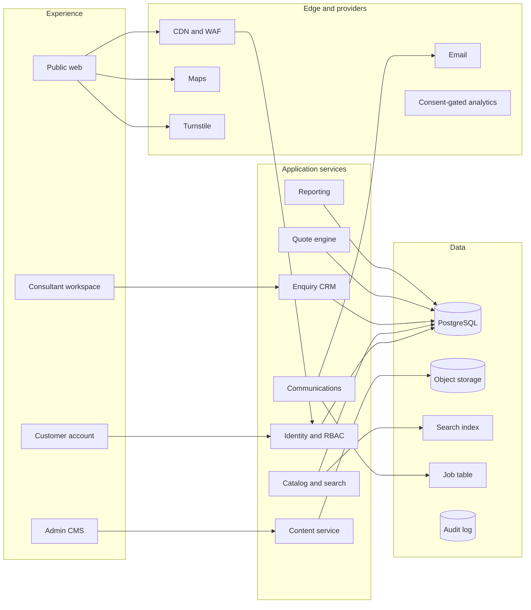
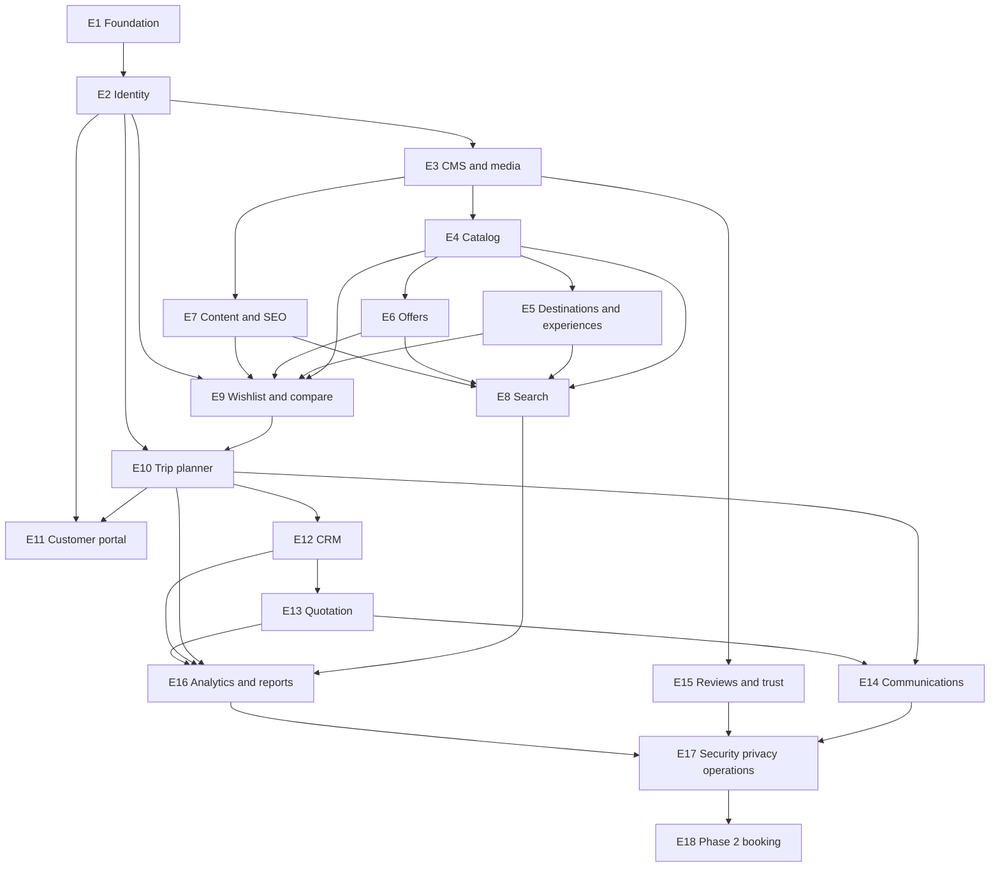

# Maldives Explorer — Implementation Plan

| Field | Value |
| --- | --- |
| Status | Approved with changes on 10 October 2026. Feature implementation waits for review of `Documentation_Correction_Report.md`. |
| Version | 1.1 |
| Date | 10 October 2026 |
| Owner | Naais Mohamed |
| Codebase state | Documentation is the contract. An earlier foundation skeleton exists and is not approval to build feature pages. |
| Authority | `Documentation/Decisions.md`, then `Maldives_Explorer_Complete_Documentation_Suite.docx`, then this plan for delivery scope and sequence, then `Database_Design.md` and `Design_System.md` for their contracts, then the SRS, the product vision, the diagrams, then existing implementation. |

This plan turns the documentation suite, the SRS, the product vision, and `Tourism_Marketplace_Development_Diagrams.pptx` into one implementation contract. It does not copy reference-site copy, layouts, photography, or code. Prices, reviews, awards, availability, and response promises stay unpublished until they have a source and an approval.

## How conflicts were resolved

| Topic | Adopted rule | Sources |
| --- | --- | --- |
| Product Phase 1 | Editorial marketplace plus consultant-assisted enquiry and quotation. Direct booking is later. | Suite §4.1 and §4.2 override the diagram pack, which splits the same scope across four delivery phases. |
| Enquiry statuses | New, Contact Attempted, Contacted, Qualified, Quoted, Negotiation, Won, Lost, Closed. | Suite §5.2. The SRS list (Quote Sent, Confirmed) is folded into Quoted and Won. |
| Roles | Visitor, Customer, Consultant, Content Editor, Content Approver, Operations Manager, Administrator, Auditor. | Suite §12.1. The five SRS roles remain valid as a coarser view of the same model. |
| Activities vs excursions | Experience is the canonical discovery record. A quote line may reference an experience. A separate Excursion table is not created. | Suite data dictionary. SRS listed both Activities and Excursions. |
| Wishlist contents | Resorts, offers, experiences, and articles. Anonymous first, then merge on sign-in. | Suite and vision. SRS “attractions” are covered by islands and experiences. |
| Search engine | PostgreSQL full-text behind a search interface for the first release. Meilisearch remains a later adapter. | SRS allows either. Suite requires an abstraction. |
| Availability target | Proposed service objective is 99.9% monthly uptime for the application, excluding agreed upstream providers. | SRS states 99.9%. The suite says the objective must be agreed. This plan proposes the SRS figure. |
| Phase names | “MVP” means the launchable assisted marketplace. “Phase 2” means everything after that launch. Delivery stages inside the MVP use a separate numbering in §11 and §17. | The suite, SRS, and diagrams each use “Phase 2” for a different slice. |

Decisions D-001 through D-014 are recorded in `Documentation/Decisions.md`. Approval of this plan is not approval of legal, commercial, retention, tax, SLA, hosting, or review policies. D-002, D-003, D-005, D-006, D-009, D-010, D-011, D-012, and D-014 stay **Provisional**. A proposed default in §3 is an engineering placeholder. It is not an owner decision until `Decisions.md` records one.

---

## 1. Executive summary of the product

Maldives Explorer is the digital gateway for discovering, comparing, planning, and arranging a Maldives vacation. It is a premium knowledge platform and a human concierge service. It is an editorial marketplace in the first release. It becomes a booking system only after commercial, supplier, and payment decisions are approved.

The promise is: “Explore clearly. Choose confidently. Travel beautifully.”

A visitor can learn how atolls, resort islands, and local islands differ; compare resorts and offers on a truthful basis; save a shortlist without registering; and submit a guided trip plan. A consultant receives that context, qualifies the lead, and sends an immutable, versioned proposal. The customer reviews the exact version in a portal, asks for clarification, and accepts or declines. Acceptance records intent. It does not create a supplier-confirmed booking.

The public site must answer, on every page, why the Maldives, why this place, why this resort, and why now, and it must offer a next step. Primary navigation is Resorts, Offers, Destinations, Experiences, Inspiration, and Plan My Trip.

Quality bar for every feature:

- Mobile-first, with the same capability on a phone as on a desktop.
- SEO-first: server-rendered primary content, canonical URLs, structured data, sitemaps, and managed redirects.
- WCAG 2.2 AA for public and staff interfaces.
- CMS-managed business content. No hardcoded resorts, prices, reviews, or marketing claims.
- Strict TypeScript, Zod at trust boundaries, server-side authorization, and audit logs for privileged actions.
- Core Web Vitals targets: largest contentful paint under 2.5 seconds, cumulative layout shift under 0.1, Lighthouse performance above 90 on representative mobile pages, and a homepage designed for under 2 seconds on a representative mobile network.
- Search results and public API reads designed for under 2 seconds and under 500 milliseconds respectively at agreed catalog size.

Brand working tokens: Deep Ocean `#083B4C`, Lagoon `#009FB7`, Aqua Mist `#DFF6F4`, Coral `#FF6F59`, Warm Sand `#FAF8F3`, Ink `#20323A`, White `#FFFFFF`. Typography stays elegant and restrained. Motion honors reduced-motion preferences. The descriptor “Your Maldives, beautifully planned.” waits on trademark, domain, and social-handle clearance (D-014).

Personas the product must serve: first-time couples, honeymoon travelers, families, luxury travelers, divers and snorkelers, value-conscious travelers, returning visitors, consultants, content editors, and administrators.

---

## 2. Feature inventory grouped by module

Priority key: **Must** is required for MVP. **Should** is in MVP if the dependency is already paid for. **Later** is Phase 2.

### 2.1 Homepage and navigation

| ID | Feature | Priority |
| --- | --- | --- |
| FR-HOME-001 | Value proposition, global search, and Plan My Trip call to action | Must |
| FR-HOME-002 | CMS-ordered and schedulable editorial modules | Must |
| FR-HOME-003 | Accessible desktop and mobile navigation | Must |
| FR-HOME-004 | Featured modules hide unpublished and expired records | Must |
| FR-HOME-005 | Trust block using sourced evidence only | Must |
| — | Destination explainer for first-time visitors | Must |
| — | Recently viewed, only when the visitor has history | Should |
| — | Newsletter module with explicit consent | Must |

Empty states are required for every module. Primary copy remains available if client JavaScript fails.

### 2.2 Resort catalog

| ID | Feature | Priority |
| --- | --- | --- |
| FR-RES-001 | Search by name, island, atoll, theme, and free text | Must |
| FR-RES-002 | Filters: price band, transfer type, audience, villa and room attributes, meal plan, activities, amenities | Must |
| FR-RES-003 | Sort by relevance, indicative price, and editorial popularity, with documented ranking | Must |
| FR-RES-004 | Cards with image, name, location, positioning, price disclosure, tags, shortlist, and quote | Must |
| FR-RES-005 | Detail: overview, media, rooms, dining, experiences, reef and diving where known, transfer, map, FAQs, related offers, related guides, alternatives | Must |
| FR-RES-006 | Indicative price is visually distinct from a live bookable price | Must |
| FR-RES-007 | Compare selected resorts on an approved attribute set | Must |
| FR-RES-008 | Draft, review, publish, schedule, unpublish, archive | Must |
| — | Grid and map views; map has a list alternative | Must |
| — | URL-addressable filters; back navigation keeps filter state | Must |
| — | Sticky shortlist and planner actions | Must |
| — | 360 tour and drone footage as media types | Should, when assets and a viewer exist |
| — | Restaurant menus | Should, as structured dining content |

Audience and theme filters cover luxury, honeymoon, family, adults only, budget, water villa, and beach villa. Missing facts are omitted or marked unknown.

### 2.3 Offers

| ID | Feature | Priority |
| --- | --- | --- |
| FR-OFF-001 | Offer is a first-class record linked to a resort and an optional room type | Must |
| FR-OFF-002 | Validity, stay conditions, occupancy basis, meal plan, transfer inclusion, inclusions, exclusions, price basis, currency, terms | Must |
| FR-OFF-003 | Expired or unpublished offers stay off public listings | Must |
| FR-OFF-004 | Search, filter, shortlist, share, and compare | Must |
| FR-OFF-005 | Approval, publication dates, and expiry monitoring | Must |
| — | Expired direct URLs show an unavailable state and alternatives | Must |
| — | Savings math only when the comparison basis matches | Must |

Offer categories include honeymoon, family, adventure, diving, luxury, and budget, stored as controlled vocabulary.

### 2.4 Destinations

| ID | Feature | Priority |
| --- | --- | --- |
| FR-DST-001 | Atolls, resort islands, and local islands are distinct | Must |
| FR-DST-002 | Orientation, map, transfer context, related resorts, experiences, and guides | Must |
| — | Culture, history, and etiquette blocks with a review date | Must |
| — | Coordinates and a source for any distance or transfer time | Must |

Routes: `/destinations`, `/atolls/[slug]`, `/islands/[slug]`.

### 2.5 Experiences

| ID | Feature | Priority |
| --- | --- | --- |
| FR-ACT-001 | Category, description, suitable traveler types, location, seasonality, duration guidance, safety notes, related resorts | Must |
| FR-ACT-002 | Two-way discovery between experiences and resorts | Must |
| — | Planner prefill from the selected experience | Must |
| — | Seasonal claims require a source and a review date | Must |

Initial categories: whale sharks, manta rays, scuba diving, snorkeling, cruises, fishing, spa, water sports, sandbanks. Categories are CMS vocabulary, not hardcoded copy.

### 2.6 Content hub

| ID | Feature | Priority |
| --- | --- | --- |
| FR-CNT-001 | Articles, guides, collections, FAQs, and reusable blocks | Must |
| FR-CNT-002 | Author, reviewer, status, schedule, last-reviewed date, tags, related entities | Must |
| FR-CNT-003 | SEO fields, social previews, structured-data fields | Must |
| FR-CNT-004 | Review reminders and stale-content flags | Must |
| — | Topic clusters and editorial collections | Must |
| — | Draft preview and managed redirects on slug change | Must |
| — | Thin tag pages are not indexable | Must |

Guide themes include Maldives, honeymoon, transfers, packing, budget, luxury, seasonal, and family travel.

### 2.7 Search

| ID | Feature | Priority |
| --- | --- | --- |
| FR-SRC-001 | Grouped results across resorts, offers, destinations, experiences, and guides | Must |
| FR-SRC-002 | Spelling-tolerant suggestions, recent searches, and no-result recovery | Must |
| FR-SRC-003 | Filter and sort state represented in the URL | Must |
| FR-SRC-004 | Consent-aware search analytics | Must |
| — | Internal and unpublished records never enter the public index | Must |

### 2.8 Wishlist and comparison

| ID | Feature | Priority |
| --- | --- | --- |
| FR-WIS-001 | Anonymous save of resorts, offers, experiences, and articles | Must |
| FR-WIS-002 | Server wishlist after sign-in, with deterministic merge | Must |
| FR-WIS-003 | Notes and removal | Must |
| FR-CMP-001 | Comparison capped at a usable count, with missing values shown as unknown | Must |

Proposed cap: 3 entities of one type. Proposed anonymous store: `localStorage`, maximum 50 items. Anonymous data is convenience storage, not a backup.

### 2.9 Trip planner and enquiries

| ID | Feature | Priority |
| --- | --- | --- |
| FR-ENQ-001 | Contact details, country, travel window, flexibility, adults, child ages, budget range and currency, trip type, interests, preferred properties, accessibility needs, free text | Must |
| FR-ENQ-002 | Local progress and resumable drafts | Must |
| FR-ENQ-003 | Consent, server validation, spam protection, duplicate detection | Must |
| FR-ENQ-004 | Match or create customer, create enquiry, attach shortlist, record attribution, acknowledge receipt | Must |
| FR-ENQ-005 | No special-category data unless a later decision justifies it | Must |
| FR-ENQ-006 | Missing-information prompts and a qualification checklist | Must |
| — | Idempotent submit | Must |
| — | Confirmation page and transactional acknowledgement | Must |

Steps: dates, budget, travel type, preferences, review and submit. Shortlist and the page the visitor came from are prefilled.

### 2.10 Customer accounts and portal

| ID | Feature | Priority |
| --- | --- | --- |
| FR-CUS-001 | Register, sign in, reset credentials, profile, consent preferences | Must |
| FR-CUS-002 | Own enquiries, latest quotes, quote history exposed to them, messages, saved items | Must |
| FR-CUS-003 | Clarification, accept, and decline against an exact quote version | Must |
| FR-CUS-004 | Object-level isolation from other customers | Must |
| — | Data export, correction, and account closure requests | Must |

Account is optional for browsing and for the first save. It is required to see quotes and message history.

### 2.11 CRM and consultant workspace

| ID | Feature | Priority |
| --- | --- | --- |
| FR-CRM-001 | Search, assign, and reassign with reason and history | Must |
| FR-CRM-002 | Controlled enquiry statuses | Must |
| FR-CRM-003 | Notes, tasks, communication summaries, attachments, follow-up dates | Must |
| FR-CRM-004 | First-response and aging against configurable targets | Must |
| FR-CRM-005 | Loss and closure require reason codes | Must |
| FR-CRM-006 | Permissioned, logged, size-capped export | Must |
| — | Private notes are invisible to customers | Must |
| — | Saved queue views | Should |

### 2.12 Quotation

| ID | Feature | Priority |
| --- | --- | --- |
| FR-QTE-001 | Many quotes per enquiry; immutable numbered versions | Must |
| FR-QTE-002 | Itinerary, accommodation, room, meal plan, transfer, experiences, line items, taxes, fees, discounts, currency, inclusions, exclusions, terms, expiry | Must |
| FR-QTE-003 | Customers see approved and sent versions only | Must |
| FR-QTE-004 | Branded accessible PDF and secure portal view | Must |
| FR-QTE-005 | Accept, decline, and expiry are timestamped against one version | Must |
| FR-QTE-006 | A commercial change creates a new version | Must |
| — | Totals reconcile to lines, taxes, fees, and discounts | Must |
| — | An expired quote cannot be accepted | Must |

Quote document sections: welcome, overview, accommodation, transfers, activities, pricing, terms, next steps.

Won status requires the operational evidence defined by the business. Customer acceptance alone does not book a supplier.

### 2.13 Reviews, newsletter, and communications

| ID | Feature | Priority |
| --- | --- | --- |
| FR-REV-001 | Source, permission, verification, moderation, publication | Must |
| FR-REV-002 | Imported ratings are not presented as first-party reviews | Must |
| FR-NWS-001 | Explicit consent, optional double opt-in, preferences, unsubscribe, suppression | Must |
| FR-COM-001 | Templated transactional email with delivery status and idempotency | Must |
| FR-COM-002 | Marketing and transactional mail are separate classes | Must |
| — | Subscriber import and export under the same consent rules | Should |

### 2.14 Analytics and reporting

| ID | Feature | Priority |
| --- | --- | --- |
| FR-ANA-001 | Consent-gated discovery and conversion events | Must |
| FR-ANA-002 | Traffic quality, search demand, shortlist use, planner completion, lead response, quote funnel, content performance | Must |
| FR-ANA-003 | Named formulas and role-based access | Must |

Event names are fixed in §10.4.

### 2.15 Administration, security, and privacy

| ID | Feature | Priority |
| --- | --- | --- |
| FR-ADM-001 | Users, roles, permissions, vocabularies, configuration, content workflow | Must |
| FR-ADM-002 | Audit log with actor, time, action, object, and before/after | Must |
| FR-ADM-003 | Validated uploads, metadata, managed storage and CDN | Must |
| FR-ADM-004 | Draft, In Review, Approved, Scheduled, Published, Unpublished, Archived | Must |
| FR-ADM-005 | Dashboard for stale content, expiring offers, failed jobs, operational alerts | Must |
| — | MFA for privileged staff | Must |
| — | Consent, export, correction, deletion or anonymization, cookie choices | Must |
| — | Rate limits on login, planner, search, and newsletter | Must |

### 2.16 Explicitly out of the first release

Direct booking, live availability, reservation records, payment capture, supplier feeds, B2B agent portal, commission accounting, native iOS and Android apps, AI resort matchmaker, AI itinerary builder, natural-language search, flight-plus-resort packaging, and real-time contracted rates.

The schema and service boundaries leave room for those capabilities. The interface must not imply that inventory is live.

---

## 3. Missing requirements

These items are not specified tightly enough to implement without a decision. A proposed default is a placeholder. It does not become policy because this plan was approved. The status column matches `Documentation/Decisions.md`.

### 3.1 Blocks a correct commercial launch

| ID | Status | Gap | Proposed default |
| --- | --- | --- | --- |
| D-001 | Accepted for the MVP boundary | Lead-generation only, agent-assisted sale, or direct booking | Agent-assisted enquiry and quotation. No payment and no supplier confirmation in MVP. Direct booking remains Phase 2 and is not approved by this plan. |
| D-002 | Provisional | Who is allowed to set an indicative price, and how often it is reviewed | Editorial price entered by staff, with currency, occupancy basis, inclusion flags, source note, and a mandatory review date. No price is public without those fields. |
| D-003 | Provisional | Assignment and service target | Manual assignment by Operations or an Administrator. Optional round-robin among active consultants is a setting, off by default. First-response target is 2 business hours, measured inside the CRM, and is not shown as a public promise until marketing approves the wording. |
| D-005 | Provisional | When a second person must approve a quote | A second approver is required when the discount exceeds 10% of the pre-discount subtotal, or when the grand total exceeds a setting defaulting to 25,000 USD. |
| D-006 | Provisional | Currencies, taxes, and fees | USD is the quote and display currency. Amounts use PostgreSQL `NUMERIC(12,2)`. Tax and fee lines are explicit quote items. Maldives green tax, GST, and service charge are entered as named lines. The system does not invent statutory rates. |
| D-012 | Provisional | Retention | Enquiry and quote records are kept for 7 years after closure. Marketing consent evidence is kept for 3 years after withdrawal. Server access logs are kept for 90 days. Analytics events avoid direct identifiers and are kept for 14 months. These periods need legal confirmation before production launch. |

### 3.2 Blocks identity, privacy, or hosting

| ID | Status | Gap | Proposed default |
| --- | --- | --- | --- |
| D-004 | Accepted | Is an account required? | Optional. Wishlist works anonymously. Quotes and messages require an account. Planner submission creates a customer record and emails a claim link. |
| D-007 | Accepted for MVP | Content languages and translation workflow | English only in MVP. Content records store `locale`, default `en`. Additional languages are Phase 2. |
| D-008 | Accepted | Authentication and MFA | Auth.js with email and password for customers, email magic link as a second sign-in method, and TOTP MFA required for every staff role. Sessions use HTTP-only secure cookies. |
| D-009 | Provisional | Analytics and consent | First-party `AnalyticsEvent` rows. Non-essential analytics wait for opt-in. Cookie categories: necessary, analytics, marketing. |
| D-010 | Provisional | Cloud vendors | Next.js on a Node host with preview deployments, PostgreSQL via Neon, object storage on Cloudflare R2, DNS and WAF on Cloudflare, email via Resend, bot defense via Cloudflare Turnstile. |
| D-011 | Provisional | What “verified review” means | A review is first-party only when the customer account accepted a quote that later reached Won, or when an editor records a written permission reference. All other testimonials are labeled editorial. |
| D-013 | Open | Resort and partner data ownership and import method | Atoll, island, and resort records come from an owner-approved dataset. Engineering does not invent them. Ownership and the import method are not decided. |
| D-014 | Provisional | Trademark, domain, and handles | Engineering uses the working name in configuration. Public launch is blocked until clearance is recorded. The descriptor “Your Maldives, beautifully planned.” is not a public claim. |

### 3.3 Specified as “according to policy” with no policy

| Gap | Proposed default |
| --- | --- |
| Comparison size | 3 items, same entity type. |
| Child and infant ages | Infant is under 2 on the arrival date. Child is 2 through 11. Ages outside 0–17 are rejected for the child list. |
| Duplicate enquiries | Same normalized email and a travel window that overlaps an open enquiry is flagged. The submit still succeeds. Double-click is blocked by an idempotency key for 24 hours. |
| Planner draft lifetime | Local draft expires after 30 days. |
| Wishlist notes length | 500 characters. |
| Ranking | Published resorts: text relevance, then editorial `popularityRank`, then newest publication. Indicative price sort ignores records with no price and says so. |
| Comparable resort attributes | Island and atoll, transfer type and time, price band and indicative from-price, meal plans available, villa types, audience tags, house reef yes/no/unknown, and a short editorial positioning line. |
| Share | Copy link plus the Web Share API when the browser provides it. |
| Upload limits | Images up to 15 MB (JPEG, PNG, WebP). Video up to 200 MB (MP4, WebM) stored as an asset URL. Other types rejected. |
| Map | MapLibre with a configured tile style. Public pages always render the same places as a list. |
| Password policy | At least 12 characters, breached-password check where the provider supports it, email verification before the account can open quotes. |
| Session | Customer session 30 days rolling. Staff session 12 hours, refreshed by use, revoked on role change. |
| Pagination | 24 public cards. 50 admin rows. Exports capped at 5,000 rows. |
| Homepage scheduling timezone | Indian/Maldives (`Indian/Maldives`). Storage remains UTC. |
| Occupancy basis vocabulary | Double occupancy, single occupancy, family occupancy. “From” price requires one of these. |
| Meal plans | Room only, bed and breakfast, half board, full board, all inclusive. |
| Transfer types | Speedboat, seaplane, domestic flight, combined. Duration requires a source note. |
| Loss reasons | Price, dates unavailable, chose another resort, no response, duplicate, not a fit, other. |
| Messaging | Portal messages plus email notification. WhatsApp is a communication-log channel, not an in-app inbox. |
| 360 viewer | Media type may be stored. A panorama viewer is Phase 2 unless a vendor is chosen during MVP. |
| Guesthouses and liveaboards | `propertyType` exists on the catalog record. MVP public filters show resorts. Other types stay unpublished until content is ready. |
| Split stays | A quote version may contain ordered itinerary segments across more than one resort. |
| High-risk self-approval | The publisher of an offer or a quote cannot be the only approver of that version. |
| Feature-flag store | Database table with owner, default, and retirement date. |
| Background work | Job rows in PostgreSQL, executed by a worker entrypoint. Jobs are idempotent. |
| Observability | Structured JSON logs, Sentry for exceptions, uptime checks on `/` and `/api/health`. |
| Legal jurisdiction and privacy statute | Not assumed. Launch checklist includes counsel-approved privacy notice, terms, and retention. |
| Seed geography | Atoll and island names are imported from an owner-approved dataset. They are not invented in code. |
| Team size | The SRS estimate of 5–10 developers and 6–12 months is a planning range. This plan’s order is valid for a smaller team; calendar time stretches, scope does not silently shrink. |

### 3.4 Known documentation gaps that are accepted

Restaurant menu photography, partner-award records, expert profiles, and house-reef facts are in the product vision and only partly in the data dictionary. This plan adds `DiningVenue`, `Award`, `ExpertProfile`, and reef fields so those pages have a place to store truth. Empty fields stay hidden.

Special-category data (health, religion, and similar) is out of scope until a written justification exists.

Partner rate feeds, payment-provider choice, and accounting export are Phase 2 decisions, tracked as D-001 and the diagram pack’s executive gates.

---

## 4. Proposed technical architecture

### 4.1 Style

One modular Next.js application. Domain services own rules. Route handlers, server actions, and React components call those services. Microservices are not introduced for MVP.



### 4.2 Stack

| Concern | Choice |
| --- | --- |
| UI | Next.js 15 App Router, React, TypeScript strict, Tailwind CSS, shadcn/ui |
| Rendering | Server Components by default. Client Components only for search UI, filters, gallery, planner steps, maps, and other interaction. |
| Validation | Zod schemas shared by forms, server actions, and route handlers |
| Database | PostgreSQL and Prisma |
| Auth | Auth.js, secure cookies, TOTP for staff |
| Search | PostgreSQL `tsvector` behind `SearchProvider` |
| Files | Cloudflare R2 and a CDN URL |
| Email | Resend behind `EmailProvider` |
| Jobs | PostgreSQL job table and a worker |
| PDF | Server-rendered proposal document, stored as a file, linked from the quote version |
| Maps | MapLibre plus an accessible list |
| Bot defense | Cloudflare Turnstile on planner, registration, and newsletter |
| Errors | Sentry |
| Tests | Vitest for units and integration, Playwright for critical journeys, axe checks on those journeys |

### 4.3 Domain modules

Identity and access. Catalog. Destinations and experiences. Offers. Content and media. Customers and consent. Wishlist. Enquiries and CRM. Quotes. Communications. Analytics and reporting. Administration and audit.

Each module exposes a service interface, Zod contracts, and authorization checks. UI does not import Prisma directly.

### 4.4 Request paths

- Public reads use Server Components, tag-based cache, and revalidation when a publication job runs.
- Public writes that must be idempotent (`POST /api/v1/enquiries`, newsletter, quote response) are route handlers.
- Same-origin staff and account mutations use server actions that call the same services.
- Future mobile clients can use the versioned REST surface without a second business layer.

### 4.5 Cross-cutting rules

- Mutations validate, authorize, then write. Multi-row commercial changes run in a transaction.
- Sent quote versions and enquiry status history are insert-only.
- Publication flips a status and enqueues search reindex plus cache invalidation.
- Providers sit behind interfaces: email, storage, search, captcha, maps, pdf.
- Secrets stay in the host’s secret store.
- Personal data is omitted from routine logs. A correlation id ties the request, the job, and the audit row together.
- Feature flags have an owner and a retirement date.
- English only in MVP. Content records include a `locale` column defaulting to `en`, and URL design can add a locale prefix later without new tables.

### 4.6 Environments

`local`, `preview`, `staging`, `production`. Staging is `noindex`. Production robots and sitemaps are generated from published records. Database migrations run forward only, through Prisma Migrate.

### 4.7 Security boundaries

Public browsers reach the CDN and WAF, then the application. Staff browsers use the same application with MFA and RBAC. Payment providers are absent in MVP. Object storage is private; the CDN serves public media variants. Audit storage is append-only from the application’s point of view and readable by Auditor and Administrator.

---

## 5. Proposed database schema

Conventions:

- Primary keys are UUIDs generated by the database.
- Slugs are unique per entity and are the public route key. Renames insert a `Redirect`.
- Timestamps are `timestamptz` stored in UTC.
- Money is `NUMERIC(12,2)` plus an ISO currency code. Application code uses decimal arithmetic.
- Lifecycle states that the code branches on are PostgreSQL enums. Business taxonomies are vocabulary tables.
- Publishable entities share: `status`, `publishedAt`, `scheduledAt`, `unpublishedAt`, `archivedAt`, `createdAt`, `updatedAt`, `createdById`, `updatedById`.
- Soft archive uses `archivedAt` and status `ARCHIVED`. Hard delete is reserved for data-protection workflows.
- Original enquiry payload is frozen in `submittedSnapshot` JSON. Later staff edits do not change that snapshot.
- Search documents use a generated `tsvector` column and a GIN index. Partial indexes cover published rows. Public queries apply offer validity. An index predicate does not use `now()` or `current_date`.

### 5.1 Identity and access

**User** — `id`, `email` (citext, unique), `name`, `passwordHash`, `emailVerifiedAt`, `status` (`INVITED`, `ACTIVE`, `SUSPENDED`, `DISABLED`), `locale`, `lastLoginAt`, `createdAt`, `updatedAt`.

**Role** — `id`, `code` unique, `name`, `description`.

**Permission** — `id`, `code` unique, `description`.

**RolePermission** — (`roleId`, `permissionId`) primary key.

**UserRole** — (`userId`, `roleId`) primary key, `assignedById`, `assignedAt`.

**MfaFactor** — `id`, `userId`, `type` (`TOTP`), `secretEncrypted`, `enabledAt`, `lastUsedAt`.

**Session** — `id`, `userId`, `expiresAt`, `revokedAt`, `userAgent`, `ipHash`.

**ExpertProfile** — `id`, `userId` unique nullable, `name`, `slug` unique, `title`, `bio`, `yearsInTourism`, `portraitMediaId`, `status`, publication fields. Public route `/experts/[slug]`.

### 5.2 Geography and catalog

**Atoll** — `id`, `name`, `slug` unique, `summary`, `description`, `latitude`, `longitude`, `seoTitle`, `seoDescription`, `status`, publication fields.

**Island** — `id`, `atollId` FK, `name`, `slug` unique, `islandType` (`RESORT`, `LOCAL`, `UNINHABITED`), `summary`, `description`, `history`, `cultureNotes`, `etiquette`, `latitude`, `longitude`, `status`, publication fields.

**Resort** — `id`, `islandId` FK, `name`, `slug` unique, `propertyType` (`RESORT`, `GUESTHOUSE`, `LIVEABOARD`), `summary`, `description`, `editorialPositioning`, `priceBandId` FK, `indicativeFromPrice`, `indicativeCurrency`, `priceBasis`, `priceIncludesTransfer`, `priceIncludesTax`, `priceSourceNote`, `priceReviewedAt`, `popularityRank`, `starCategory` nullable, `starCategorySource`, `hasHouseReef` nullable boolean, `reefSummary`, `diveCenterSummary`, `reefSourceNote`, `reefReviewedAt`, `checkInNotes`, `faq` relation, `status`, publication fields.

**RoomType** — `id`, `resortId` FK, `name`, `slug` unique per resort, `description`, `category` (beach villa, water villa, suite, other — vocabulary), `maxAdults`, `maxChildren`, `sizeSqm` nullable, `features` text, `indicativeFromPrice` nullable, `status`, `sortOrder`.

**DiningVenue** — `id`, `resortId` FK, `name`, `venueType`, `cuisine`, `description`, `mealPlans` relation, `status`, `sortOrder`.

**TransferOption** — `id`, `resortId` FK, `transferTypeId` FK, `durationMinutes` nullable, `durationBasis`, `sourceNote`, `notes`, `sortOrder`.

**Amenity** — `id`, `code` unique, `name`, `category`, `description`.

**ResortAmenity** — (`resortId`, `amenityId`) primary key.

**AudienceTag** — `id`, `code` unique, `name`. Examples stored as data: family, adults only, honeymoon, diving, luxury, budget.

**ResortAudience** — (`resortId`, `audienceTagId`) primary key.

**ExperienceCategory** — `id`, `slug` unique, `name`, `description`, `sortOrder`.

**Experience** — `id`, `categoryId` FK, `name`, `slug` unique, `summary`, `description`, `seasonality`, `seasonSourceNote`, `seasonReviewedAt`, `suitability`, `durationGuidance`, `difficulty`, `safetyNotes`, `environmentalNotes`, `status`, publication fields.

**ResortExperience** — (`resortId`, `experienceId`) primary key, `notes`.

**IslandExperience** — (`islandId`, `experienceId`) primary key.

### 5.3 Offers and collections

**Offer** — `id`, `resortId` FK, `roomTypeId` FK nullable, `title`, `slug` unique, `summary`, `currency`, `fromPrice`, `comparisonPrice` nullable, `comparisonBasisNote` nullable, `occupancyBasisId` FK, `mealPlanId` FK, `transferIncluded` boolean, `validFrom`, `validUntil`, `stayFrom`, `stayUntil`, `minNights` nullable, `terms`, `status`, publication fields. The published index is `WHERE status = PUBLISHED`. Public queries also require `validUntil >= current_date` and a published parent resort. `validUntil` is a date, so the comparison is `current_date`, and that comparison stays in the query.

**OfferInclusion** — `id`, `offerId` FK, `text`, `sortOrder`.

**OfferExclusion** — `id`, `offerId` FK, `text`, `sortOrder`.

**OfferAudience** — (`offerId`, `audienceTagId`) primary key.

**Collection** — `id`, `title`, `slug` unique, `summary`, `body`, `status`, publication fields. Route `/collections/[slug]`.

**CollectionItem** — `id`, `collectionId` FK, `entityType`, `entityId`, `sortOrder`, unique (`collectionId`, `entityType`, `entityId`).

### 5.4 Content and media

**Article** — `id`, `title`, `slug` unique, `excerpt`, `body` (structured document JSON with an allowlisted block schema), `categoryId` FK, `authorId` FK, `reviewerId` FK nullable, `reviewedAt`, `staleAfter`, `locale` default `en`, `seoTitle`, `seoDescription`, `ogMediaId`, `canonicalPath` nullable, `status`, publication fields.

**ContentCategory** — `id`, `slug` unique, `name`, `description`, `parentId` nullable.

**Tag** — `id`, `slug` unique, `name`. Tag archives are `noindex`.

**ArticleTag** — (`articleId`, `tagId`) primary key.

**ContentRelation** — `id`, `articleId` FK, `entityType`, `entityId`, `sortOrder`.

**Faq** — `id`, `ownerType`, `ownerId` nullable for global FAQ, `question`, `answer`, `sortOrder`, `status`.

**HomepageModule** — `id`, `moduleType`, `title`, `config` JSON, `sortOrder`, `startsAt`, `endsAt`, `status`.

**ReusableBlock** — `id`, `code` unique, `blockType`, `body` JSON, `status`.

**MediaAsset** — `id`, `storageKey`, `mimeType`, `byteSize`, `width`, `height`, `durationSeconds` nullable, `altText`, `caption`, `attribution`, `focalPoint` JSON, `kind` (`IMAGE`, `VIDEO`, `DRONE`, `TOUR_360`, `DOCUMENT`), `status`.

**MediaLink** — `id`, `mediaId` FK, `ownerType`, `ownerId`, `role` (`HERO`, `GALLERY`, `OG`, `PORTRAIT`, `ATTACHMENT`), `sortOrder`.

**Redirect** — `id`, `fromPath` unique, `toPath`, `statusCode` default 301, `active`.

**Award** — `id`, `title`, `issuer`, `year`, `sourceUrl`, `resortId` nullable, `status`. Unpublished until source and approval exist.

### 5.5 Customers, consent, and shortlists

**Customer** — `id`, `userId` FK unique nullable, `name`, `email` citext, `phone`, `countryCode`, `locale`, `createdAt`, `updatedAt`. Unique normalized email.

**ConsentRecord** — `id`, `subjectType`, `subjectId`, `purpose` (`ENQUIRY_CONTACT`, `ACCOUNT`, `NEWSLETTER`, `ANALYTICS`, `MARKETING`), `status` (`GRANTED`, `WITHDRAWN`), `noticeVersion`, `source`, `capturedAt`, `withdrawnAt`, `ipHash`. Insert-only.

**SavedItem** — `id`, `customerId` FK, `entityType` (`RESORT`, `OFFER`, `EXPERIENCE`, `ARTICLE`), `entityId`, `note`, `createdAt`. Unique (`customerId`, `entityType`, `entityId`).

**Subscription** — `id`, `email` citext unique, `status` (`PENDING`, `CONFIRMED`, `UNSUBSCRIBED`, `SUPPRESSED`), `preferences` JSON, `consentRecordId` FK, `confirmTokenHash` nullable, `subscribedAt`, `unsubscribedAt`, `source`.

### 5.6 Enquiries and CRM

**Enquiry** — `id`, `reference` unique human code, `customerId` FK, `status`, `assignedUserId` FK nullable, `source`, `medium`, `campaign`, `referrer`, `landingPath`, `travelStart`, `travelEnd`, `flexibility` text, `adultCount`, `childCount`, `budgetMin`, `budgetMax`, `budgetCurrency`, `tripTypeId` FK, `requirements` text, `accessibilityNeeds` text, `qualificationScore` nullable, `firstResponseAt` nullable, `submittedSnapshot` JSON, `idempotencyKey` unique, `createdAt`, `updatedAt`.

**EnquiryTraveler** — `id`, `enquiryId` FK, `travelerType` (`ADULT`, `CHILD`, `INFANT`), `ageAtArrival` nullable, `sortOrder`.

**EnquiryInterest** — (`enquiryId`, `experienceId`) and a second link table `EnquiryResort` (`enquiryId`, `resortId`) plus `EnquiryOffer` (`enquiryId`, `offerId`) so the shortlist context is relational and also copied into the snapshot.

**EnquiryStatusHistory** — `id`, `enquiryId` FK, `fromStatus`, `toStatus`, `reasonCode`, `note`, `changedById`, `changedAt`. Insert-only.

**EnquiryAssignment** — `id`, `enquiryId` FK, `fromUserId` nullable, `toUserId`, `reason`, `assignedById`, `assignedAt`. Insert-only.

**Task** — `id`, `enquiryId` FK, `assigneeId` FK, `title`, `dueAt`, `status` (`OPEN`, `IN_PROGRESS`, `DONE`, `CANCELLED`), `completedAt`.

**Note** — `id`, `enquiryId` FK, `authorId` FK, `visibility` (`INTERNAL`, `CUSTOMER`), `body`, `createdAt`. `INTERNAL` is excluded from every customer query by a repository filter, not by UI convention.

**CommunicationLog** — `id`, `enquiryId` FK, `channel` (`EMAIL`, `PHONE`, `PORTAL`, `WHATSAPP`), `direction` (`INBOUND`, `OUTBOUND`), `subject`, `summary`, `providerReference`, `occurredAt`, `loggedById`.

**Attachment** — `id`, `ownerType`, `ownerId`, `mediaId` FK.

### 5.7 Quotes

**Quote** — `id`, `enquiryId` FK, `reference` unique, `activeVersionId` nullable, `createdAt`.

**QuoteVersion** — `id`, `quoteId` FK, `versionNo` integer, unique (`quoteId`, `versionNo`), `currency`, `subtotal`, `taxTotal`, `feeTotal`, `discountTotal`, `grandTotal`, `termsSnapshot`, `welcomeMessage`, `overview`, `expiresAt`, `status` (`DRAFT`, `IN_REVIEW`, `APPROVED`, `SENT`, `ACCEPTED`, `DECLINED`, `EXPIRED`, `SUPERSEDED`, `WITHDRAWN`), `createdById`, `approvedById` nullable, `approvedAt`, `sentAt`, `pdfMediaId` nullable. A database trigger or a service guard rejects updates once `sentAt` is set. Supersede writes a new row.

**ItinerarySegment** — `id`, `quoteVersionId` FK, `sortOrder`, `resortId` nullable, `roomTypeId` nullable, `mealPlanId` nullable, `startDate`, `endDate`, `transferSummary`, `notes`.

**QuoteItem** — `id`, `quoteVersionId` FK, `itemType` (`ACCOMMODATION`, `TRANSFER`, `EXPERIENCE`, `TAX`, `FEE`, `DISCOUNT`, `OTHER`), `experienceId` nullable, `description`, `quantity`, `unitAmount`, `taxAmount`, `discountAmount`, `lineTotal`, `sortOrder`. Discount lines store positive numbers and the service subtracts them. `lineTotal` is computed in the service and checked against the stored value before send.

**QuoteResponse** — `id`, `quoteVersionId` FK, `customerId` FK, `responseType` (`CLARIFICATION`, `ACCEPT`, `DECLINE`), `message`, `createdAt`. Accept is rejected when `expiresAt` is past or status is not `SENT`.

### 5.8 Communications, audit, and platform

**Message** — `id`, `enquiryId` FK, `senderType` (`CUSTOMER`, `STAFF`), `senderId`, `body`, `createdAt`. Customer portal reads this table. Internal notes stay in `Note`.

**EmailTemplate** — `id`, `code` unique, `locale`, `classification` (`TRANSACTIONAL`, `MARKETING`), `subject`, `body`, `version`, `status`.

**EmailDelivery** — `id`, `templateCode`, `toEmail`, `idempotencyKey` unique, `providerId`, `status`, `error`, `relatedType`, `relatedId`, `createdAt`, `sentAt`.

**Review** — `id`, `resortId` nullable, `sourceType` (`FIRST_PARTY`, `EDITORIAL`, `IMPORTED`), `sourceReference`, `displayName`, `rating` nullable numeric, `body`, `verificationStatus`, `consentStatus`, `moderationStatus`, `featured`, `publishedAt`. Imported rows cannot be rendered on public pages as first-party.

**AuditLog** — `id`, `actorId` nullable, `action`, `entityType`, `entityId`, `before` JSON, `after` JSON, `correlationId`, `occurredAt`. No update and no delete API.

**AnalyticsEvent** — `id`, `eventName`, `anonymousKey`, `userId` nullable, `properties` JSON, `consentState`, `occurredAt`.

**IdempotencyKey** — `key` primary key, `requestHash`, `responseCode`, `responseBody` JSON, `createdAt`, `expiresAt`.

**SystemSetting** — `key` primary key, `value` JSON, `updatedById`, `updatedAt`.

**VocabularyItem** — `id`, `set` (`MEAL_PLAN`, `TRANSFER_TYPE`, `OCCUPANCY_BASIS`, `PRICE_BAND`, `TRIP_TYPE`, `LOSS_REASON`, `CLOSURE_REASON`), `code`, `label`, `sortOrder`, `active`. Unique (`set`, `code`).

**FeatureFlag** — `key` primary key, `enabled`, `owner`, `description`, `retiresOn`.

**Job** — `id`, `type`, `payload` JSON, `status`, `runAt`, `attempts`, `lastError`, `idempotencyKey` unique, `lockedAt`, `finishedAt`.

**SlaPolicy** — `id`, `name`, `firstResponseMinutes`, `businessHours` JSON, `active`.

### 5.9 Indexing highlights

- Unique slugs on atoll, island, resort, offer, experience, article, collection, expert.
- Partial index on offers: `WHERE status = PUBLISHED`, including `valid_until` as an indexed column so the public query can filter it. The predicate does not contain `validUntil >= now()` or `current_date`.
- GIN on search vectors for resort, offer, island, atoll, experience, article.
- Enquiry: `status`, `assignedUserId`, `createdAt`, `customerId`, `reference`.
- Quote version: (`quoteId`, `versionNo`) unique, plus `status`.
- Audit and analytics are time-range indexed and partitioned later if volume requires it. MVP starts unpartitioned.
- Foreign keys on every relation above. `ON DELETE RESTRICT` for commercial parents. `ON DELETE CASCADE` for pure join rows.

### 5.10 Enquiry state machine

| State | Allowed next | Control |
| --- | --- | --- |
| New | Contact Attempted, Contacted, Lost, Closed | Assignment and acknowledgement |
| Contact Attempted | Contact Attempted, Contacted, Lost | Channel and timestamp |
| Contacted | Qualified, Lost, Closed | Summary and next action |
| Qualified | Quoted, Negotiation, Lost | Qualification checklist complete |
| Quoted | Negotiation, Won, Lost, Closed | A sent version exists |
| Negotiation | Quoted, Won, Lost, Closed | Follow-up date |
| Won | Closed | Accepted version and operational reference |
| Lost | Reopen to Contacted with permission | Loss reason |
| Closed | Reopen to Contacted with permission | Closure reason |

Content state machine: Draft → In Review → Approved → Scheduled or Published → Unpublished → Archived.

---

## 6. Proposed Prisma model structure

Prisma models map 1:1 onto the tables in §5. Model names are singular PascalCase. Table names are mapped with `@@map` to snake_case plurals. Fields are camelCase in Prisma and snake_case in PostgreSQL via `@map`.

Enums:

- `UserStatus`, `PublishStatus`, `IslandType`, `PropertyType`, `MediaKind`, `SavedEntityType`
- `EnquiryStatus`, `TravelerType`, `TaskStatus`, `NoteVisibility`, `CommChannel`, `CommDirection`
- `QuoteVersionStatus`, `QuoteItemType`, `QuoteResponseType`
- `ConsentPurpose`, `ConsentStatus`, `SubscriptionStatus`
- `ReviewSource`, `EmailClassification`, `JobStatus`

Module grouping inside `prisma/schema.prisma`, in this order, with a comment banner per group:

1. `User`, `Role`, `Permission`, `RolePermission`, `UserRole`, `MfaFactor`, `Session`, `ExpertProfile`
2. `Atoll`, `Island`, `Resort`, `RoomType`, `DiningVenue`, `TransferOption`, `Amenity`, `ResortAmenity`, `AudienceTag`, `ResortAudience`
3. `ExperienceCategory`, `Experience`, `ResortExperience`, `IslandExperience`
4. `Offer`, `OfferInclusion`, `OfferExclusion`, `OfferAudience`, `Collection`, `CollectionItem`
5. `Article`, `ContentCategory`, `Tag`, `ArticleTag`, `ContentRelation`, `Faq`, `HomepageModule`, `ReusableBlock`, `MediaAsset`, `MediaLink`, `Redirect`, `Award`
6. `Customer`, `ConsentRecord`, `SavedItem`, `Subscription`
7. `Enquiry`, `EnquiryTraveler`, `EnquiryResort`, `EnquiryOffer`, `EnquiryInterest`, `EnquiryStatusHistory`, `EnquiryAssignment`, `Task`, `Note`, `CommunicationLog`, `Attachment`
8. `Quote`, `QuoteVersion`, `ItinerarySegment`, `QuoteItem`, `QuoteResponse`
9. `Message`, `EmailTemplate`, `EmailDelivery`, `Review`
10. `AuditLog`, `AnalyticsEvent`, `IdempotencyKey`, `SystemSetting`, `VocabularyItem`, `FeatureFlag`, `Job`, `SlaPolicy`

Representative relations:

- `Resort.island` → `Island`; `Island.atoll` → `Atoll`
- `Offer.resort` → `Resort`; `Offer.roomType` → `RoomType`
- `Enquiry.customer` → `Customer`; `Enquiry.quotes` → `Quote[]`
- `Quote.versions` → `QuoteVersion[]`; `QuoteVersion.items` → `QuoteItem[]`
- `Customer.user` → `User`; `SavedItem.customer` → `Customer`
- Polymorphic owners (`MediaLink`, `ContentRelation`, `Faq`, `Attachment`) store `ownerType` + `ownerId` without a Prisma relation. Integrity is enforced in services.

Repositories live next to services, not in a generic data-access layer. Example: `modules/quotes/quote-repository.ts` is the only quote writer. The send operation updates nothing on a sent version; it inserts history and a delivery job in one transaction.

Seed script, run only in local and staging, loads vocabulary codes and an empty admin user from environment variables. Geographic and commercial content is not seeded with fiction.

---

## 7. Proposed Next.js application structure

```text
prisma/
  schema.prisma
  migrations/
  seed.ts
src/
  app/
    (public)/
      page.tsx
      search/page.tsx
      plan/page.tsx
      wishlist/page.tsx
      compare/page.tsx
      resorts/page.tsx
      resorts/[slug]/page.tsx
      collections/[slug]/page.tsx
      offers/page.tsx
      offers/[slug]/page.tsx
      destinations/page.tsx
      atolls/[slug]/page.tsx
      islands/[slug]/page.tsx
      experiences/page.tsx
      experiences/[slug]/page.tsx
      guides/page.tsx
      guides/[category]/page.tsx
      guides/[slug]/page.tsx
      about/page.tsx
      experts/page.tsx
      experts/[slug]/page.tsx
      reviews/page.tsx
      faq/page.tsx
      contact/page.tsx
      privacy/page.tsx
      cookies/page.tsx
      terms/page.tsx
      accessibility/page.tsx
      layout.tsx
    (account)/
      account/page.tsx
      account/saved/page.tsx
      account/enquiries/page.tsx
      account/enquiries/[reference]/page.tsx
      account/quotes/[id]/page.tsx
      account/messages/page.tsx
      account/preferences/page.tsx
      login/page.tsx
      register/page.tsx
      forgot-password/page.tsx
      layout.tsx
    admin/
      layout.tsx
      page.tsx
      catalog/...
      content/...
      enquiries/...
      quotes/...
      customers/...
      reviews/...
      newsletter/...
      media/...
      reports/...
      settings/...
      audit/...
    api/
      health/route.ts
      v1/...
    robots.ts
    sitemap.ts
  modules/
    identity/
    catalog/
    destinations/
    experiences/
    offers/
    content/
    search/
    customers/
    wishlist/
    enquiries/
    crm/
    quotes/
    communications/
    analytics/
    admin/
  components/
    ui/
    patterns/
    layout/
  lib/
    auth/
    db/
    validation/
    analytics/
    observability/
    money/
  jobs/
    worker.ts
    handlers/
  tests/
    unit/
    integration/
    e2e/
docs/
  decisions/
```

Route groups `(public)` and `(account)` do not appear in the URL. Admin is a separate layout with its own authentication gate.

Each domain folder contains `service.ts`, `repository.ts`, `schemas.ts`, `policies.ts`, and co-located tests. `policies.ts` answers “may this actor do this to this object?”.

Shared layout includes skip link, landmarks, header, footer, cookie bar, and a mobile bar with Search and Plan My Trip. Breadcrumbs render on hierarchical pages.

Metadata is generated per page from CMS fields. JSON-LD is emitted only when the page qualifies for Organization, Article, FAQ, BreadcrumbList, or a conservative lodging description. Filter URLs are `noindex`. Preview routes are `noindex`.

---

## 8. Proposed UI component library

Base layer is shadcn/ui on Radix primitives and Tailwind, themed with the brand tokens in §1. Components live in `components/ui` and are wrapped only when a domain rule exists.

### 8.1 Primitives

Button (primary, secondary, tertiary, destructive; default, hover, focus-visible, loading, disabled). Input, textarea, label, field error. Combobox, multi-select, checkbox, radio group, switch. Date range picker. Currency input. Dialog, sheet, dropdown menu, popover, tabs, accordion, tooltip. Table, pagination, badge, skeleton, separator, avatar, breadcrumb, toast via a live region. Carousel only where motion can be reduced to a static list.

### 8.2 Patterns

| Pattern | Requirement |
| --- | --- |
| `ResortCard`, `OfferCard`, `ExperienceCard`, `GuideCard`, `ExpertCard` | Skeleton, unavailable, and price-disclosure variants |
| `GlobalSearch` | Modal on desktop, full-screen on small screens; autosuggest; grouped results; recent searches; keyboard control |
| `FilterPanel` | Sidebar from tablet up; sheet on small screens; chips; clear; result count |
| `CompareTray` | Max 3; disabled add with an explanation when full |
| `MediaGallery` | Grid, lightbox, caption, attribution, video, empty state |
| `MapWithList` | List is in the tab order and is complete without the map |
| `Planner` | Progress, per-step validation, summary of errors, back, next, save indicator |
| `PriceDisclosure` | Basis, currency, occupancy, transfer and tax flags, “indicative” label |
| `StatusBadge` | Text plus color from the controlled vocabulary |
| `QuoteDocument` | The same section order in portal and PDF |
| `DataTable` | Sort, filter, pagination, empty, error, loading; bulk actions only where a policy exists |
| `CookieConsent` | Accept all, reject non-essential, manage categories, reopen from the footer |
| `EmptyState`, `ErrorState` | One next step each |

### 8.3 Responsive rules

Small screens use one column, sheets for filters, and a thumb-reachable plan action. Touch targets meet the accessibility target size. Tablets do not receive stretched desktop tables; comparison becomes stacked attribute groups. Desktop uses an editorial grid and a max measure for prose. Wide viewports cap content width.

### 8.4 Accessibility acceptance

Visible focus, heading order, named landmarks, persistent labels, field and summary errors, meaningful alt text, captions or a transcript for video, reduced motion, table headers, and status that is not conveyed by color alone. Contrast uses the brand tokens only where the pair meets WCAG 2.2 AA; where a token pair fails, the component uses a documented darker or lighter step.

---

## 9. Proposed admin CMS structure

`/admin` is denied by default. Navigation is permission-filtered.

| Area | Routes | Who |
| --- | --- | --- |
| Dashboard | `/admin` | Staff. Widgets depend on permission: stale content, offers expiring within 14 days, unassigned enquiries, SLA breaches, failed jobs. |
| Catalog | `/admin/catalog/atolls`, `islands`, `resorts`, `resorts/[id]`, `amenities`, `audiences` | Editor creates drafts. Approver publishes. |
| Experiences | `/admin/catalog/experiences` | Editor, Approver |
| Offers | `/admin/catalog/offers` | Editor, Approver. Expiry queue on the list. |
| Collections and homepage | `/admin/content/collections`, `/admin/content/homepage` | Editor, Approver |
| Guides | `/admin/content/articles` | Editor, Approver. SEO panel and review date required before publish. |
| FAQs | `/admin/content/faqs` | Editor, Approver |
| Media | `/admin/media` | Editor. Alt text required before an image can be published. |
| Redirects | `/admin/content/redirects` | Approver |
| Reviews | `/admin/reviews` | Editor moderates. Approver features a review. |
| Enquiries | `/admin/enquiries`, `/admin/enquiries/[reference]` | Consultant sees assigned and explicitly shared records. Operations sees the queue. |
| Quotes | `/admin/quotes/[id]` | Consultant drafts. Approver approves when the threshold says so. |
| Customers | `/admin/customers` | Operations, Administrator. Export is a separate permission. |
| Newsletter | `/admin/newsletter` | Operations. Import requires a consent attestation checkbox stored on the audit log. |
| Reports | `/admin/reports` | Operations, Administrator, Auditor |
| Users | `/admin/settings/users` | Administrator |
| Vocabularies, SLA, flags | `/admin/settings` | Administrator |
| Audit | `/admin/audit` | Auditor, Administrator |

Publication validation is server-side: required fields, a published parent where the model needs one, alt text on required images, price disclosure on anything with a number, and a review date on seasonal or price-bearing content. The author of an offer cannot be the sole publisher.

Preview uses a signed, short-lived URL and `noindex`.

Editorial forms autosave drafts. The public site reads only published projections.

---

## 10. Proposed API architecture

### 10.1 Standards

- Public and external contracts live under `/api/v1` and are versioned in the path.
- Server actions are thin wrappers for the same services and are not a second contract.
- Zod parses every input. Error bodies use a stable code, a human-safe message, optional `fieldErrors`, and a `correlationId`.
- Collections are paginated with `page` and `pageSize` caps.
- Idempotency-Key header is required on enquiry create, newsletter create, email send, and quote accept.
- Object-level checks run in the service after authentication.
- Internal notes, audit payloads, secrets, and other customers’ identifiers are absent from customer JSON.

Error shape:

```json
{
  "error": {
    "code": "ENQUIRY_VALIDATION_FAILED",
    "message": "Check the highlighted information.",
    "fieldErrors": { "travelDates": ["Select a valid travel window."] },
    "correlationId": "…"
  }
}
```

### 10.2 Public read

| Method | Path | Purpose |
| --- | --- | --- |
| GET | `/api/v1/resorts` | Published resort search |
| GET | `/api/v1/resorts/{slug}` | Published resort detail |
| GET | `/api/v1/offers` | Published, unexpired offers |
| GET | `/api/v1/offers/{slug}` | Offer detail, or a typed unavailable payload |
| GET | `/api/v1/atolls/{slug}` | Atoll detail |
| GET | `/api/v1/islands/{slug}` | Island detail |
| GET | `/api/v1/experiences` | Experience index |
| GET | `/api/v1/experiences/{slug}` | Experience detail |
| GET | `/api/v1/guides/{slug}` | Published guide |
| GET | `/api/v1/search` | Grouped public search |
| GET | `/api/health` | Liveness, no secrets |

These reads also power Server Components. The route handlers exist so the contract is testable and ready for a later client.

### 10.3 Public protected writes

| Method | Path | Protection |
| --- | --- | --- |
| POST | `/api/v1/enquiries` | Turnstile, rate limit, idempotency, consent |
| POST | `/api/v1/newsletter/subscriptions` | Turnstile, rate limit, consent version |
| POST | `/api/v1/newsletter/unsubscribe` | Signed token |

### 10.4 Customer

| Method | Path | Purpose |
| --- | --- | --- |
| GET | `/api/v1/me` | Profile |
| PATCH | `/api/v1/me` | Profile and consent preferences |
| GET | `/api/v1/me/saved` | Saved items |
| PUT | `/api/v1/me/saved/{type}/{id}` | Upsert, including merge payload |
| DELETE | `/api/v1/me/saved/{type}/{id}` | Remove |
| GET | `/api/v1/me/enquiries` | Own enquiries |
| GET | `/api/v1/me/quotes/{id}` | Own sent quote |
| POST | `/api/v1/me/quotes/{id}/response` | Clarify, accept, or decline one version |
| GET | `/api/v1/me/messages` | Customer-visible thread |
| POST | `/api/v1/me/privacy/export` | Export request job |
| POST | `/api/v1/me/privacy/deletion` | Deletion request job |

### 10.5 Staff

| Method | Path | Purpose |
| --- | --- | --- |
| GET | `/api/v1/admin/enquiries` | Queue |
| PATCH | `/api/v1/admin/enquiries/{id}` | Allowed fields and status transition |
| POST | `/api/v1/admin/enquiries/{id}/assign` | Assign with reason |
| POST | `/api/v1/admin/quotes` | Create draft |
| POST | `/api/v1/admin/quotes/{id}/versions` | New version from a prior one |
| POST | `/api/v1/admin/quote-versions/{id}/approve` | Approve |
| POST | `/api/v1/admin/quote-versions/{id}/send` | Freeze, render PDF, send |
| POST | `/api/v1/admin/content/{type}` | Create draft |
| POST | `/api/v1/admin/content/{type}/{id}/publish` | Validate and publish |
| POST | `/api/v1/admin/media` | Signed upload |

Staff routes check permission codes, then object scope. A consultant’s list is limited to assigned enquiries unless the role includes queue-wide access.

### 10.6 Analytics events

Recorded only when consent allows, except a minimal server-side operational log that contains no marketing identifier:

`search_submitted`, `search_result_selected`, `filter_applied`, `entity_viewed`, `saved_item_added`, `comparison_started`, `planner_started`, `planner_step_completed`, `enquiry_submitted`, `quote_viewed`, `quote_response`, `newsletter_subscribed`, `outbound_contact_clicked`.

### 10.7 Jobs

`enquiry.acknowledge`, `quote.send`, `quote.expire`, `offer.expire`, `content.stale-scan`, `search.reindex`, `privacy.export`, `privacy.anonymize`, `email.dispatch`.

Each handler checks the idempotency key and exits cleanly on a replay.

---

## 11. Development phases

The complete MVP is Releases A through C. A release is a delivery slice of that same MVP. It is not a smaller product and it is not permission to drop a later release. Calendar ranges assume a focused team. A smaller team keeps the same order and lengthens the calendar. Scope changes go through `Documentation/Decisions.md`.

### 11.1 Releases

| Release | Name | What a visitor or staff member can do | Stages |
| --- | --- | --- | --- |
| A | Discovery and lead capture | Research published resorts, offers, destinations, experiences, and guides. Search, save, compare, and submit a consented trip plan. Staff can draft and publish the catalog that makes that possible. | 0–5, and the publishing part of the CMS |
| B | Staff operations | Assign and work the enquiry, record tasks and internal notes, measure the internal service target, and prepare, approve, and send a versioned quote. | 7, and the staff half of 8 |
| C | Customer proposal experience | The customer who owns the enquiry can open that quote, exchange messages on that enquiry, and clarify, accept, or decline the sent version. | 6 for the account that opens a quote, and the customer half of 8 |

Release A does not include the CRM queue, quote preparation, or a customer proposal screen. Release B does not show the proposal to the customer. Release C is required before the MVP is complete. Reviews, newsletter, reports, consent proof, and the launch checklist in stage 9 close the MVP after Release C. They are not a fourth product.

Provisional decisions block only the behavior they govern. D-002 blocks publishing an indicative price. D-003 blocks treating the two-hour target as an operating rule. D-005 and D-006 block sending a customer-facing quote. D-009 blocks non-essential analytics. D-010 blocks production hosting. D-011 blocks calling a review verified. D-012 blocks production retention jobs. D-014 blocks public brand claims and launch.

| Stage | Name | Outcome | Exit criteria |
| --- | --- | --- | --- |
| 0 | Decisions and skeleton | Decision log, Stage 0 checklist, CI, environments, design tokens, health route | `Documentation/Stage_0_Checklist.md` passes. Provisional decisions in `Decisions.md` are still provisional. Preview deploy serves a health check. |
| 1 | Foundation | Auth, RBAC, MFA, audit, media upload, design system, job worker, observability | Staff can sign in with MFA. An audit row is written for a role change. Uploads land in storage. |
| 2 | Catalog | Atolls, islands, resorts, rooms, dining, transfers, amenities, public resort pages | An editor can publish a resort that appears on `/resorts` and `/resorts/[slug]` with SEO fields and an empty-state homepage module. |
| 3 | Destinations, experiences, offers | Public discovery across those types, expiry rules | Expired offers vanish from lists and return an unavailable detail state. |
| 4 | Content, search, SEO | Guides, FAQs, collections, homepage builder, grouped search, sitemap, redirects | UAT-009 slug redirect passes. Search never returns drafts. |
| 5 | Shortlist and planner | Wishlist, compare, multi-step planner, enquiry create | UAT-001, UAT-002, UAT-003, and UAT-010 pass. |
| 6 | Accounts and portal | Registration, merge, saved items, enquiry view | Wishlist merge is deterministic. Integration tests prove a customer cannot read or write another customer's enquiry, quote, or message. |
| 7 | CRM | Queue, assignment, statuses, tasks, notes, SLA | UAT-004 and UAT-005 pass. Private notes have an integration test. |
| 8 | Quotes | Versions, totals, approval, PDF, portal response | UAT-006, UAT-007, and UAT-013 pass. Quote response is one transactional operation, covered by an ownership integration test. |
| 9 | Communications, reviews, reports, launch | Templates, newsletter, moderation, dashboards, consent, production checklist | UAT-008, UAT-011, UAT-012, UAT-014, and UAT-015 pass. Launch checklist in the suite is signed. |

Stages 0 through 5 are Release A. Stage 7 and the staff half of stage 8 are Release B. The customer half of stages 6 and 8 is Release C. Stage 9 closes the MVP after Release C. It does not replace Releases A through C.

---

## 12. Epic breakdown

Each epic is done only when acceptance criteria, permissions, validation, empty and error states, responsive layout, accessibility, analytics, audit, and tests for that epic are in place.

| Epic | Stories (compressed) | Depends on |
| --- | --- | --- |
| E1 Foundation and platform | App shell, CI, environments, logging, health, design tokens, job runner, secret layout | Stage 0 |
| E2 Identity and access | Customer auth, staff auth, MFA, roles, permissions, session revocation, password reset | E1 |
| E3 CMS and media | Publish workflow, media library, redirects, preview, vocabularies, homepage modules | E2 |
| E4 Catalog and resorts | CRUD, public list and detail, filters, map plus list, price disclosure, related content slots | E3 |
| E5 Destinations and experiences | Atoll, island, experience models and pages, cross links | E4 |
| E6 Offers | Offer editor, public catalog, expiry job, share and save hooks | E4 |
| E7 Content hub and SEO | Articles, categories, FAQs, collections, metadata, JSON-LD, sitemap, robots, stale flags | E3 |
| E8 Search | Index pipeline, grouped search, suggestions, URL state, no-result recovery | E4, E5, E6, E7 |
| E9 Wishlist and compare | Local store, merge, notes, compare view | E4, E6, E5, E7, E2 for merge |
| E10 Trip planner | Steps, drafts, consent, Turnstile, idempotent enquiry, acknowledgement | E9, E2 |
| E11 Customer portal | Profile, saved, enquiries, messages, privacy requests | E2, E10 |
| E12 CRM | Queue, assignment history, state machine, tasks, internal notes, SLA, export | E10, E2 |
| E13 Quotation | Draft, version, calculate, approve, send, PDF, customer response | E12 |
| E14 Communications | Templates, delivery log, newsletter, suppression | E1, E10, E13 |
| E15 Reviews and trust | Moderation, source labels, expert profiles, about page | E3 |
| E16 Analytics and reports | Event capture, consent gate, KPI queries, admin dashboards | E8, E10, E12, E13 |
| E17 Security, privacy, operations | Rate limits, retention jobs, backup restore notes, launch runbook | All MVP epics |
| E18 Phase 2 booking | Out of MVP. Supplier, payment, and booking epics are not started. | MVP launch plus D-001 |

Story template for the backlog: “As a [role], I want [capability], so that [outcome].” Acceptance covers the happy path, permissions, validation, empty, loading, and error states, responsive behavior, accessibility, analytics, audit, and test evidence. Requirement ids from §2 are cited on each story.

---

## 13. Dependency graph



Critical path: E1 → E2 → E3 → E4 → E9 → E10 → E12 → E13 → E14 → E17.

Search, content, and reviews can proceed in parallel with offers once the CMS workflow exists. Customer portal can start once enquiries exist and does not block CRM. Phase 2 has no edge into the MVP critical path.

---

## 14. Risk analysis

| Risk | Impact | Mitigation |
| --- | --- | --- |
| Scope is a 6–12 month product (about 75–100 public screens, 40–60 admin screens, 60–80 tables, 120–180 API operations in the SRS estimate) | A partial build ships with dead buttons, which the suite forbids | Build by the critical path in §13. Hide navigation for unreleased modules. Do not stub commercial actions. |
| Open commercial rules (tax, discount authority, price source) | Quotes could misstate money | Release B does not send a customer-facing quote until D-002, D-005, and D-006 are accepted in `Decisions.md`. Plan approval does not accept them. |
| Empty catalog and no licensed photography | The site cannot look or rank like the vision | Content production is a parallel workstream with named owners. Launch is blocked by the suite checklist item on placeholder content. |
| Indicative prices read as live rates | Trust and legal exposure | One `PriceDisclosure` component. No availability language. Schema fields for basis and review date are mandatory. |
| Child ages are personal data | Privacy incident | Collect age only, restrict CRM access, include the field in export and deletion, and keep the purpose in the consent notice. |
| Quote immutability bug | Commercial dispute | Insert-only version rows, a service guard, and UAT-006 as a release test. |
| Wishlist merge duplicates or drops notes | Lost research | Deterministic unique key and an integration test for note preservation and unavailable entities. |
| Filter URLs create thin indexable pages | SEO damage | `noindex` on filter combinations. Canonical points at the clean listing. |
| Search misses drafts or leaks notes | Data exposure | Public search queries a published projection, never the editorial tables’ private columns. |
| PDF is inaccessible or totals drift | Failed UAT-013 and accessibility commitment | Totals are computed once in the quote service and rendered from that snapshot in both portal and PDF. |
| MFA lockout of the only administrator | Operational outage | Two break-glass admins, recovery codes stored offline, documented before launch. |
| Vendor concentration and data residency | Cost and compliance surprise | Providers sit behind interfaces. D-010 and counsel confirm region before production data is real. |
| Trademark or domain rejection | Rebrand late | D-014 is a launch gate. The name is configuration, not scattered strings. |
| Reference-site imitation | Copyright and brand risk | Original layout, copy, and media. Reviewers reject cloned sections. |
| Retention periods are wrong for the operating jurisdiction | Regulatory exposure | Proposed periods in §3 are engineering defaults. Production launch waits on counsel. |
| Building Phase 2 inside MVP | Delay and false “book now” affordances | E18 is not scheduled. UI copy uses “Request a plan” and “Request a quote”. |

---

## 15. MVP definition

MVP is Releases A through C: an editorial marketplace and a consultant-assisted enquiry and quotation platform. It is complete when a stranger can discover a real resort, understand the island and transfer, compare truthful options, save them, submit a consented plan, and later accept or decline a versioned proposal, while staff can publish, assign, quote, and audit that journey. Shipping Release A or Release B alone does not complete the MVP.

### In

- Releases A, B, and C, which contain stages 0 through 9 and epics E1 through E17.
- Homepage, resorts, offers, destinations, experiences, guides, search, wishlist, compare, planner.
- Customer account and portal.
- Consultant CRM, tasks, notes, assignment history, SLA measurement.
- Versioned quotes, portal view, PDF, accept and decline.
- Reviews with source labels, newsletter with consent, transactional email.
- Admin CMS, media, redirects, users, roles, audit, operational dashboard.
- English locale, USD quotes, indicative prices.
- WCAG 2.2 AA on critical journeys, SEO baseline, consent management, and the 15 UAT scenarios in the suite.

### Out

- Live inventory, payments, supplier booking, cancellation, reconciliation.
- B2B agent logins and commissions.
- Native mobile applications.
- AI matchmaker, AI itinerary builder, and natural-language search.
- Additional languages, even though `locale` is already stored.
- Public display of a response-time promise, awards, or partner status without an approved source.

### Launch gates

The suite’s pre-launch checklist is mandatory: domain and TLS, production secrets, MFA, migrations, a tested restore, email authentication, alerts, robots and sitemap, counsel-approved legal pages, no placeholder content, image rights, incident contacts, analytics validation, and signed UAT.

### Release cut

Release A can be deployed as discovery and lead capture while Releases B and C are still in progress. Staff do not get a CRM in that deployment, and customers do not get a proposal screen. The quote the visitor eventually receives still belongs to the same MVP. Release A is not a different product.

---

## 16. Phase 2 definition

Phase 2 starts after MVP launch. It is the SRS future-enhancements list plus the suite’s optimization and transactional stages. It is sequenced so optimization does not wait on payments, and payments do not start before the five executive gates in the diagram pack are signed: business model, operating ownership and service levels, privacy posture, partner integration strategy, and payment and booking model.

### 2A — Optimization

- Meilisearch (or equivalent) behind the existing `SearchProvider`, including stronger typo tolerance.
- Editorial recommendation reasons (“Recommended because…”) driven by rules, not opaque ranking.
- Experiment framework with a hypothesis, owner, metric, guardrail, and stop condition. Consent, security, and accessibility are not experiments.
- Additional locales, hreflang, and translation status on content that already has a `locale` column.
- Personalization from consented first-party behavior: recently viewed and saved themes.
- 360 viewer if a vendor and accessible alternative are chosen.
- Richer restaurant menus if the dining model needs extra fields after real content arrives.

### 2B — Transactional booking

- Supplier or partner feed as the inventory authority, separate from editorial offers.
- Live availability and a reservation record.
- Payment provider, refunds, and reconciliation. The diagram pack’s `Payment` entity attaches to a confirmed commercial document, not to an indicative offer.
- Booking, amendment, and cancellation workflows.
- Customer acceptance of a quote may then create a booking, under a new status model that is specified before build.
- Accounting export.

### 2C — Extended channels and intelligence

- AI resort matchmaker, vacation builder, and natural-language search, using published catalog data and a human review path for anything shown as a recommendation.
- B2B agent portal, agent accounts, and commission rules.
- Native apps consuming `/api/v1` without new business rules.
- Dynamic packages that combine flights, resorts, transfers, and experiences, only after each component has an authoritative price.

Phase 2 does not reopen sent MVP quote versions. New commercial documents get new types rather than overloading `QuoteVersion`.

---

## 17. Recommended implementation order

Work is vertical. A stage is not “UI first” or “schema first” in isolation. Each increment includes schema, permission, service, UI, analytics, tests, and the decision note.

1. This plan is approved with the changes in version 1.1. Record owner decisions in `Documentation/Decisions.md`. Do not treat that approval as acceptance of the Provisional rows.
2. Confirm brand clearance status, hosting region, and who will supply the first atoll, island, and resort records. D-010, D-013, and D-014 remain open until that confirmation is written down.
3. Stage 0: complete `Documentation/Stage_0_Checklist.md` before feature pages.
4. Release A, stage 1: design system in the application, database, auth, RBAC, MFA, audit, media, jobs, and the health check.
5. Release A, stage 2: one resort can be drafted, approved, published, and rendered on mobile and desktop with real fields and no fake price.
6. Release A, stage 3: destinations, experiences, and offers, including expiry applied in the public query.
7. Release A, stage 4: guides, homepage modules, search, sitemap, canonical tags, and redirects.
8. Release A, stage 5: wishlist, compare, and the planner through acknowledgement email.
9. Release C account foundation can start once enquiries exist: registration, wishlist merge, and proof that one customer cannot open another customer's enquiry.
10. Release B, stage 7: CRM state machine, assignment, tasks, and private notes. The two-hour target stays internal until D-003 is accepted.
11. Release B then Release C, stage 8: staff prepare and send a quote only after D-002, D-005, and D-006 are accepted. The customer portal, PDF, and the transactional response operation ship together.
12. Stage 9: newsletter, reviews, reports, consent proof, rate limits, backup restore, and the UAT set. D-009, D-011, and D-012 stay provisional until accepted.
13. Content production runs from step 5 onward, in the CMS, by editors. Engineering does not hardcode that content.
14. Phase 2A discovery spikes may be written as decision records during Stage 9. Phase 2B implementation waits for the executive gates. Phase 2C waits on 2A or 2B as each item requires.

Definition of done for every increment is the suite table: functionality, security, UX, data, performance, SEO, analytics, automated tests, and documentation.

---

## Approval

This plan is approved with changes on 10 October 2026.

The approval adopts Releases A through C as the complete MVP and adopts the corrections in version 1.1. It does not approve legal, commercial, retention, tax, SLA, hosting, or review policies. Provisional decisions stay in `Documentation/Decisions.md` until the owner records a final decision.

Feature pages, production routes, authentication work, application-tree migrations, and feature modules wait until `Documentation/Documentation_Correction_Report.md` has been reviewed.
