# Design mockups

Concept homepage, resort page and mobile homepage for each of the six palettes. Layout is identical across palettes so colour is the only variable. Content is sample text and illustrated placeholders; no real resorts, prices or claims.

Open any `.html` file in a browser to see it move. Each page has a **Palette** pill (bottom left) that recolours the whole page live between the six directions. Palette tokens and CSS are in [`../palettes`](../palettes).

**Motion in the HTML files:** drifting waves, swaying palms, a breathing sun and slow clouds in the hero; staggered hero entrance; scroll reveals; card and tile lift on hover with a slow image zoom; heart button pop; sliding nav underline; sticky nav shadow on scroll; working FAQ accordion. All motion switches off for visitors who prefer reduced motion. The PNGs are rendered with motion off.

## Navigation menu

Open any `home.html` or `resort.html` and use the header.

| Mega menu | Mobile drawer | Search |
| --- | --- | --- |
| [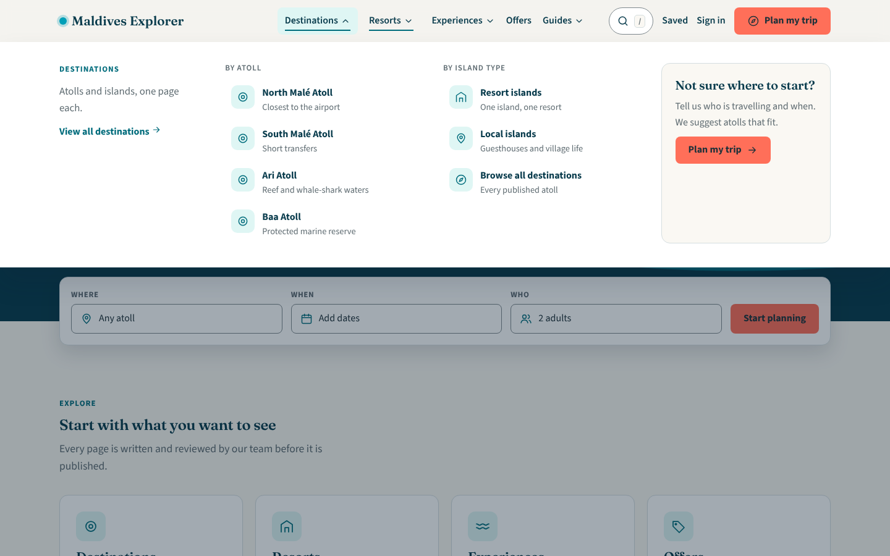](menu/mega-destinations.png) | [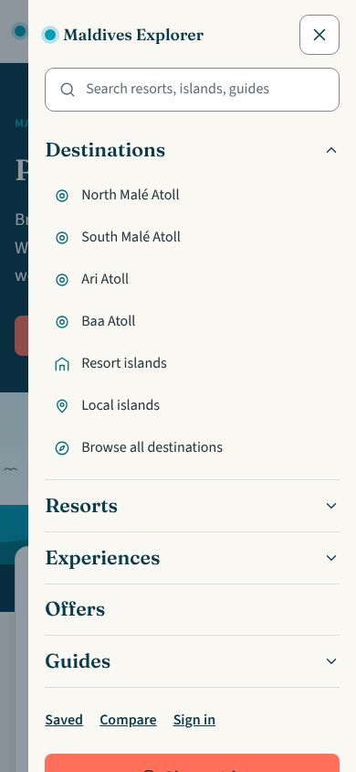](menu/mobile-drawer.png) | [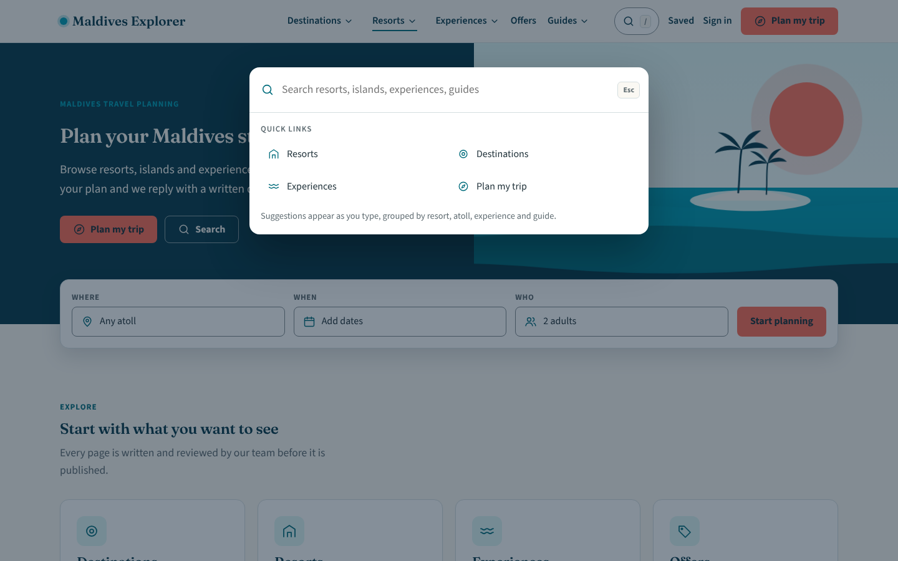](menu/search-overlay.png) |

- **Desktop:** Destinations, Resorts, Experiences and Guides open a mega menu on hover or click. Each has a short intro, two grouped link columns with icons and one-line descriptions, and a promo card. Moving between items switches panels instantly, and a scrim dims the page.
- **Keyboard:** Down arrow opens a panel and moves into it, left and right arrows move between items, Escape closes and returns focus.
- **Mobile:** hamburger opens a slide-in drawer with accordion sections, large tap targets, a search field and a Plan my trip button. Focus is trapped and the page behind does not scroll.
- **Search:** press `/` or Ctrl/Cmd+K, or click the search pill, for a command-style overlay with quick links.
- Menu entries, atoll names and the one-line descriptions are sample content for review. Final names and copy follow the approved catalogue.

## Ocean & Coral
Current brand

| Homepage | Resort page | Mobile |
| --- | --- | --- |
| [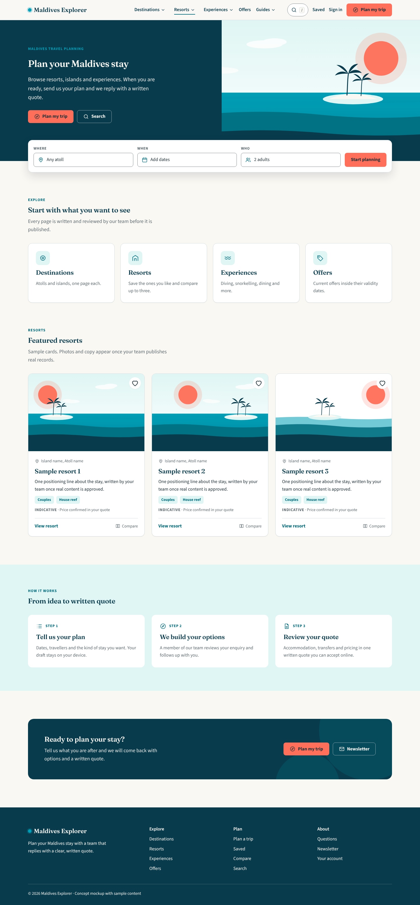](current/home-desktop.png) | [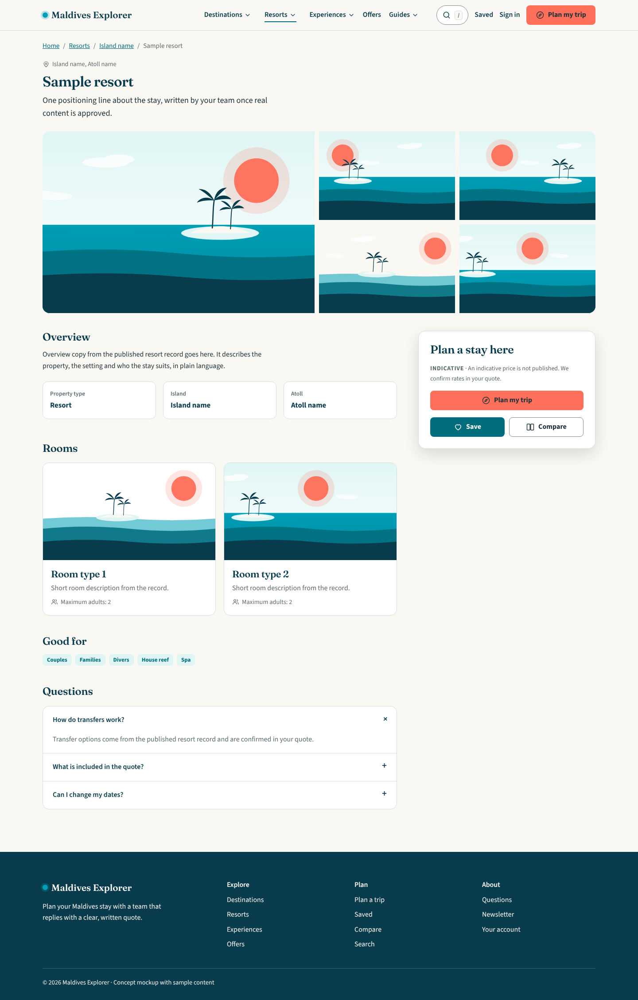](current/resort-desktop.png) | [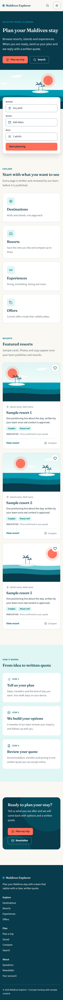](current/home-mobile.png) |

[home.html](current/home.html) · [resort.html](current/resort.html)

## Lagoon Daylight
Brighter, airier

| Homepage | Resort page | Mobile |
| --- | --- | --- |
| [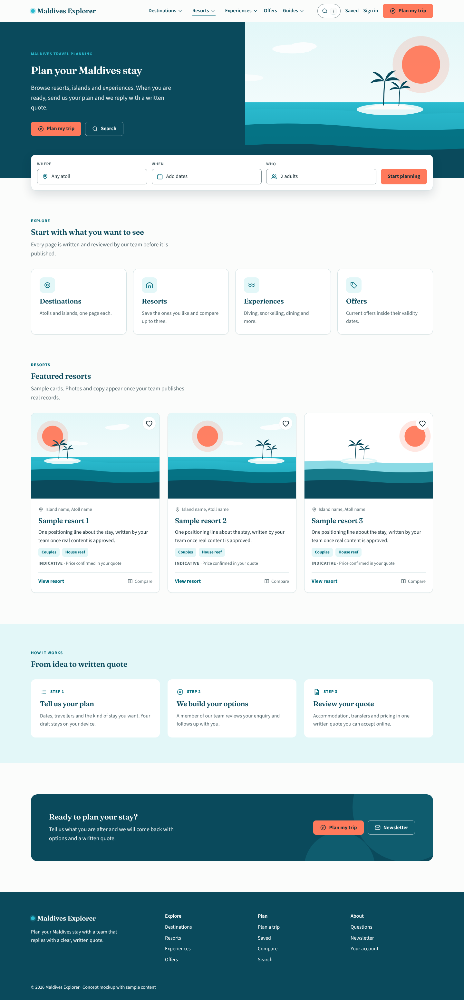](daylight/home-desktop.png) | [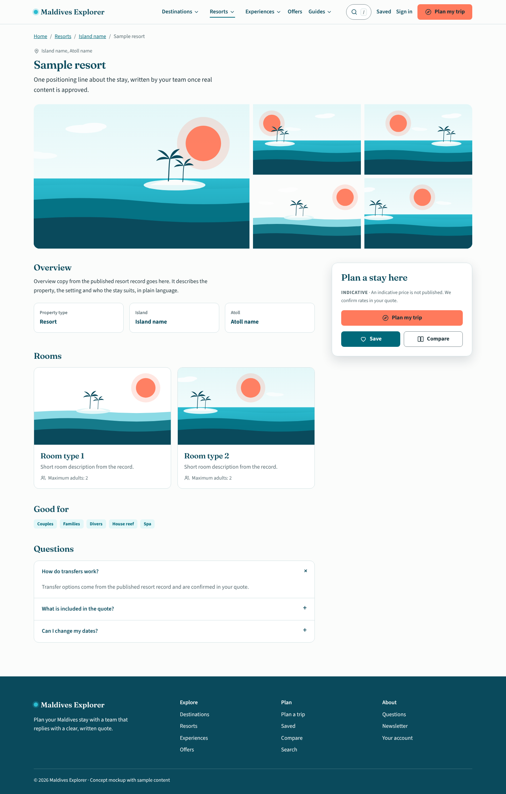](daylight/resort-desktop.png) | [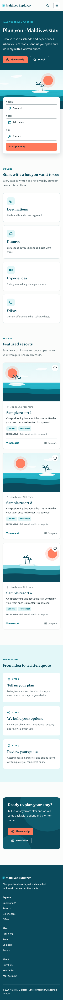](daylight/home-mobile.png) |

[home.html](daylight/home.html) · [resort.html](daylight/resort.html)

## Sunset Atoll
Warm, romantic

| Homepage | Resort page | Mobile |
| --- | --- | --- |
| [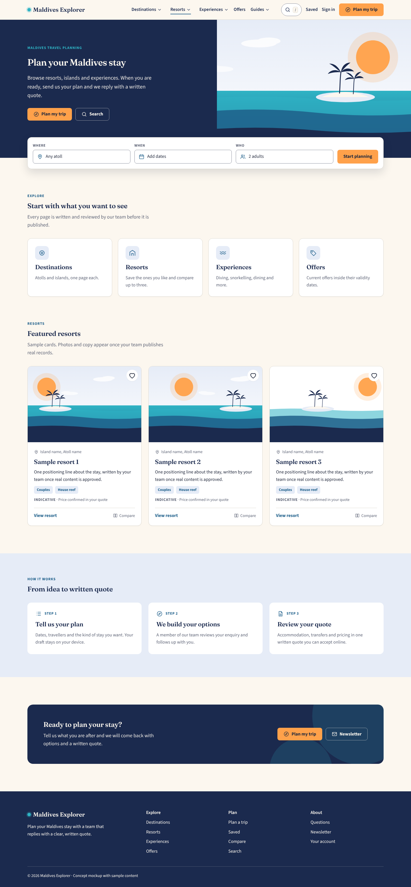](sunset/home-desktop.png) | [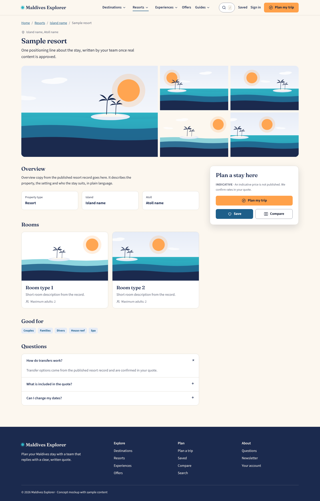](sunset/resort-desktop.png) | [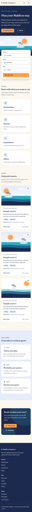](sunset/home-mobile.png) |

[home.html](sunset/home.html) · [resort.html](sunset/resort.html)

## Coral Reef
Playful, energetic

| Homepage | Resort page | Mobile |
| --- | --- | --- |
| [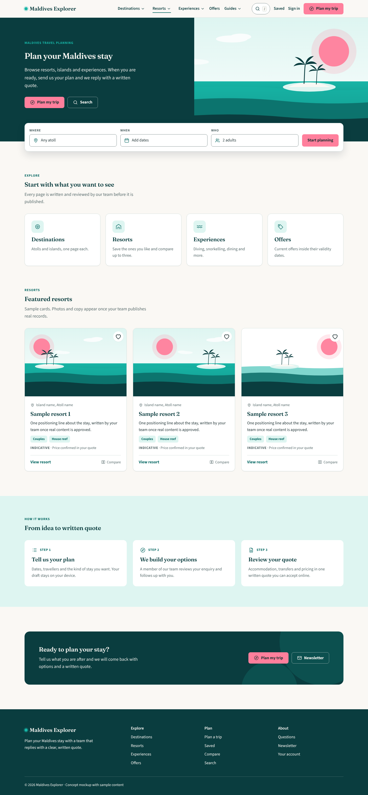](reef/home-desktop.png) |  | [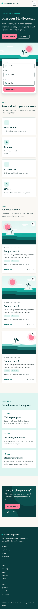](reef/home-mobile.png) |

[home.html](reef/home.html) · [resort.html](reef/resort.html)

## Midnight Resort
Premium, quiet

| Homepage | Resort page | Mobile |
| --- | --- | --- |
| [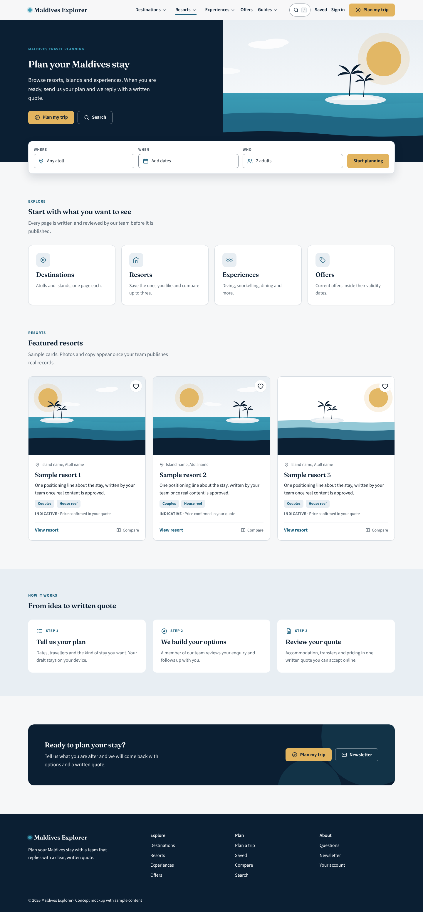](midnight/home-desktop.png) | [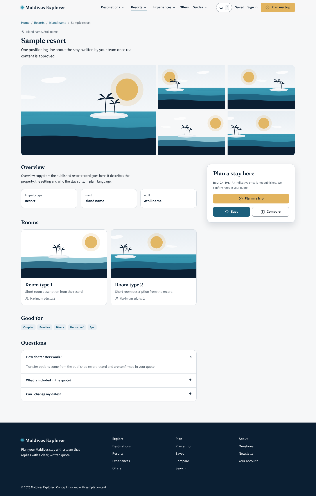](midnight/resort-desktop.png) | [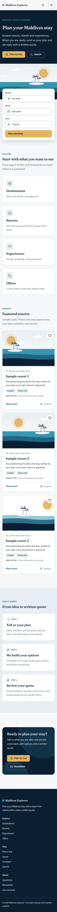](midnight/home-mobile.png) |

[home.html](midnight/home.html) · [resort.html](midnight/resort.html)

## Tropical Palm
Natural, fresh

| Homepage | Resort page | Mobile |
| --- | --- | --- |
| [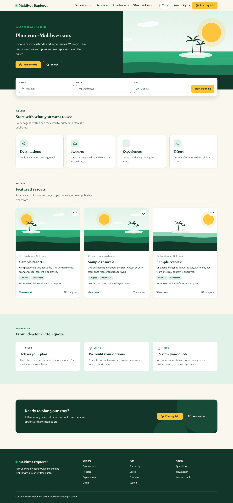](palm/home-desktop.png) | [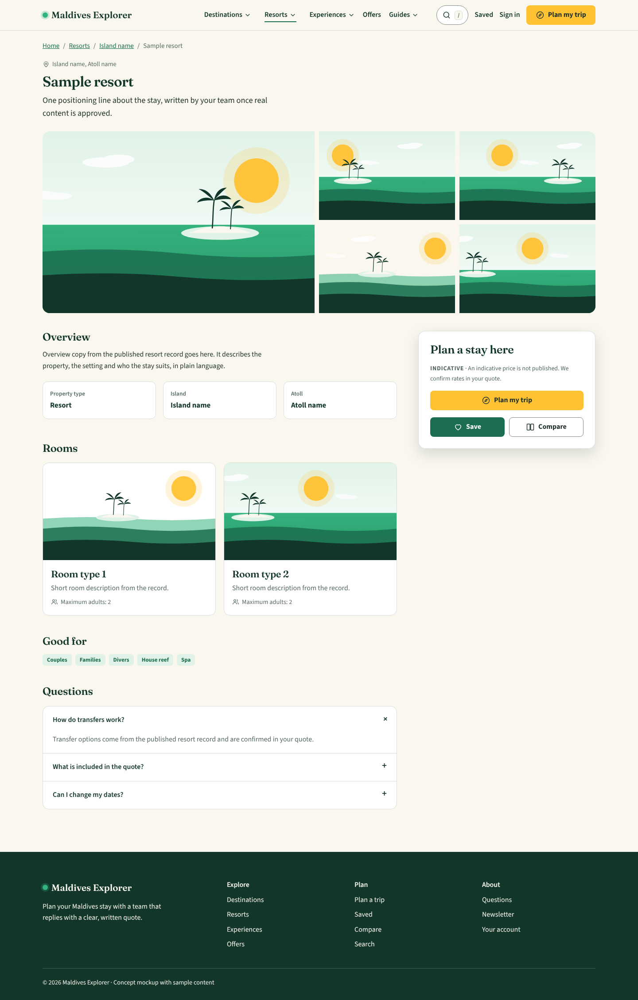](palm/resort-desktop.png) | [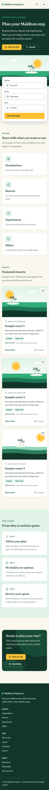](palm/home-mobile.png) |

[home.html](palm/home.html) · [resort.html](palm/resort.html)

